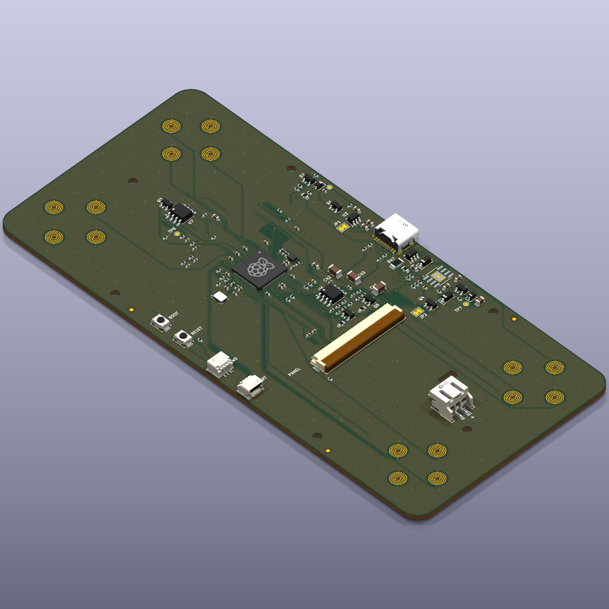

# Two-player handheld: reference design (REF-A)

A complete, orderable design for the production version of the handheld:
schematic, 2-layer board, JLCPCB fab and assembly files, a printable case, and
the documents to build, bring up and review it.

**Branch `ref-design-battery-bottom`:** main's design with the cell back under the
board (on the tub's floor) instead of on the board under the screen; the panel drops to
2.4 mm over the board. A variant to compare against main, not the reference. Its board
needs `route.py 80` (twice the default passes) to route completely.

**This is the 2-layer build**, on `main` since 2026-09-24: the first, 4-layer
design (kept on branch `ref-design-4layer`) with every cost change Alex approved
that day, on two copper layers with JLC's standard 0.3 mm holes. Built by Claude in parallel with
Alex's own hand-made board (`hardware/prod_board/`, `hardware/prod_case/`),
which this folder never touches.



## What it is

- RP2354B (2 MB flash inside), USB-C (charging + firmware + debug console)
- 3.5in 320x480 IPS panel (EastRising ER-TFT035IPS-6, ILI9488, SPI) with a published
  datasheet and 3D model, its FPC in a 50-pin ZIF connector (no soldering); a
  constant-current backlight sink per LED group
- 16 membrane contacts (bare gold combs) under DS Lite silicone: a D-pad and
  four face buttons at each end
- PWM audio through an RC filter into an FM8002A amplifier and a 15 mm speaker
- One 403450 Li-ion cell (about 700 mAh) lying on the tub's floor under the board, TP4056 charger with USB load sharing,
  ME6211 3V3 LDO, soft power on seat 1's Y button with MCU hold
- Case 75.4 x 156.2 mm, 14.6 mm at the screen and 11.1 mm at the button decks (genuine DS Lite
  caps stand 1.3 mm proud there), two printed parts held by six M2 screws, as a DS Lite

## Folder

| Path | What |
|---|---|
| `board/design.py` | **the design as data**: every part, value, LCSC number, footprint and net. Edit this. |
| `board/placement.py` | where parts go on the board (the case supplies the rest) |
| `board/battler.kicad_pro` / `.kicad_sch` / `*.kicad_sch` / `.kicad_pcb` | the KiCad 10 project (generated) |
| `board/lib/` | project footprints and 3D models |
| `board/fab/` | gerbers zip, JLC BOM and CPL, STEP, renders, schematic and assembly PDFs |
| `board/tools/` | the scripts that build and check all of it (below) |
| `board/sim/` | ngspice simulation of the backlight current sinks (loop stability, accuracy, transients); `backlight_results.txt` is the last run |
| `case/case.scad` | the case, and the source of every mechanical position |
| `case/*.stl`, `case/board.dxf`, `case/positions.json` | printable parts, board outline, positions for the board scripts |
| `case/fitkit/` | a printable fit kit: board mock, part dummies and case coupons, to test the real parts before ordering ([its README](case/fitkit/README.md)) |
| `docs/` | [BOM](docs/bom.md) (factory and self-assembled), [assembly](docs/assembly.md), [bring-up](docs/bringup.md), [pin map](docs/pinmap.md), [design review](docs/design_review.md), [Konnect notes](docs/konnect_notes.md) |
| `tools/quotes/` | JLCPCB and PCBWay instant-quote scripts for the bare board and assembly |
| `datasheets/SOURCES.md` | where each datasheet comes from |

## Rebuilding

Everything in `board/` except `design.py`, `placement.py`, `lib/` and `tools/`
is generated. After changing the design:

```sh
cd hardware/ref_design
python3 case/export.py --stl                 # case -> positions.json, DXFs, STLs
cd board
python3 tools/build_sch.py                   # design.py -> schematic (through Konnect)
python3 tools/check_netlist.py               # KiCad's netlist == design.py ?
python3 tools/check_pins.py                  # every part's pins against its datasheet review (pin_review/)
python3 sim/models.py && python3 sim/backlight.py   # backlight sink stability (ngspice, about 40 min; only when it changes)
kicad-cli sch erc battler.kicad_sch          # 0 errors expected
RP2350B_REF=.../RPI-RP2350B-MINIMAL_R4-S1.kicad_pcb python3 tools/build_pcb.py
FREEROUTING_JAR=.../freerouting-1.9.0.jar python3 tools/route.py   # about 10 min
python3 tools/route.py --finish              # only if route.py left a connection open
python3 tools/silk.py
python3 tools/check_pcb.py                   # DRC with schematic parity
python3 tools/fab.py                         # gerbers, BOM, CPL, STEP, renders
python3 ../case/check_fit.py                 # board inside the case?
python3 ../case/fitkit.py                    # the printable fit kit (about 7 min)
python3 tools/pinmap.py                      # docs/pinmap.md
python3 ../viewer/build.py                   # the exploded 3D view (GitHub Pages, /assembly/)
```

The exploded view is published at https://alex-berliner.github.io/mega_blastoise/assembly/
whenever main is pushed. Its parts are built here (GitHub's runners lack KiCad's 3D
library and OpenSCAD) and committed; `viewer/pre-push`, installed as the repo's pre-push
hook, rebuilds and commits them when main would go out with stale ones.

Needs KiCad 10 (kicad-cli and its `pcbnew` Python module), OpenSCAD, Java,
Freerouting 1.9.0, Konnect, and Raspberry Pi's RP2350B minimal KiCad design
(document RP-010329-CA) for the core layout. The project library in `lib/` is
already built; `tools/lib_from_ref.py` (the core's land patterns, from that
design) and `tools/sym_lib.py` (symbols KiCad lacks) rebuild it.

## Status

Designed and checked, not yet built. What was checked, what wasn't, and what
must be measured before ordering: [docs/design_review.md](docs/design_review.md).
