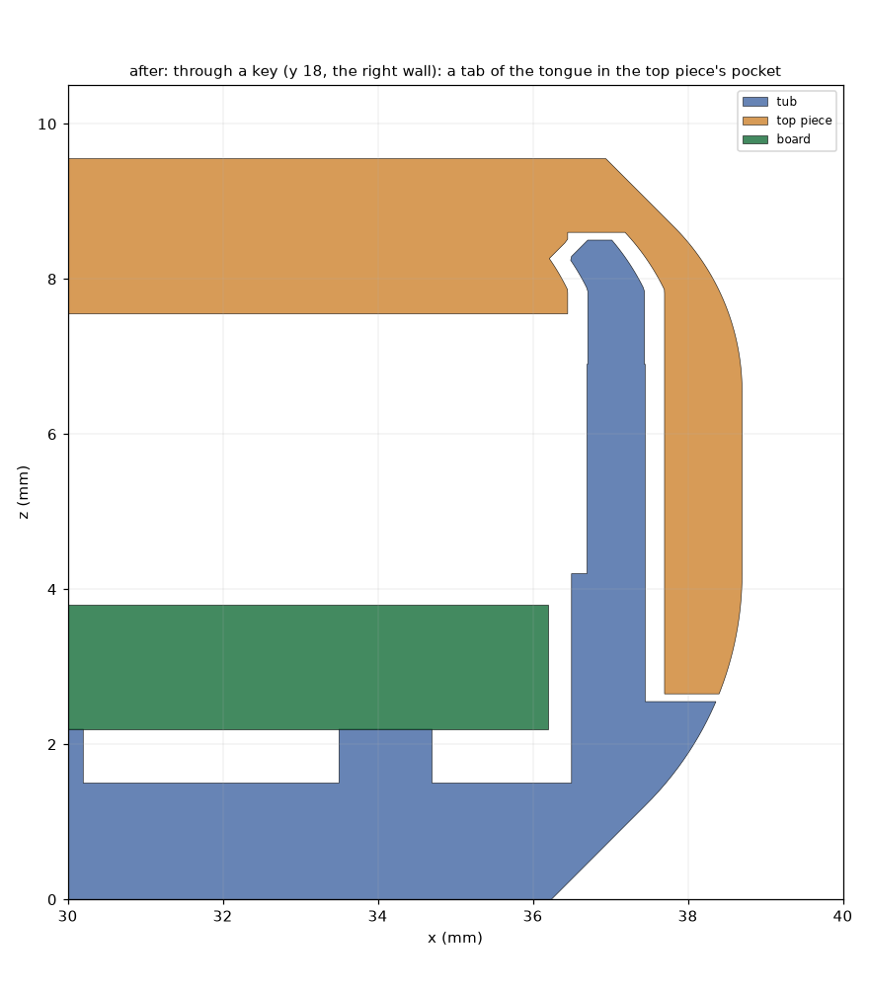
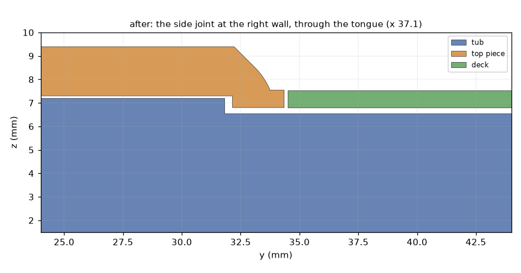
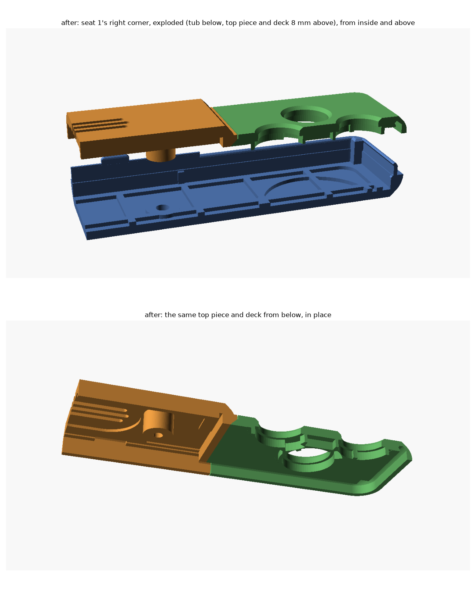

# The shell for the 2.4 in panel (2026-10-21), with the cell in the board (2026-10-22), joints that hold it together, and the seam on the round (2026-10-22)

The case's redesign after Alex's notes on his last print (items 10, 13, 14 and 15) and the change
to the EastRising ER-TFT024IPS-3, then reworked for the board with the cell in a hole in it and the
speaker on its top (row 19, `CELLCUT_FOR_CASE.md`, which supersedes `BOARD_OUTLINE.md` where they
differ). Everything here is in `case.scad`; this file says why.

## In one paragraph

Four printed parts: a **top piece** (the screen face, the curved steps down to the decks, a spine
at each end, and the sides), two **decks** (one part,
printed twice: the button faces at each end), and the **tub** (the back, with a pocket for the
cell). The top piece and the decks all curve over the sides and meet the tub flush at one seam,
2.55 mm up the walls, low on the back's round: their skirts follow the round down to it and slide
4.55 mm (4.05 at the decks) down over the tub's **tongue**, which keys them: tabs into pockets in the top piece, a post in each
corner that pushes a deck home, and grip ribs, so the four parts hold together before the screws
go in (see "The joints"). Each deck seats into the top piece **from behind**
on a 45 degree wedge, reaches out to the case's outline and curves over the end and the sides
itself, and has its own screw. The board, with the cell in a hole in it, lies inside the tub's
walls. Everything is built **upside down**: the speaker into its pocket, caps and silicone into the
decks, the decks into the face-down top piece, the panel into its pocket, the board face down (the
speaker's plug into J4 first), the tub (the cell stuck in its pocket) over it, six screws from the
back. The speaker stays in the top piece, so J4 is unplugged before the board and the top piece come
apart. Every part prints without
supports in its own pose: the tub back down, the top piece and the decks face down.

| | cb51826 | 2026-10-21 | Now (2026-10-22) |
|---|---|---|---|
| Outside | 75.4 x 156.2 mm | 75.4 x 132.7 mm | **77.4 x 132.7 mm** (a DS Lite is 73.9 x 133.0) |
| Thickness | 13.4 at the screen, 11.5 at the decks | 13.35, 11.5 | **9.55 at the screen, 7.7 at the decks** |
| Board | 70.4 x 151.24 | 70.4 x 127.7 | 72.4 x 127.7 (r 5.5), a 54 x 37 hole for the cell |
| Cell | under the board | under the board | in the board's hole, its bottom in a 0.6 pocket in the tub's floor |
| Speaker | floor grille | floor chamber, side outlet | on the board's top in the right bezel, a grille in the face |
| Parts | tub, lid, two deck inserts | tub, top piece, two decks | the same |
| Held by | six screws, four snap hooks | six M2 x 8: four into the top piece, one into each deck | six M2 x 6, the same way (the side ones into the top piece beside the glass, since the side screws came back inward); before the screws, the tongue's keys and grip ribs |
| Crush ribs | on the lid | on the top piece's and the decks' walls | on the tub's walls (the board is inside them) |

(The images are rendered from the parts of this commit; see "Images" at the end.)

The side view has no board in it, so the USB-C opening shows the far wall's inside and reads as
a recess; it is a through-opening (checked 2026-10-22): J1's mouth (8.94 x 3.20, its face 0.19 under
the surface) sits centred in it, 0.25 clear in y and 0.29 / 0.25 in z, and a mated plug's overmold
(the shortest the USB-IF allows) stands 0.16 off the wall. case.scad asserts the opening against
the port and the plug, and check_fit.py checks it against J1's 3D model.

## The board with the cell in it (2026-10-22)

`CELLCUT_FOR_CASE.md` (final) has the board's side. What the case does with it:

- **2 mm wider.** The board is 72.4 (x +-36.2), so `case_w` is 77.4, 1 mm more on each side. The
  clusters, Start/Select and the debug pinholes stay where they were (`edge_margin_x` 5 is the
  case's side to a silicone piece, `edge_margin` 4 still its end), so `positions.json`'s buttons
  don't move. The USB-C opening, the receptacle's face (x 38.55) and the board's tab and its slot
  go 1 mm out with the right wall, with the stepped tab seams and the `usb_gap` opening as before.
- **The stack.** The worst-case cell (4.5) stands at most `cell_top` 1.6 over the board, so its
  bottom is 2.9 under the top copper, 1.3 under the board's back. The tub's floor is pocketed
  `cell_pocket` 0.6 under it (0.9 of floor left there), so the board rests on 0.7 ribs
  (`board_lift`): floor 1.5 + 0.7 + board 1.6 + 5.75 = **9.55 at the screen**, 7.7 at the decks
  (the notes' figure for the pocketed floor; 10.15 with a flat one).
- **The cell's pocket** is the hole's outline 0.25 inside (r 0.75 corners). The cell lies against
  its right wall (x 25.05), so TH1, at the hole's right edge, reads it across about 1 mm.
- **Floor ribs under the strips.** The ring of ribs under the board's edge and the 12 mm grid stay,
  clear of the hole by 0.5; new ribs run along each strip (the left one at x -31.2 under SW18, SW19
  and J5/J6, the right one at x 29.6 under the power latch) and across the right one at y 14 (by
  TH1). They keep off the four Start/Select domes' vents, J1's legs and the test pads on the back
  (`rib_free`, which check_fit reads).
- **The board is inside the tub's walls.** Its top (3.8) was under the seam (4.2), so the top pieces'
  skirts no longer reached it (since the seam came down to 2.55 they run down beside its edge, outside
  the tongue: "The seam on the round"): the **crush ribs moved to the tub's walls** (sides at y +-28, ends at
  x +-22), their lead-in at the top, where the board meets them as the tub goes on. The tub's
  cavity follows the back's round only 0.2 in (`tub_round_in`), so the board's edge keeps 0.3 to
  it. The skirts' cut over the tongue is only the wall's inner half (and, where the tongue leans
  in under the decks, a groove in the plates): a cut across the whole inside took 0.1 off the decks'
  plates and left the pads' walls hanging.
- **The side screws** are the board's, inside the top piece (Alex, 2026-10-22: no shoulders): H1
  and H2 at (+-32.5, 29), at the seat-2 ends of the strips beside the cell's hole; H3 at (25.9,
  -21.95) in the right bezel, between the speaker and J4's plug; H4 at (-33.0, -15.2) in the left
  bezel, between J2 and the LDO. The top piece's 5.0 bosses run from the board to the ceiling (the
  pilot stops 0.8 under the screen face). Each keeps 0.3 or more from the panel's frame (H3: 0.54),
  1.2 from the side wall's inside, 0.72 from the step's top edge and 0.3 from the joint's band where
  the decks' wedges start (H1, H2: y 31.5 against 31.8), and H3 0.52 from the speaker's pocket, 0.36
  from J4 and 0.30 from its mated plug (asserts). The **tub's bosses** under the board are only
  `board_lift` (0.7) tall; 6.0 wide at H1, H3 and the ends, **5.0 at H2 and H4** (`tub_boss_d`): a
  6.0 boss would come within 0.8 of the cell's hole at H2 and 0.2 of the board's edge at H4. The 5.0
  ones leave 1.3 to the hole at H2 and 0.7 inside the board's edge at H4, and 1.3 of plastic round
  the screw's 2.4 clearance hole (the head's 4.4 counterbore is in the floor under them, 1.0 from the
  tub's bottom chamfer at H4). The shoulders, the decks' notches and their checks went.
- **Shorter screws:** M2 x 6. An 8 would run 0.9 past the decks' pilots now; a 6's tip stops 0.1
  short of the decks' (which end 0.6 under the face) and 1.75 short of the top piece's.
- **The speaker** lies on the board's top in the right bezel (centre 28.7, -11.4 since the side
  screws came back inward, its seat-2 end 0.1 short of the cell's hole; 10 x 15 x 3.5, 3.8 worst
  case). The top piece's underside has a 0.5 pocket over it, its outline plus 0.5 (the
  board's keep-out), so 0.45 over a worst-case speaker; the face over it is 1.5. The **grille** is
  three 1.0 slots along the racetrack, 1.8 apart, inside the outline less 1.5 (over the cone):
  12, 10.8 and 10.8 long, about 33 mm2 open. The rim round them is solid, for the front foam ring
  to seal on. Face down they are plain holes in the plate on the bed: nothing to bridge
  (`overhangs.py`: no supports). The bezel next to the screen bay keeps its full 2.0 from the panel
  frame (x 22.86) to the pocket (x 23.2), 1.5 from there to the grille (x 26.4); the grille's slots run
  y -5.4 to -17.4. A 0.3 pocket over J4 (31.9, -27.0) and its mated plug, each grown 0.25, gives
  the plug room; it goes round H3's boss and stops at the joint's band. The floor chamber, the
  side outlet and the pad went.
- **The speaker's leads** (35 mm, to a 1.25 mm plug) run on the board from the speaker to the back
  of J4's mated plug (x 24.75, its mouth faces the glass), round H3's boss, which stands between
  them. With the leads leaving the speaker's seat-1 end (turn it so they do), the shortest path that
  keeps a 0.8 lead off the boss, the speaker and J4 is 14.0 mm (1.5 straight out of the plug, then
  up the 0.65 gap between H3's boss and U7's end, partly over U7's end under the panel frame, 1.0 of
  room there, and over the boss's top, 1.4 below the speaker). If they can't ride over U7, round U7
  under the panel it is 27.4. Plugging in takes about 10 more (the plug's 4.0 travel out of the
  mouth, and a few mm to hold it): 24 or 37 mm against 35. Leads leaving a long side need 17.1
  (left) to 25.0 (right), the far end 28.1, each over U7's end. So J4 is plugged with the board just
  off its place: with the leads in, J4 can be at most about 20 mm from where it lands.
- **J2** (the cell's plug, 3.4) at the hole's seat-1 corner and its mated plug (3.2, over the left
  strip) sit under the left bezel's 3.75; **J5/J6** (2.9) face the left edge. Their plugs go in
  with the tub off; no slot in the wall (debug is case-open, and a slot weakens the wall and lets
  light in).
- **Start/Select (row 4)** close on 4.0 mm metal snap domes (0.31 high at worst with the Kapton
  dot): `ss_metal_dome`, `ss_plunger_gap` and two asserts: the dome fits the pad's well (4.6 >=
  4.3), and the pad's plunger rests 0.05 over the dome's apex. The plunger's rest height in a real
  strip is unmeasured; 0.36 (the least that clears) is assumed, so `ss_lift` stays 0.35. If a strip
  measures g < 0.36, raise `ss_lift` by 0.36 - g: at most 0.15 with today's lip, up to 0.45 with a
  0.3 Start/Select chamfer. The model's pads now show each metal dome and the plunger over it.
- **The spines** keep their length; seat 1's covers U6 (1.75, over the decks' 1.6) and seat 2's only
  U9 (1.2), so they could be shorter (not done: the decks and positions.json stay as they are).

## The joints (2026-10-22, after Alex printed the shell)

Alex, on the print of 110d46b: "the top pieces need to flow better and interlock. Right now it
feels like the pieces are designed to fit on the tub but not mesh with each other. Also it would
be good if the pieces went farther over the side. Like the tub has a tall inner wall that the top
piece slides farther down for some more stability. Maybe add some tabs on the tub wall to fit into
the top pieces?" And: "The last version was pretty sturdy and only needed the screws to lock
together, this version needs the screws to fit together at all which is bad". So the test is: with
no screws, the four parts go together and hold as one, nothing rocking or falling apart when
handled gently; the screws only lock it.

**What got looser.** The kit Alex printed before was 4df3f96's (f3763df, which raised `slide_fit`
from 0.15 to 0.25, went in the same minute, so any kit of that shell had 0.25). Between it and
110d46b:

| | 4df3f96 (held) | 110d46b (needed the screws) |
|---|---|---|
| `slide_fit` (`deck_gap`, `seam_fit`) | 0.25 | 0.25 |
| the decks' wedges under the top piece | 0.95 | 0.95 |
| the tongue | 1.5 tall, 0.75 thick | the same |
| `seam_gap` | 0.1 | 0.1 |
| the board | z 6.0 to 7.6, inside the skirts, over the tongue | z 2.2 to 3.8, inside the tub's walls, under the seam (4.2) |
| crush ribs (0.05 short of the board) | on the top piece's sides (y +-28) and each deck's end (x +-22), z 5.8 to 8.6 | on the tub's walls |
| the skirts' height | top piece 9.05, decks 7.2 | 5.25 and 3.4 |
| shoulders, the decks' notches | none (99e3f04 added them, c955631 took them out) | none |

Only the board and its crush ribs changed. In 4df3f96 the board, laid face down, pressed into ribs
on the top piece's sides and on both decks' ends: it tied the three top parts into one, and each
deck's end hugged the board's end inside its 7.2 mm skirt. The tub sat on loosely in both (a 1.5
tongue at 0.25 a side, nothing gripping). With the cell in the board, the board went under the
seam and its ribs onto the tub, and nothing tied a deck to the top piece or either to the tub. The
fits and the wedges were never what held it, so they aren't what's restored: the tongue now does
the board's old job (below).

**What made the parts read as separate (110d46b, rendered and cut):**
1. Butt joints with a slot: at each side wall the deck's skirt ended 0.25 from the top piece's, a
   straight slot through the skirt from the seam over the round to the face, and the same 0.25 slot
   ran along the step's crease. By design nothing touched.
2. Nothing held a deck along the case. The 45 degree wedges at the step and round the spine's end
   both face the same way: they stop a deck coming out of the face, and push it back along the case
   when it's pushed towards the face. Face down, a deck settled back down its wedges; face up,
   screws out, it floated 0.25 each way and 0.35 up and down, so the surfaces stepped and the gaps
   ran 0 to 0.5 at the joints.
3. The skirts sat on the tub, not over it: 1.4 of overlap on a 1.5 tongue, 0.25 a side, so the top
   piece could tilt on it, and nothing gripped, so it lifted straight off.
4. A straight path past the joints: through the side slot into the groove's clearance, and over
   the tongue's top (0.1 under the decks' plates) into the case.
5. Not a problem: the rounds and skirt heights match across the joints (both skirts end at 4.3;
   at the side joints both round over from the decks' 7.7 face through `face_r`). The top piece's
   side follows the step down over the last 2.1 before the joint, which reads as a soft crease
   beside the seam; it is continuous, and stays.

**What changed, for each:**
- **The tongue is 3.0 tall** along the top piece's sides (`tongue_h`, its top 7.2, 0.35 under the
  top piece's underside): the top piece's skirt runs 2.9 down over it (was 1.4). Under the decks and
  across the step's band (|y| over 31.8, where the band starts) it is **2.5** (`deck_tongue_h`, top
  6.7): the decks' skirts run 2.4 down over it. It runs on unbroken under the side joints, so one
  wall locates both neighbours (the step from 3.0 to 2.5 is under the top piece's band, 2.6 from the
  joint, and the grooves overlap it 0.35 each way). What limits it under the decks is their face's
  round: 0.9 under the 7.7 face (the groove's top) it has come 0.86 in, so the groove leans in after it
  (the skirt never under `skirt_t` 0.7) and the tongue leans in with it, to 2.25 from the outline:
  0.25 outside the board's edge, which it passes as the tub goes on (its tip is chamfered from the
  wall's inside, so it leads the board in), and the deck's plate keeps 0.9 over the groove. A 3.0
  tongue there would leave 0.4 of plate and come within 0.05 of the board's edge. **The seam stayed at 4.2** in this pass (it came down
  the same day: "The seam on the round"),
  where the back's round ends: a lower seam would put the skirts' edges on the round (a feather edge
  in the face-down print, a seam on a curve), and it's the tongue's top, not the seam, that limits
  the overlap. The skirts still stop `seam_gap` 0.1 over the tub and the grooves 0.1 over the
  tongue's top, so the screws clamp the board, not the seam; a deck's plate bears on nothing.
- **Tabs into the top piece** (`keys`): four, at y 18 and -16 on the right wall and 22 and -24 on
  the left (two a side; clear of the USB-C notch, the side screws' bosses, the speaker's and J4's
  pockets and the pinholes, asserted). Each carries the tongue 1.3 higher (to 8.5), 5.0 along the
  wall, its tip leaning in under the face's round and chamfered (0.33 at the very top), its corners
  0.5 x 45 degrees as lead-ins. They sit in pockets in the top piece's sides, `seam_fit` 0.25 along
  the wall, with 0.95 of face over each. They locate the top piece along the case and stop it
  twisting; the two tongues locate it across.
- **The USB-C notch keys too:** over the tub's tab the top piece's skirt keeps its inner half from
  the opening's centre up (18.0 wide), and the tongue stops `usb_fit` 0.2 short of it on each side,
  so the opening's upper half is still all in the top piece.
- **A post in each corner for the decks:** the board's corners (r 5.5) leave 2 mm inside the tub's
  corners (r 2.3 inside), the only place on the tongue with room inwards. Each post stands from the
  floor to the tongue's top, its inner corner at (+-34.80, +-62.45), 0.3 outside the board's corner,
  about 2.6 x 2.6, its inner faces chamfered 0.4 at the top. It sits in a notch in the deck's plate:
  across the case with `seam_fit`, along it with none, so as the tub goes on it pushes the deck
  towards the screen onto its wedges and holds it there. One part still fits both ends.
- **The decks sit on their wedges:** no clearance on the wedges along the step and round the
  spine's end (the posts hold the deck on them, at its place over the board's buttons), `deck_gap`
  0.15 on the straight faces (the land, the skirts' ends at the side walls, the spine's sides; was
  0.25). The seams across the face and down the sides are an even 0.15. (Pushing the deck past its
  place to close them moved the openings 0.15 off the buttons: "Alternatives considered".)
- **Grip ribs** on the tongue's outside (`grips`): 1.0 wide, standing 0.2 off it, 0.05 short of
  the skirt, as the board's crush ribs are of the board (a skirt's inside prints small, so it grips
  them), from the seam to 0.1 short of where the tongue's outside starts to lean or chamfer (6.8
  along the top piece, 5.9 at the decks), each with a 45 degree lead-in. Two a side for the top piece (y +-25), one a side for each
  deck (y +-52), and one 2.0 wide across each side joint (y +-34.35): it presses both skirts' ends
  out to the same line, so the two lie flush. They hold the tub on and centre each part across it.

**How each joint holds, no screws:** the top piece is on the tub by its skirts over 2.9 of tongue
(across), four tabs and the USB-C notch (along, and against twisting) and four grip ribs (on). Each
deck is on the tub by its skirts over 2.4 of tongue and two grip ribs (across, on) and two corner
posts (across with 0.25, along by pushing it onto the top piece). Each deck is on the top piece by
its wedges (held there by the posts: it can't move along the case, towards the face or across) and
by the rib across each side joint (the skirts flush). The board is centred by the tub's crush ribs
and sits between the tub's ribs and bosses and the top pieces' bosses.

All of it prints without supports: the tub back down (the tabs, posts and ribs stand up; every lean
and chamfer 45 degrees or steeper), the top piece and the decks face down (the grooves, pockets and
notches open upwards). `overhangs.py`: none needed. No new test plate: `slide_fit` (on `6_tests`)
covers the tongue and the keys, and the seam coupons in `4_fit_coupons` now carry a tab (y 22) and
a grip rib (y 25).

## The seam on the round (2026-10-22)

Alex, after the joints: the top pieces' outer walls should come farther down the side, over most of
the back's round, to a much lower ledge on the tub, the tub keeping its tongue that the top pieces
slide over. Agreed: the seam from the round's end (4.2) down to about 2.5.

- **The height: `z_seam` 2.55**, one height all round. The skirts' outsides follow the back's round
  down to their tips at 2.65 (`seam_gap` 0.1 over the tub); their insides stay straight down the
  tongue (the groove where it was, `wall`/2 in), so they still slide straight on. What sets it is
  the skirts' tips: the round has come 0.30 in at 2.65, which leaves a tip 0.70 thick
  (`skirt_t`); at a 2.5 seam it would be 0.32 and the tips 0.68. Going lower means moving the
  tongue and its groove inwards (and the keys, the posts, the grip ribs and the decks' leaning groove
  with them) into the board's margin; 2.55 is within 0.05 of what was agreed, with nothing else
  moved. Asserted: the tips at the top piece and the decks, and the room beside the board's edge.
- **The margins, all round** (horizontal sections of the parts at 2.67 to 4.13, the side walls, the
  end walls, the corners, past the side screws' bosses, the crush ribs and the USB-C tab): at the
  skirts' tips the outside is 2.20 from the board's edge (38.40 against 36.2 at 2.65), of which the
  skirt takes 0.70, `seam_fit` 0.25 and the tongue 0.75, leaving 0.50; under the round's end the
  tongue reaches in to the tub's cavity wall below it (`tub_round_in`), so it is 0.95 thick there
  and 0.30 from the board, as the tub's wall was. The tightest places are the skirts' tips (0.70,
  everywhere round the case, the same at the ends and the corners since the plan's offsets keep their
  distance round a corner), the tongue to the board (0.30) and the grip ribs (0.05 to the skirts, by
  design). The board's corners (r 5.5) are farther from the case's (r 4.3) than its edges are.
- **The overlap:** the tongue keeps its tops (7.2 along the top piece's sides, 6.7 under the decks)
  and rises from the new seam: `tongue_h` 4.65, `deck_tongue_h` 4.15. The top piece's skirt runs
  **4.55** down over it (was 2.9), the decks' **4.05** (was 2.4).
- **The ledge** on the tub at the seam is a flat step 0.9 wide, from the outside (38.36) to the
  tongue's outer face (37.45), all round.
- **Keys, posts and grip ribs** stay where they were: the tabs into the top piece still reach 8.5
  and now rise from the lower seam with the tongue; the corner posts stand from the floor to 6.7 as
  before; the grip ribs now run from the seam (2.55) to the same tops (6.8 along the top piece, 5.9 at
  the decks), 4.25 long instead of 2.6, so they grip over more of the skirt (`grip_reach` is still
  a guess: see "Best guesses").
- **USB-C:** the brief for this pass expected the opening to sit wholly in the top piece's wall
  with the tub's tab gone. It can't: the receptacle's face is 0.15 under the surface, so its front
  stands 0.85 into the skirt, and the board goes onto the face-down top piece straight down. Any skirt
  under the receptacle's mouth would be in its way, unless the board went in 0.9 off to the left and
  slid across under the bosses, the speaker and the panel's frame. So the opening is split as before:
  its upper half in the top piece, its lower half in the tub's tab, which now rises from the new seam
  (2.55) to the port's centre (5.43; its outer half to 4.33), 18 wide, in a notch in the skirt, with
  the stepped seams that keep light out. Under the opening the tab is 1.0 tall. The band (the tongue)
  is cut behind it, as before, for the board's tab to pass as the tub goes on. The USB-C asserts are
  tied to the tab (it rises from the seam, at least 0.8 under the opening; and an assert that fails
  if the notch ever stops being needed). check_fit: J1's mouth 0.25 / 0.25 clear in y, 0.29 / 0.25 in
  z, a mated plug's overmold 0.16 off the wall, as before.
- **Printing:** the top piece and the decks print face down, so the skirts' inward-curving edge is
  at the top of the print and slopes inwards going up: an upward face, no supports (`overhangs.py`,
  and the P1S slices: supports only under the board mock, as before). The tub prints back down as
  before; the ledge is an upward face. The top piece is 6.9 tall now (was 5.75), each deck 5.05
  (was 3.9); both still fit their plates.

## The smooth rounds (2026-10-22)

The top piece's and the decks' rounds and the step were stacks of flat 0.1 mm slabs, as the tub's
was until 4df3f96. They are now solids lofted through the profile every 0.05: the decks' outline as
the tub's; the top piece as boxes lofted up the step (the screen block, the spines) and the side
walls swept along y under the step's height, so the side round still follows the step down to the
deck. The chamfers are exactly `overhang`: every downward face is
45.0000 degrees from vertical or steeper (166 mm2 of the top piece's and 73 mm2 of a deck's at
45). Sliced on the P1S (0.2 mm, Bambu Studio's command line), the outer wall now lies on the true
surface at every layer (0.000 mm off) and steps out 0.2, 0.2, 0.199, 0.18, 0.15, 0.126 ... up each
round; the slabs had sat up to 0.05 off it on the decks' round and 0.025 on the step. (Here the
slabs' faces happened to fall 0.01 off the P1S's planes, so they printed without the tub's 0.4
risers; the lofts no longer depend on that.) The loft also runs its sides' edges the other way
round from its caps': 4df3f96's ran them the same way, which OpenSCAD's Manifold backend rejected
("PolySet -> Manifold conversion failed") and quietly repaired.

## The length and the width

The end bands are as they were (the clusters, Start/Select and the end screw sit where they sat
relative to the case's end): `band` = `edge_margin` 4 + `piece_d` 26 + `piece_to_glass` 5 = 35 mm a
side, so `case_l` is 132.7. The width is the board's 72.4 plus the walls and their clearance, 77.4,
2 mm more than the clusters set (`edge_margin_x` 5 at the sides); `glass_side` follows, 16.6 mm
from the bay to each long edge: room for USB-C and the speaker on the right, the core and the debug
parts on the left.

## Item 10: the top pieces curve over the sides and meet the tub flush

- **The seam** (`z_seam` 2.55 since 2026-10-22; 4.2, `back_r`, until then) is low on the tub's back
  round. Below it is the tub: the floor, the round's lower part (ending in a 45 degree chamfer at the
  bed) and nothing else. Above it the top piece's and the decks' skirts carry on round it, up into the
  walls, and the top piece (in the middle) and the decks (at the ends) form all
  of the walls and roll into their faces through `face_r` = 3.0: an arc out of the wall that turns
  into a chamfer at `overhang` where the arc would go flatter in the print pose (the same profile
  as the back's round, `edge_in()`).
- **The joint at the seam:** the tub's wall carries a **tongue**, its inner half up past the
  seam to 7.2 (4.65 over it, `tongue_h`; to 6.7 at the decks, `deck_tongue_h` 4.15; 1.5 tall until "The
  joints", 3.0 and 2.5 until "The seam on the round"); the top pieces'
  skirts come down outside it, their outer half to the seam. The
  outsides are flush; a skirt can't move inwards; there is no straight path through the seam for
  light or dust; and it is the top pieces that wrap over the tub ("or go over it"), not the tub that
  forms a lip. The skirts stop `seam_gap` 0.1 short of the tub so the screws clamp the board, not
  the seam.
- **Width:** 77.4 since 2026-10-22 (the board's 72.4); the walls stay 2.0.
- **USB-C:** with the seam below the port, the opening's lower half is now a **tab of the tub** that
  rises from the seam (2.55 since "The seam on the round") into a notch in the top piece's skirt (the old lid tongue, upside down), with
  the stepped seams that stopped light showing through. The board's tab sits in a slot in that tab.
- **Snap hooks: dropped.** They held the lid on the tub while the case was turned over for the
  screws. Built upside down, nothing has to hold anything while the screws go in (gravity does), and
  the PLA hooks snapped on the first print. The six screws hold the case closed, as before.

## Item 13: the step down to the decks is a curve

The step is 1.85 mm tall (the screen face 5.75 over the board, the decks 3.90). It belongs to the
top piece, which prints face down, so every point of it faces down in the print pose, and nowhere
may it slope flatter than `overhang` (45 degrees, a guess until the `6_tests` ladder). Under that rule a
straight 45 degree slope is already the gentlest possible line; a curve can only be steeper
somewhere. So the step is the same round as every other outside edge, which reads as one shape
(the screen block's edges all roll over alike): `step_r` = 3.0, an arc that reaches the deck steep
(22 degrees off vertical) and turns, near the screen face, into a 45 degree chamfer where it would
otherwise go flatter. Its run is 1.53 mm plus a 0.6 mm flat at the deck's level (`joint_land`, so the
top piece's edge at the joint is square, not a knife edge). The seam with the deck lies in the
crease at its foot.

When Alex's ladder says a printer can do, say, 60 degrees, `overhang = 60` lets the arc run much
further up before the chamfer starts (and makes every other round rounder too); nothing else
changes. A concave cove at the deck's edge, the softest shape for a thumb, is impossible in any
face-down print: it would be a downward face at the deck's height with nothing under it.

## Item 14: no more cards slotted in from the front

The inserts dropped in from the front between the tub's walls and tucked under a lip on the tub's
end wall; they wobbled at the sides and the lip felt fragile. Now each deck:

- **reaches the case's outline** and curves over the end and the sides itself, down to the seam,
  where its skirt sits on the tub's tongue like the top piece's: supported all round its outer edge
  by the tub, no lip;
- **seats into the top piece from behind:** along the step and round the spine its edge goes 0.8
  straight down from the face (`deck_land`) and then out 1.2 at 45 degrees under a matching undercut
  in the top piece (`wedge_w`; `deck_gap` 0.15 on the straight faces and the spine's sides, none on
  the wedges along the step and round the spine's end, where the tub's corner posts hold it: "The
  joints"). It drops in from behind, centres itself, and can't
  come out of the front. The wedges on the spine's two sides oppose each other, so it can't move
  across the case; along it, the wedges at the step and round the spine's end both face the same
  way, so they don't hold it: the tub's corner posts push it onto them (2026-10-22; until then
  nothing did, and a deck slid back down its wedges);
- **has its own screw:** the end screw now goes through the board into a boss on the deck (the end
  bosses moved off the spine into the deck, just past the spine's end), pulling it down onto the
  board. No anchor ring round a column any more, so the
  0.15 ring that was too tight is gone with it.

One part fits both ends (the end bosses are each other turned round, as before).

## Item 15: built upside down

1. **Top piece face down** on a clean cloth. **Speaker** face down into its pocket over the grille,
   its front foam ring stuck to the pocket's ceiling (the pocket centres it; standing on the board,
   0.45 to 0.75 under the ceiling, its front would be open to its back).
2. **Decks:** each face down into its end of the top piece from behind; it drops onto its wedges
   and sits flat (it may settle 0.15 back down them, onto the spine's sides: the tub's posts push it
   home in step 8).
3. **Caps** into the decks from behind (A/B/X/Y tab into its slot, notches onto their ribs; the
   D-pad; Start/Select), then the **silicone** on them: the walls on the deck's back locate each pad.
   The Start/Select metal domes and their Kapton dots are on the board already.
4. **Panel** glass down into the top piece's pocket on its tape; the frame centres it.
5. **The cell** into the tub's floor pocket on a strip of double-sided tape, against the pocket's
   right wall (towards TH1).
6. **Board on edge** at seat 1's end, face towards the panel: the FPC into J3 and its latch, the
   cell's plug into J2 (the tub held beside it).
7. **Board** face down towards the bosses (four in the top piece, one on each deck), the FPC
   folding under the panel. Just before it lands, the **speaker's plug into J4** (its mouth faces the
   glass; the leads reach about 20 mm, so J4 must be near its place), the leads laid round H3's
   boss on the panel's side; then the board down onto the bosses.
8. **Tub** over it all, straight down (the board lying centred on its bosses, within about 0.5:
   the tongue's chamfered tip and the posts' lead-ins guide it in, then the crush ribs centre it):
   the cell drops into the board's hole, the tongue slides 4.5 mm down inside the skirts, its four
   tabs into the top piece's pockets and the USB-C tab into its notch, the corner posts push each
   deck onto its wedges, and the grip ribs take hold. Press it down all round until the seam is an
   even line. The case now holds together: lift it by the top piece and nothing falls out.
9. **Six M2 x 6** from the back, snug: they lock it.

Opening it is the same backwards: screws out, ease the tub off (it grips: pull it straight up,
an end at a time; the cell comes with it, on its leads), lift the board only a little and
**unplug J4 first**: the speaker stays stuck in the top
piece (Alex's choice), on 35 mm leads. Then the board comes away, and everything else lies where it
was. The same goes for anyone opening it face up: unplug J4 before the top piece comes off.

## The other parts of the design

- **How the screen is located and held:** as before, its top in a pocket in the top piece's
  underside under a 0.8 skin, centred by a 1.1 frame (0.4 a side), held by double-sided tape. The
  window is the panel's visual area (38.72 x 50.96, the active area plus 1.0). The panel's back is
  2.4 over the board (J3 under it), 0.8 over a worst-case cell.
- **J3's whole range:** the folded FPC's tip lands 22.5 to 25 mm in from the seat-1 glass edge
  (`tip_range`, an estimate), so J3's origin is 20.3 to 22.8 in. The case keeps the FPC's whole
  footprint, out to 25.5 in, and J3's courtyard over the whole range clear (`fpc_zones`, `j3_zone`).
- **How the board is located:** crush ribs on the tub's side and end walls, 0.05 short of the
  board, with a lead-in at their upper end; the screws line it up. It is clamped between the tub's
  bosses and the top pieces' bosses, and rests on the tub's floor ribs.
- **Screws:** side bosses at (+-32.5, 29), (25.9, -21.95) and (-33.0, -15.2) in the top piece;
  end bosses at (+-3.0, +-50.75), on the decks.
- **Debug pinholes:** BOOTSEL and RESET at (-31.2, 8.6 and 1.6); J5 and J6 at y 15.2 and 22.7.

## Print orientation and supports

| Part | Pose | Supports (`overhangs.py`) |
|---|---|---|
| tub | back down, as exported | none |
| top piece | face down | none |
| deck (print two) | face down | none |
| board mock, USB-C board coupon | as before | yes, as before (the USB-C stand-in) |
| speaker dummy | flat | none since 2026-10-22 (a plain racetrack, face up) |

## Row 9: the tub's bottom edge (2026-10-21)

Alex saw a vertical lip on the outside of the tub, all round its bottom edge, on the print of the
10-20 kit. That tub's mesh has none (its only one was the speaker pad, row 6) and neither kit added
a brim or support round it. But its round was built in flat 0.1 steps whose faces lay exactly on
the P1S's slicing planes, and Bambu Studio took the step above or below as it liked: the chamfer
printed 0.35, 0.1, 0.3, 0.1 out per layer, pairs of layers standing straight at the bed. The
round is now one smooth solid lofted through the outline every 0.1 (`tub_outside()`), so each
layer steps out 0.2 on the P1S and the U1, from the wall into the back within `overhang`. If the
next print still shows a lip, it is the first layer's squish: the kits keep Bambu's and Alex's
0.15 elephant-foot compensation.

## Best guesses until `6_tests`

Alex won't print `6_tests` soon, so these are committed as best guesses (2026-10-21). Each is marked
"GUESS" in `case.scad`; when the plate is printed, check each against its coupon and move it.

| Parameter | Guess | Checked on `6_tests` by | Which way to move it |
|---|---|---|---|
| `cap_hole_d` | 8.0 | `tune_openings`: holes 7.6 / 7.8 / 8.2 beside the keyed 8.0 cluster | the smallest hole a real A/B/X/Y cap drops through and presses without catching; smaller if 8.0 rattles |
| `dpad_gap` | 0.65 | `tune_openings`: D-pad openings 0.55 / 0.65 / 0.75 | the tightest opening the real D-pad rocks freely in every direction |
| `overhang` | 45 | `test_overhangs`: fins 45 to 75 degrees from vertical, a convex R6 round (on the P1S and the U1) | up to the steepest fin that prints clean on both printers; every round and the step to the decks get rounder with it |
| `slide_fit` (`seam_fit`) | 0.25 a side | `test_rings`: rings 0.2 / 0.3 / 0.4 / 0.5 a side over the 5.0 `test_column` | the smallest ring that slides on the column by hand without force or rocking (0.15 was too tight on the old insert's ring) |
| `grip_reach` (2026-10-22) | 0.2: the grip ribs 0.05 short of the skirts | the case itself (and the seam coupons): the tub should press on by hand and stay on when the case is lifted by the top piece | towards 0.25 (touching) if the tub falls off; towards 0.1 if it won't go on |

`slide_fit` is the one parameter for a printed part sliding on a printed part: the tub's tongue
inside the skirts and the keys in their pockets take it (`seam_fit`). The decks' wedges took it too
until 2026-10-22 (`deck_gap`); now the posts hold each deck on its wedges, with no clearance there,
and `deck_gap` is 0.15 on the joint's straight faces. Raising it from 0.15 to 0.25 (2026-10-21)
changed no position the board reads (`positions.json` is the same): the top piece's wall behind the
undercut kept its thickness (`step_wall_t` 1.35, which used to be written 1.2 + `deck_gap`), and the
tub's tongue became 0.75 thick (was 0.85).

## Alternatives considered

- **Decks as wells in the top piece** (the top piece's rim at screen height all round each end,
  the deck dropped into it from behind): the stiffest, every screw in the top piece, no seam round
  the decks' outer edges. Rejected: a 1.9 mm bumper round the thumbs' area, higher than the caps'
  tops, and Alex asked for "the top pieces" to curve over the sides.
- **A one-piece top with the decks in it:** no deck seams, but face down the decks print 1.85 mm
  off the bed (supports, the peel-away face the inserts were made to avoid); face up its insides are
  all ceilings. Rejected.
- **Printing the top piece face up** (the outside all top surfaces, a smooth curve for free):
  the bezels' undersides become 13 mm ceilings. Rejected.
- **The deck carrying the curve's foot:** face down, anything of the deck above its face is below
  the bed. Not possible.
- **No spine** (a straight step across, a simpler rectangular deck): since 2026-10-22 J2 and J4 are
  in the bezels and the spines only cover U6 and U9, so it is the board's call now: U6 (1.75) under
  seat 1's spine would have to go under the screen or drop to 1.6.
- **The side screws' bosses on the decks** (2026-10-22): the simplest, but the top piece would have
  no screw, and the decks' wedges only hold it from moving in. **A tab of the top piece at the
  deck's height** round each screw: a 5.6 mm ledge 1.85 off the bed, face down. So: shoulders,
  until the board brought the side screws back inside the top piece (2026-10-22) and they went.
- **A D-shaped or wall-merged tub boss at H2 and H4** (2026-10-22): a round 5.0 boss already keeps
  1.3 from the cell's hole and 0.7 inside the board's edge, and it is only 0.7 tall; a D or a boss
  run into the wall would gain nothing there.
- **A slot in the left wall for the debug cables** (J5, J6): not done, debug is case-open.
- **Keeping the hooks:** nothing needs them when the case is built upside down, and they snapped in
  PLA.
- **The seam higher** (at the port's centre, no USB-C tab): then the tub forms most of the walls and
  the board isn't inside the top piece's skirt when it goes in. **Seam at the board:** the same
  tab and a thin tub wall above the round. The round's end is the natural line.
- **The tub's skin over the top's tongue** (the old way round): the tub would form the outer lip,
  which item 10 rules out.
- **A lap or a tongue in a groove in the skirts at the side joints** (2026-10-22, "The joints"): the
  skirt there is 1.0 thick, 0.7 near its top; halves of 0.5 or thirds of 0.33 print as one line or
  not at all. The tub's tongue runs on behind the joint instead, so both skirts lap the same wall,
  and a grip rib across the joint presses both skirts' ends out to one line.
- **Keys for the decks on the side walls, as bumps on the tongue's inside into the plates**: anything
  on the tub inboard of its wall passes the board's edge as the tub goes on, with the board not yet
  centred (it lies on the bosses). Only the corners, where the board's r 5.5 corner leaves 2 mm, have
  room: the posts.
- **Pushing each deck past its place onto the step, to close the seams**: the openings moved 0.15
  off the buttons, and `check_buttons.py` went from its 11 known failures to 21 (the silicone and
  the caps against the deck). The decks stay where they were, on their wedges, the seams 0.15.
- **A 3.0 tongue under the decks too**: the decks' round leaves room for 2.5 (the plate 0.4 over the
  groove at 3.0, and the tongue's lean within 0.05 of the board's edge). (**The seam lower, for more
  overlap**, was rejected here too: the skirts' edges would lie on the back's round. Alex asked for
  exactly that next: "The seam on the round".)
- **The seam at the round's end (4.2)** (2026-10-22, "The seam on the round"): a clean line where
  the back's round meets the walls, the skirts' tips square. Replaced at Alex's ask: the top pieces'
  walls over most of the round, to a much lower ledge, for a shell that reads as the top pieces
  wrapping the case rather than sitting on the tub. **A 2.5 seam:** the skirts' tips would be 0.68,
  under `skirt_t`, unless the tongue moved inwards. **The USB-C opening wholly in the top piece, the
  tub's tab gone:** the receptacle stands 0.85 into the skirt and the board goes in straight down
  (see that section).
- **Shoulders and the decks' notches back** (for the hold): neither kit Alex printed had them (they
  lived from 99e3f04 to c955631), so they weren't what held 4df3f96; the screws stay inward.

## Open questions

1. **The overhang limit** (`overhang`, 45, a guess): the `6_tests` ladder on both printers. A higher limit
   makes the step and every edge rounder in one line.
2. **The deck's wedge and its clearance** (`deck_gap` 0.15 on the straight faces, none on the
   wedges along the case; `wedge_w` 1.2): the `0_buttons_end` coupons (top piece end + deck) show
   whether a deck drops in over the spine and sits on its wedges, and whether the seam in the
   step's crease looks right. If it binds over the spine, `deck_gap` back towards 0.25.
3. **The seam and the joints** (`seam_fit` = `slide_fit` 0.25, `grip_reach` 0.2, guesses; `seam_gap`
   0.1, `tongue_h` 4.65 and `deck_tongue_h` 4.15 over a seam at 2.55): the seam coupons (a tab and a grip rib on them) and the
   case. Whether the tub presses on by hand, stays on when the case is lifted by the top piece and
   eases off again; whether the corner posts push the decks onto their wedges (each deck's seams
   even, no rocking) without forcing the tub's corners out. Too tight at the posts: take 0.1 off
   their inner faces (`post_c`).
4. **J3's range** (`tip_range` 22.5 to 25) is an estimate; a real panel's folded FPC settles it.
5. **The speaker in its pocket:** stuck by its front ring to the pocket's ceiling, its back stands
   0.45 (worst case) to 0.75 off the board. If Alex would rather tape it to the board (as the board
   session drew it), its front then needs a foam ring 0.5 to 0.8 thick to seal on the grille's rim.
6. **J4 and the speaker's leads:** the speaker stays in the top piece, so J4 must be plugged with
   the board just off its place (the leads reach about 20 mm past the closed path) and unplugged
   before the parts come apart. Worth trying on the fit kit with a real speaker: whether the leads
   lie flat round H3's boss and over U7's end, and whether the plug can be reached with the FPC in.
   The speaker's lead exit is unknown here (assumed at its seat-1 end).
7. The screw columns: no column passes through another printed part any more, so the `6_tests`
   rings only matter if one ever does again.
8. **The board as the tub goes on:** the tongue's leaning top passes 0.25 outside the board's edge
   (under the decks; 0.5 elsewhere) before the crush ribs centre the board, so the board must lie
   within about 0.5 of centred on its bosses (the tongue's chamfered tip and the posts' lead-ins
   guide it in that far).
9. **The tongue is a thin wall now** (0.75, 4.65 tall over the seam, 0.95 thick below 4.2): inside
   the skirts it is held all along, but off the case it will flex. Handle the tub by its floor. The
   skirts' tips are 0.70 at the seam; if the face-down print leaves them ragged, the seam can go up
   (each 0.1 up the round thickens them about 0.04).

## Images

Rendered from the parts of this commit (`case/images/`; the session scratchpad has the sources):
the outside views with OpenSCAD from the assembled STLs, the sections with matplotlib from
`trimesh` cuts of the same parts (the cell nominal, the speaker 3.5 tall). The joints' images
(2026-10-22: `joint_outside`, `section_seam_zoom`, `section_joint_zoom`, `section_tongue_end`,
`section_key_top`, `section_key_post`, `section_side_joint`, `section_usb_wall`, `exploded_keys`)
were of 7e9d7e1's parts. Since "The seam on the round" every image here is of 8dbf2c3's parts (the
board drawn as its outline's slab in the close-ups), except `exploded_keys`, which still shows the
skirts ending at 4.3; `section_usb` and `outside_usb` are new.
