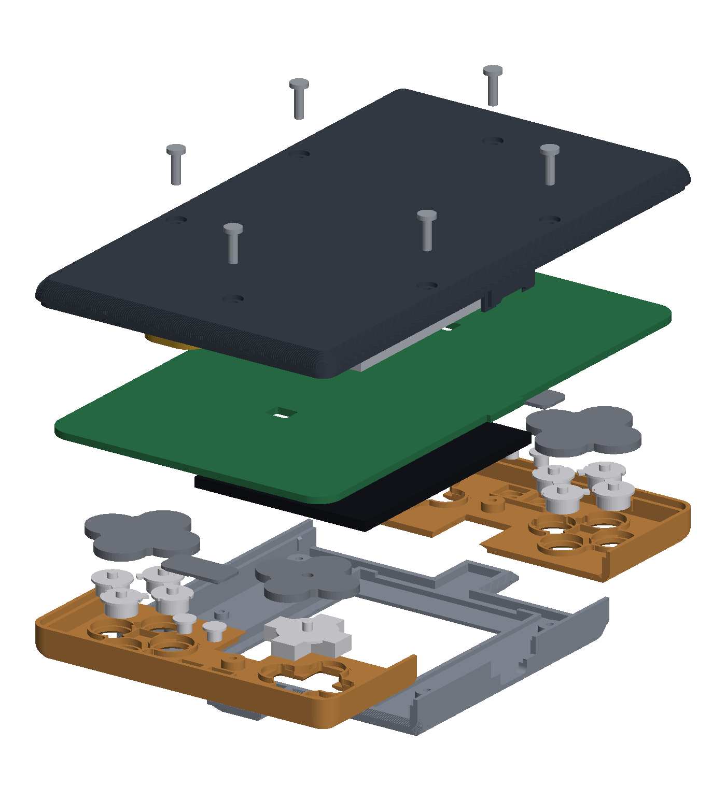

# The shell for the 2.4 in panel (2026-10-21)

The case's redesign after Alex's notes on his last print (items 10, 13, 14 and 15) and the change
to the EastRising ER-TFT024IPS-3. Everything here is in `case.scad`; this file says why.

## In one paragraph

Four printed parts: a **top piece** (the screen face, the curved steps down to the decks, a spine
at each end, and the sides), two **decks** (one part, printed twice: the button faces at each end),
and the **tub** (the back). The top piece and the decks all curve over the sides and meet the tub
flush at one seam, 4.2 mm up the walls, where the back's round ends; the tub no longer forms an
outer lip. Each deck seats into the top piece **from behind** on a 45 degree wedge, reaches out to
the case's outline and curves over the end and the sides itself, and has its own screw. Everything
is built **upside down**: caps and silicone into the decks, the decks into the face-down top piece,
the panel into its pocket, the board face down, the tub over it, six screws from the back. Every
part prints without supports in its own pose: the tub back down, the top piece and the decks face
down.

| | Before (cb51826) | Now |
|---|---|---|
| Outside | 75.4 x 156.2 mm | 75.4 x 132.7 mm (a DS Lite is 73.9 x 133.0) |
| Thickness | 13.4 at the screen, 11.5 at the decks | 13.35 at the screen (the panel is 2.3 +-0.1 thick, not 2.35), 11.5 at the decks |
| Panel | ER-TFT035IPS-6, 54.5 x 83.0 | ER-TFT024IPS-3, 42.72 x 59.46; each seat's half of the screen 36.7 x 24.5 |
| Board | 70.4 x 151.24 | 70.4 x 127.7 (r 5.5), the same USB-C tab |
| Parts | tub, lid, two deck inserts | tub, top piece, two decks |
| Held by | six screws into the lid, four snap hooks | six screws: four into the top piece, one into each deck; no hooks |
| Seam | the tub's skin rose to the face round the lid | one seam low on the side walls, the top pieces over the tub's tongue |

(The images are rendered from the STLs; see "Images" at the end for where they live.)

## The length and the width

The end bands are as they were (the clusters, Start/Select, J2 and the end screw sit where they sat
relative to the case's end): `band` = `edge_margin` 4 + `piece_d` 26 + `piece_to_glass` 5 = 35 mm a
side. Only the panel's bay shrank, 86.24 to 62.70, so `case_l` is 132.7. The width is set by the
clusters (`case_w` is now the input, 75.4, and `glass_side` follows: 15.6 mm from the bay to each
long edge). The bezels beside the glass are 5.9 mm wider than before, which is room the board can
use (and where J2 could go, see "Alternatives").

## Item 10: the top pieces curve over the sides and meet the tub flush

- **The seam** (`z_seam` = `back_r` = 4.2) is where the tub's back round ends and the walls go
  straight up. Below it is the tub: the floor, the round (4.2, ending in a 45 degree chamfer at the
  bed) and nothing else. Above it the top piece (in the middle) and the decks (at the ends) form all
  of the walls and roll into their faces through `face_r` = 3.0: an arc out of the wall that turns
  into a chamfer at `overhang` where the arc would go flatter in the print pose (the same profile
  as the back's round, `edge_in()`).
- **The joint at the seam:** the tub's wall carries a **tongue**, its inner half 1.5 mm up past the
  seam (`tongue_h`); the top pieces' skirts come down outside it, their outer half to the seam. The
  outsides are flush; a skirt can't move inwards; there is no straight path through the seam for
  light or dust; and it is the top pieces that wrap over the tub ("or go over it"), not the tub that
  forms a lip. The skirts stop `seam_gap` 0.1 short of the tub so the screws clamp the board, not
  the seam.
- **Width:** unchanged at 75.4; the walls stay 2.0. Nothing was added outside.
- **USB-C:** with the seam below the port, the opening's lower half is now a **tab of the tub** that
  rises from the seam into a notch in the top piece's skirt (the old lid tongue, upside down), with
  the stepped seams that stopped light showing through. The board's tab sits in a slot in that tab.
- **Snap hooks: dropped.** They held the lid on the tub while the case was turned over for the
  screws. Built upside down, nothing has to hold anything while the screws go in (gravity does), and
  the PLA hooks snapped on the first print. The six screws hold the case closed, as before.

## Item 13: the step down to the decks is a curve

The step is 1.85 mm tall (the screen face 5.75 over the board, the decks 3.90). It belongs to the
top piece, which prints face down, so every point of it faces down in the print pose, and nowhere
may it slope flatter than `overhang` (45 degrees, a guess until the `6_tests` ladder). Under that rule a
straight 45 degree slope is already the gentlest possible line; a curve can only be steeper
somewhere. So the step is the same round as every other outside edge, which reads as one shape
(the screen block's edges all roll over alike): `step_r` = 3.0, an arc that reaches the deck steep
(22 degrees off vertical) and turns, near the screen face, into a 45 degree chamfer where it would
otherwise go flatter. Its run is 1.53 mm plus a 0.6 mm flat at the deck's level (`joint_land`, so the
top piece's edge at the joint is square, not a knife edge). The seam with the deck lies in the
crease at its foot.

When Alex's ladder says a printer can do, say, 60 degrees, `overhang = 60` lets the arc run much
further up before the chamfer starts (and makes every other round rounder too); nothing else
changes. A concave cove at the deck's edge, the softest shape for a thumb, is impossible in any
face-down print: it would be a downward face at the deck's height with nothing under it.

## Item 14: no more cards slotted in from the front

The inserts dropped in from the front between the tub's walls and tucked under a lip on the tub's
end wall; they wobbled at the sides and the lip felt fragile. Now each deck:

- **reaches the case's outline** and curves over the end and the sides itself, down to the seam,
  where its skirt sits on the tub's tongue like the top piece's: supported all round its outer edge
  by the tub, no lip;
- **seats into the top piece from behind:** along the step and round the spine its edge goes 0.8
  straight down from the face (`deck_land`) and then out 1.2 at 45 degrees under a matching undercut
  in the top piece (`wedge_w`, `deck_gap` clearance, 0.25 until `6_tests`). It drops in from behind, centres itself, and can't
  come out of the front. The wedges on the spine's two sides and its end oppose the ones along the
  main step, so pushed home it can't move in x or y either;
- **has its own screw:** the end screw now goes through the board into a boss on the deck (the end
  bosses moved off the spine into the deck, just past the spine's end), pulling it down onto the
  board and its wedges up against the top piece. No anchor ring round a column any more, so the
  0.15 ring that was too tight is gone with it.

One part fits both ends (the end bosses are each other turned round, as before).

## Item 15: built upside down

1. **Board first, face up.** Push the cell's plug up through its hole and into J2, the speaker's
   into J4. Stick the cell to the board's back with its foam pad, and the speaker by its back with
   thin double-sided tape at its outline (the board session marks both on the back's silkscreen; see
   BOARD_OUTLINE.md). They ride with the board from here.
2. **Top piece face down** on a clean cloth.
3. **Decks:** each face down into its end of the top piece from behind; it drops onto its wedges and
   sits flat.
4. **Caps** into the decks from behind (A/B/X/Y tab into its slot, notches onto their ribs; the
   D-pad; Start/Select), then the **silicone** on them: the walls on the deck's back locate each pad.
5. **Panel** glass down into the top piece's pocket on its tape; the frame centres it.
6. **FPC into J3:** hold the board on edge at seat 1's end, face towards the panel, slide the FPC into
   J3 and close the latch.
7. **Board** face down onto the bosses (four on the top piece, one on each deck); the crush ribs on
   the top piece's side walls and the decks' end walls centre it, and the FPC folds under the panel.
8. **Tub** over it all: its tongue slides inside the skirts, its tab into the USB-C notch.
9. **Six M2 x 8** from the back, snug.

Opening it is the same backwards: screws out, lift the tub off, lift the board (the cell and the
speaker come with it), and everything else lies where it was.

## The other parts of the design

- **How the screen is located and held:** as before, its top in a pocket in the top piece's
  underside under a 0.8 skin, centred by a 1.1 frame (0.4 a side), held by double-sided tape. The
  window is the panel's visual area (38.72 x 50.96, the active area plus 1.0). The panel's back is
  2.4 over the board (J3 under it).
- **J3's whole range:** the folded FPC's tip lands 22.5 to 25 mm in from the seat-1 glass edge
  (`tip_range`, an estimate), so J3's origin is 20.3 to 22.8 in. The case keeps the FPC's whole
  footprint, out to 25.5 in, and J3's courtyard over the whole range clear (`fpc_zones`, `j3_zone`);
  the board places J3 at the middle for now (`fpc_conn`).
- **How the board is located:** crush ribs on the top piece's side walls (x) and the decks' end walls
  (y), 0.05 short of the board, with a lead-in at their lower end; the screws line it up. It is
  clamped between the tub's bosses and the top pieces' bosses as before, and rests on the tub's
  floor ribs.
- **Speaker:** today's approach (face down on a pad round a chamber in the floor, sound out of slots
  in the left wall's lower edge, plug-in J4), moved to y 31, past the cell's end and clear of the
  left side screw at y 22.
- **Cell:** centred under the board (cell_y 0, was -12): its wire end must be past its plug's hole,
  which moved with the shorter case. The rule that its plug can't reach J4 is now measured from the
  cell's end (its leads come from there), not as a straight line from the hole.
- **Screws:** side bosses at (+-31.4, +-22) beside the glass (they were at y 36, which is now in
  the step); end bosses at (+-3.0, +-50.75), on the decks.
- **Debug pinholes:** BOOTSEL and RESET moved to y 13 and 6 (the left side boss is at y 22).

## Print orientation and supports

| Part | Pose | Supports (`overhangs.py`) |
|---|---|---|
| tub | back down, as exported | none |
| top piece | face down | none |
| deck (print two) | face down | none |
| board mock, USB-C board coupon, speaker dummy | as before | yes, as before (their own overhangs) |

## Best guesses until `6_tests`

Alex won't print `6_tests` soon, so these are committed as best guesses (2026-10-21). Each is marked
"GUESS" in `case.scad`; when the plate is printed, check each against its coupon and move it.

| Parameter | Guess | Checked on `6_tests` by | Which way to move it |
|---|---|---|---|
| `cap_hole_d` | 8.0 | `tune_openings`: holes 7.6 / 7.8 / 8.2 beside the keyed 8.0 cluster | the smallest hole a real A/B/X/Y cap drops through and presses without catching; smaller if 8.0 rattles |
| `dpad_gap` | 0.65 | `tune_openings`: D-pad openings 0.55 / 0.65 / 0.75 | the tightest opening the real D-pad rocks freely in every direction |
| `overhang` | 45 | `test_overhangs`: fins 45 to 75 degrees from vertical, a convex R6 round (on the P1S and the U1) | up to the steepest fin that prints clean on both printers; every round and the step to the decks get rounder with it |
| `slide_fit` (`deck_gap`, `seam_fit`) | 0.25 a side | `test_rings`: rings 0.2 / 0.3 / 0.4 / 0.5 a side over the 5.0 `test_column` | the smallest ring that slides on the column by hand without force or rocking (0.15 was too tight on the old insert's ring) |

`slide_fit` is the one parameter for a printed part sliding on a printed part: the tub's tongue
inside the skirts (`seam_fit`) and each deck's wedge in the top piece's undercut (`deck_gap`) take
it. Raising it from 0.15 changed no position the board reads (`positions.json` is the same): the
deck's wedge now stops 0.25 short of the undercut (it reaches 0.95 under the top piece, was 1.05),
the top piece's wall behind the undercut is as thick as before (`step_wall_t` 1.35, which used to be
written 1.2 + `deck_gap`), and the tub's tongue is 0.75 thick (was 0.85).

## Alternatives considered

- **Decks as wells in the top piece** (the top piece's rim at screen height all round each end,
  the deck dropped into it from behind): the stiffest, every screw in the top piece, no seam round
  the decks' outer edges. Rejected: a 1.9 mm bumper round the thumbs' area, higher than the caps'
  tops, and Alex asked for "the top pieces" to curve over the sides.
- **A one-piece top with the decks in it:** no deck seams, but face down the decks print 1.85 mm
  off the bed (supports, the peel-away face the inserts were made to avoid); face up its insides are
  all ceilings. Rejected.
- **Printing the top piece face up** (the outside all top surfaces, a smooth curve for free):
  the bezels' undersides become 13 mm ceilings. Rejected.
- **The deck carrying the curve's foot:** face down, anything of the deck above its face is below
  the bed. Not possible.
- **No spine** (J2 and J4 to the side bezels, which are now 13 mm wide): a straight step across, a
  simpler rectangular deck. Rejected for now: it moves J2, J4 and both plug holes, crowds the
  bezels (USB-C and the charger on the right, the debug parts on the left) and brings J4 within the
  cell plug's reach; the spine is today's approach. Worth revisiting with the board session.
- **Keeping the hooks:** nothing needs them when the case is built upside down, and they snapped in
  PLA.
- **The seam higher** (at the port's centre, no USB-C tab): then the tub forms most of the walls and
  the board isn't inside the top piece's skirt when it goes in. **Seam at the board:** the same
  tab and a thin tub wall above the round. The round's end is the natural line.
- **The tub's skin over the top's tongue** (the old way round): the tub would form the outer lip,
  which item 10 rules out.

## Open questions

1. **The overhang limit** (`overhang`, 45, a guess): the `6_tests` ladder on both printers. A higher limit
   makes the step and every edge rounder in one line.
2. **The deck's wedge and its clearance** (`deck_gap` = `slide_fit` 0.25, a guess; `wedge_w` 1.2): the `0_buttons_end`
   coupons (top piece end + deck) show whether a deck drops in, centres and sits without rocking, and
   whether the seam in the step's crease looks right.
3. **The seam** (`seam_fit` = `slide_fit` 0.25, a guess; `seam_gap` 0.1, `tongue_h` 1.5): the seam coupons.
4. **J3's range** (`tip_range` 22.5 to 25) is an estimate; a real panel's folded FPC settles it.
5. **The speaker taped to the board's back:** its foam ring must still meet the tub's pad when the
   tub closes (0.4 mm between its back and the board). If that's fiddly, stick it to the tub's pad
   instead and plug it in before the board goes face down (its 35 mm leads allow it).
6. **No spine?** (see Alternatives) A question for the board session's re-placement.
7. The screw columns: no column passes through another printed part any more, so the `6_tests`
   rings only matter if one ever does again.

## Images

Rendered from the STLs of this commit (`img/` under the session scratchpad; copies of the ones used
here are in `case/images/`).
