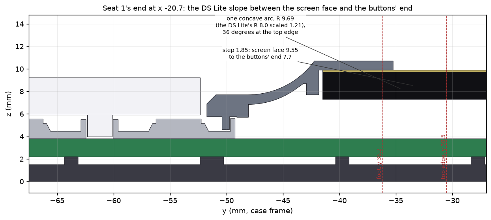
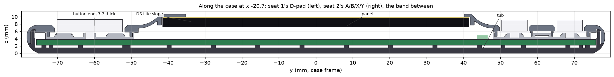
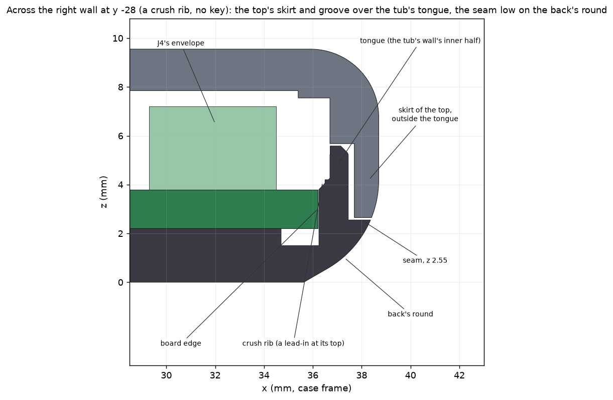
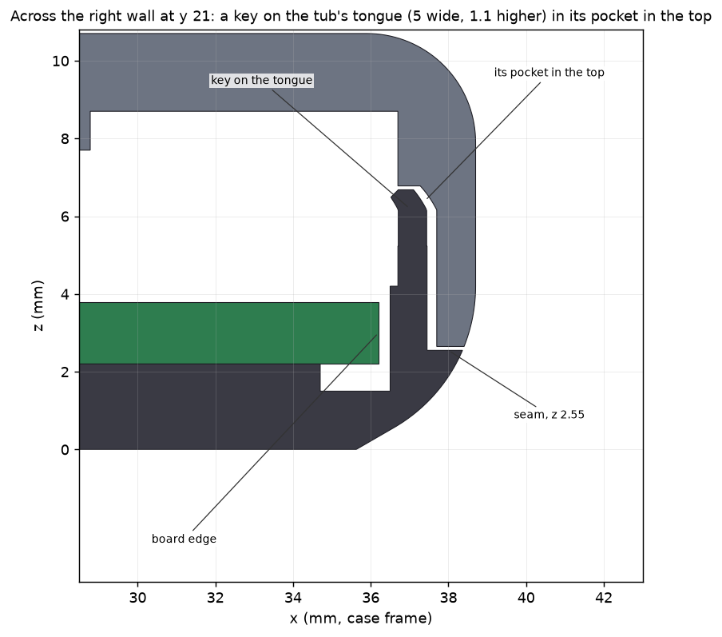

# The shell: a tub and one top (2026-10-25)

The case is two printed parts: the **tub** (the back) and the **top** (the whole face and both sides, one piece), held by
six M2 screws. Everything is in `case.scad`; this file says why. The board's side of it is in `CELLCUT_FOR_CASE.md` (final)
and `BOARD_OUTLINE.md`; the DS Lite measurements the buttons follow are in `DSLITE.md`.

The top replaced the island and the two decks of 2026-10-23 on 2026-10-25 (Alex: "make unibody main"; earlier: "we're gonna
go uni body for the top and print with pla support material"). Those, and everything built round them, are under
"Rejected" below and in full in [SHELL_ISLAND.md](SHELL_ISLAND.md) (this file as it stood the day before).

## In one paragraph

The **top** is a band at the screen's height from the left side wall to the right, its two ends the DS Lite's lower screen
frame in section (a sharp top edge, then one concave arc down to the buttons' height), and the two **ends** beyond it at the
buttons' height, where the genuine caps stand 1.41 mm proud. It rolls over the sides in true quarter arcs and down the back's
round to a seam 2.55 mm up the walls. The **tub** has the back, a pocket in its floor for the cell and, standing up inside the
top's skirt all round, a **tongue** (4.05 mm over the seam round the ends, 3.03 along the sides) that keys the top: two tabs
into pockets in each side wall and grip ribs, so the two parts hold together before the screws go in. The board, with the cell in
a hole in it, lies inside the tub's walls. The top prints **face down** (its slopes and rounds on **Bambu Support For PLA**
interface, a second filament), the tub back down with no supports. It goes together **upside down**: caps and silicone into
the top from behind, the speaker into its pocket, the panel, the board face down (the speaker's plug into J4 first), the tub
over it, six screws from the back (four into the top beside the glass, one at each end).

| | |
|---|---|
| Outside | 77.4 x 132.7 mm (a DS Lite is 73.9 x 133.0) |
| Thickness | 9.55 at the screen (the band), 7.7 at the ends |
| Board | 72.4 x 127.7 (r 5.5), a 54 x 37 hole for the cell |
| Parts | tub (16.1 cm3), top (14.2 cm3) |
| Held by | six M2 x 6 self-tapping, wafer head (`screw_l`); before them the tongue, keys and grip ribs |
| Print | tub back down, no supports; top face down on support filament (two filaments, a prime tower) |

## The top

Built from `top()` in `case.scad`: `uni_outer()` (the outside), `uni_cavity()` (the inside), the groove and the key pockets cut
from it, and what it carries (`top_inner()`, `end_inner()`) and what is cut through it (`top_cuts()`, `end_cuts()`).

**The band and the DS Lite's curve.** The screen's height (9.55) runs across the whole width: Alex, after an x-ray showing that
J1, J2, J4, J5 and the speaker force a block out to the sides: "have the island extend fully to the left and right but try to
minimize its extension on the top and bottom". The side at the screen's height is the case's side profile (the round of `face_r`
2.8), and beyond the band the ends'. Its two ends are the only edges, each a copy of the DS Lite's lower screen frame in section
("make an exact copy of this curve structure and adapt it to our purpose"), measured from `nintendo_ds_bottom_base.stl`: a sharp
top edge, and from it one concave arc of radius 8.0 (rms 0.002 mm over its facets) that starts 36 degrees off the flat and is
tangent to the deck 4.70 out and 1.528 down. Scaled uniformly to our 1.85 step (x1.211): R 9.69, 5.69 out, the top edge at 30.53
from the middle (0.4 outside the panel's pocket) and the foot at 36.22. The section is carried out over the side rounds unchanged
(each slice of the slope is the ends' side section lifted by the profile's height), so the same curve shows in the side view.

**The ends.** 7.7 thick (the face 3.9 over the board, `deck_face`), with the buttons' openings as in the DS Lite's faceplate
(`DSLITE.md`): holes 8.0 with a 0.6 chamfer, flange pockets with their notch ribs and tab slots, the D-pad's cross opening,
Start/Select's 3.8 holes; under them the walls that rest on each silicone pad's web (the A/B/X/Y clover, the D-pad's lobes,
Start/Select's frame) and the end screw's boss. Nothing there is new.

**The inside.** The ceiling is 7.55 (`z_ceil`, 2.0 under the screen face) under the band until 2.0 past the slope's top edge; then it
keeps `uni_skin` (0.7) under the slope (the arc at radius R + 0.7), down to the ends' ceiling 5.7 (`z_deck_under`) at the foot. The
panel's pocket and its 1.1 locating frame are cut into the underside under a 0.8 skin; the speaker has a pocket (0.5 deep) and a
grille of seven slots in the right bezel; a 0.3 pocket covers J4 and the speaker's mated plug; U6 (1.75 tall, in the strip between
seat 1's clusters) has a pocket in the ends' underside up to 0.75 under the face; four side bosses (H1 to H4's) and two pinhole
guides hang from the ceiling. The USB-C opening is cut through the wall at the port's centre with the tub's tab filling its lower
half, and the skirt's inner half stays over the notch from the opening's centre up.

**The skirt and the groove.** The skirt follows the back's round down to the seam (its tip 0.70 thick at 2.65) and the tongue slides
into a groove in its inner half (`seam_fit` 0.25 each side, `seam_gap` 0.1 over the tongue's top). Round the ends, where the
round's skirt over the tongue's upper corner would be only 0.47 thick, the tub's tongue has a 0.45 chamfer and is 0.1 lower and
the top's groove is filled to follow it 0.1 off (`uni_groove_out`, a 45 degree ramp): the wall there is 0.669 (was 0.467).

**The wall under the rounds** (`check_wall.py`, a stage of `tools/build.py`: sections every 1 mm along the case, both sides, the
end rounds at x -20 to 20, and a 3D check of the whole round including the plan corners; the USB-C opening, which breaks through
the round by design, is left out): the thinnest plastic square to the outer surface is **0.708 under the slope and band** (floor
0.699), **0.669 along the ends' sides and round their ends** (floor 0.66) and **0.666 in 3D** (floor 0.62; its points are 0.1 apart).
Asserted in `case.scad` too: `uni_groove_skin` (0.65 at every groove level), the clearance of the filled groove to the tongue's
chamfer, and `uni_skin` under the slope's side round.

**Against the board** (`check_fit.py`, the boxes of every part's 3D model; `positions.json` is unchanged by this): PASS, no
collisions. The strip between the clusters under the band's end, which `positions.json`'s decks zones leave out, has the ends'
ceiling, so `case.scad` echoes it (`TOP`) and the check holds it to 1.6 over the board (2.85 in U6's pocket): U6 stands 1.75 in its
pocket, the other two parts in it are lower. (The island's joint zones and the arms' hooks, which the check had until now, are
gone.) The earlier passes' mesh check of the one-piece top (each part's model box against the top's inside, sections every 0.02 mm)
found no collisions and measured the least clearances: J2 0.36, J4 0.66, SW18/19 0.47, U6 0.52 (to its pocket's side), U7 0.70 and
the speaker's worst case 0.45.

## The tub

The back, rolling into the walls through `back_r` 4.2 (up to 60 degrees from vertical, `overhang`, smooth: one loft every 0.1), up
to the seam at 2.55; six bosses under the board's screw holes (6.0, or 5.0 at H2 and H4 where 6.0 would be too near the cell's hole
and the board's edge) with counterbores for the heads; the floor's ribs (a grid, a ring and the strips' ribs) on which the board
rests `board_lift` 0.7 high, clear of the cell's hole, the test pads, J1's legs and the domes' vents; the cell's 0.6 pocket; eight
crush ribs on the walls, 0.05 short of the board's edge, with a lead-in at their upper end, that centre it; the USB-C tab, which
rises from the seam into the top's notch and carries the opening's lower half.

**The tongue** is the wall's inner half standing up past the seam inside the skirts: `deck_tongue_top` 6.6 (4.05 over the seam)
round the ends, `arm_tongue_top` 5.58 (3.03) along the side walls, stepping at |y| 35.55 (just inside the slope's foot) with
the grooves overlapping the step 0.35 each way. It is 0.75 thick, its outer edge chamfered at the tip (0.3, 0.45 round the ends)
and its inner edge at 45 degrees, so it leads the board in as the tub goes on.

**What it still carries, and why** (what the island's and decks' joints took out is listed in "Rejected"):
- the **keys** (`keys`: two tabs on each side wall, 5.0 wide, 1.1 higher than the tongue, at y 21 and -18 on the right and -21 and
  18 on the left): the top's pockets use them; they locate the top along the case with 0.25 of play each way and hold its sides out
  on the tongue;
- the **grip ribs** (16: two each side of each end at y 40 and 52, four on each side wall), 0.05 short of the skirts: they hold the
  top on the tub until the screws go in and centre it across the case (a GUESS, `grip_reach`);
- the **crush ribs**, the **USB-C tab**, the bosses and the floor's ribs, as before.

**Removed from the tub** because only the island's and the decks' joints used them: the four laps' slots and the four hooks'
slots in the tongue (the tongue is whole along the walls again), and the four corner posts (they pushed each deck onto the
island's wedge; a one-piece top would be held at both ends with no clearance along the case by them, so it has none). The
top lost its four posts' notches (9 mm3 in all); nothing else about it changed (volume and bounds compared with the one-piece
top of 35d9ce0).

## Build order

Upside down (every part goes in straight down); `docs/assembly.md` has the steps. The top lies face down on its screen face (the
band, 77.4 x 61, on the bench: the ends stand 1.85 off it, so the caps, which stand 1.41 proud, clear the bench by 0.44):
1. caps into the top from behind (each ABXY cap's tab into its slot and its notches onto the ribs), the D-pad and Start/Select, then
   the silicone pads over them (the walls on the ends' underside locate each pad);
2. the speaker face down into its pocket over the grille;
3. the panel glass down into its pocket on double-sided tape (the frame centres it);
4. the cell into the tub's pocket on tape; the board on edge at seat 1's end: the FPC into J3, the cell's plug into J2;
5. the board face down onto the top's bosses, the speaker's plug into J4 just before it lands;
6. the tub straight down over it all: the tongue into the grooves, the keys into their pockets, the crush ribs centring the board;
7. six M2 x 6 from the back.

## Printing

| Part | Pose | Supports |
|---|---|---|
| tub (`tub.stl`) | back down, as exported | none (`overhangs.py`) |
| top (`top.stl`) | face down | tree supports from the bed and from the part, **interface in Bambu Support For PLA**, body in PLA, top Z distance 0, prime tower |
| coupons cut from the top with its slope or rounds (`coupon_seam_top`, `coupon_usb_top`, `coupon_buttons_top`) | face down | as the top |
| the other coupons, the tuning slices, the dummies | flat or face down | none; the board mock's and the USB board coupon's USB-C stand-in has plain PLA supports |

Face down, the screen face is the first layer; the ends' faces stand 1.85 up from it, and they, the slopes and the side rounds
hang over the bed and print on the support interface. Slicing the top on a P1S (Bambu Studio 2.08, 0.20 mm, 2026-10-25): about
27 g of PLA (with its purge) and 6 to 7 g of support filament, the supports only from the bed up to 2.2 mm, under the ends' faces,
the slope and the outer rounds. The kits (`print_package_README.md`) have the plates: `1_case` (tub and top) is 48.6 g of PLA, 5.8 g of
support filament, 17 filament changes and 3 h 04 min on a P1S (3 walls, 0.12 mm layers over the first 4.5 mm); `5_unit` (the whole unit and its dummies, one plate on both
printers) is 75.2 g and 4 h 18 min. `support_check.py` reads the G-code and fails the build if any part other than the top and the
coupons cut from it has support under it, or if the support filament prints anything but interface and the prime tower.

## The checks

| Stage (`tools/build.py`) | What | Now |
|---|---|---|
| `export` | `positions.json`, `board.dxf`, `tub.stl`, `top.stl` | `positions.json` byte for byte as before |
| `check_buttons` | every cap sits and presses without touching the shell; silicone against the shell | the same 11 known failures as before, all of the caps against the silicone models (`caps_silicone`, `pressed_silicone`), none of the shell |
| `check_wall` | the top's wall under its side rounds | see above |
| `check_fit` | the board inside the case | PASS |
| `fitkit` | the fit kit | `case/fitkit/README.md` |
| `check_manifold` | every printed part's mesh | 48 parts, every edge on two faces |
| `print_u1`, `print_p1s` | the print kits | the P1S's are sliced; the U1's are not (Orca's CLI crashes on a U1 preset), their numbers are the P1S's |
| `viewer` | the exploded 3D view | `viewer/` |

`case.scad` asserts what it can: the tongue (`tip_min`, the board's edge), the keys, the grip ribs, the USB-C opening and tab, the
button stack, the screw bosses, and the top's skins (`uni_skin`, `uni_groove_skin`). With `overhang = 45` instead of 60 the tub and the top still
build and every assert passes (checked 2026-10-25; the kits were not rebuilt for it).

## Best guesses until the first print

Marked "GUESS" in `case.scad`; check each against its coupon and move it:

| Parameter | Guess | Checked by | Which way to move it |
|---|---|---|---|
| `cap_hole_d` | 8.0 | `tune_openings`: holes 7.6 / 7.8 / 8.2 beside the keyed cluster | the smallest hole a real A/B/X/Y cap drops through |
| `dpad_gap` | 0.65 | `tune_openings`: 0.55 / 0.65 / 0.75 | the tightest the real D-pad rocks freely in |
| `overhang` | 60 (a variant; 45 on the old main line) | `test_overhangs` on both printers | the steepest clean fin; it sets the tub's back round and the skirts' round |
| `slide_fit` (`seam_fit`) | 0.25 a side | `test_rings`: 0.2 / 0.3 / 0.4 / 0.5 over the 5.0 column; the seam coupons | the smallest that slides by hand |
| `grip_reach` | 0.2 (ribs 0.05 short of the skirts) | the case itself and `coupon_seam_*` | towards 0.25 if the tub falls off, towards 0.1 if it won't go on |
| `dome_h` | 1.75 | `tune_stack_*` at 1.6, 1.75, 1.9 | the one where the caps stand about 1.4 proud |

## Open questions (on the first print, most important first)

1. **The finish on the support interface.** Face down, the ends' faces, the slopes and the side rounds come off the Support For
   PLA interface and the screen face off the plate; the two textures will differ. Print `coupon_buttons_top` (an end, face down)
   first and look at it.
2. **A 133 mm one-piece part with 0.7 mm skirt tips may warp** more than three short parts did, and now there are no joints to take
   up a print's error: the top must still slide over the tongue and the keys fit their pockets. `coupon_seam_*` and `1_case` show it.
3. **Caps and silicone go into one part from behind**, face down on the screen face with the ends 1.85 off the bench: whether it
   sits steady on its band while they go in (the island's build bars are gone).
4. **The skin under the slope and the side rounds is 0.67 to 0.71**, and J2 and J4 are 0.36 from its inside: a sagging support
   interface or a fat first layer face down eats into it.
5. **The tub's tongue is a thin wall** (0.75, 4.05 tall over the seam round the ends): held all along inside the skirts, but it flexes
   off the case. Handle the tub by its floor.
6. **J3's range** (`tip_range` 22.5 to 25) is an estimate; a real panel's folded FPC settles it.
7. **J4 and the speaker's leads:** the speaker stays in the top, so J4 is plugged with the board just off its place and unplugged
   before the parts come apart.
8. **The overhang limit** (`overhang`): the `6_tests` ladder (and `overhang_kit.zip`) on both printers.

## Rejected

**The island and the two decks (2026-10-23 to 2026-10-25).** The case's face and sides were two C-shaped decks (one part printed
twice, a core with the buttons and an arm along each side wall) and, in the window they formed, an island (the raised screen block,
its spines, and an ear on each side wall, over the USB-C on the right and blank on the left), all printed face down in plain PLA
without supports and joined by: a 45 degree wedge on the island's edge under a lip on the decks'; a lap at each ear's end behind the
arms' skirts; a hook on each arm through a slot in the tub's tongue; a post in each tub corner that pushed each deck onto the
wedge; and two printed build bars that stood the decks 1.85 off the bench while the island went in last. **Why it went:** Alex
chose one top printed on support filament for one flowing surface. The island and decks always showed their seam round the screen
block (he, on the blend: "it needs to look like one piece one flow, not two"), the island had to stand 2.6 in from the sides so the
board's tall parts could lie under its inside, every joint was a clearance and a tolerance chain on three parts, and the build
needed two bars and a fixed order. The one-piece top has no joints of its own: it replaces four kinds of joint (the wedge and lips, the laps, the hooks, the
posts), three printed parts and the bars with a second filament, a prime tower and a finish on the support interface. Its first edge was an S (r 3.0 convex, r 1.5 concave), then
the DS Lite's frame; the island's full notes, measurements and images are in [SHELL_ISLAND.md](SHELL_ISLAND.md) (the tag
`ref-design-island-archive` has its parts).

**A one-piece top printed without supports** was rejected earlier (face down, the ends print 1.85 mm above the bed and the bezels'
undersides become big ceilings). It is reversed: the supports and their interface are the second filament now.

**The 45 degree island line** (`ref-design-cellcut`, with its `case_45_60.zip` and `island_coupons.zip` kits) is superseded by
this design; neither zip is in this branch's kits. What the printers can do at 60 degrees only matters for the tub's back round
and the skirts now (`overhang`).

The other alternatives of the island's time (a bumper round the thumbs, a tooth joint and others) are in `SHELL_ISLAND.md`,
"Alternatives considered".

## Images

Rendered by `python3 case/render_images.py` from the parts of this commit (`case/images/`): the outside views with OpenSCAD from the
assembled STLs, the sections with matplotlib from `trimesh` cuts of the same parts (the cell nominal, the speaker 3.5 tall, the board
as its parts' envelopes). The island's images are in `images/island/`.
