# The shell for the 2.4 in panel (2026-10-21), with the cell in the board (2026-10-22), joints that hold it together, the seam on the round, the side joint (2026-10-22), the lip under the step and the island (2026-10-23), the left ear and the hooks (2026-10-24)

The case's redesign after Alex's notes on his last print (items 10, 13, 14 and 15) and the change
to the EastRising ER-TFT024IPS-3, then reworked for the board with the cell in a hole in it and the
speaker on its top (row 19, `CELLCUT_FOR_CASE.md`, which supersedes `BOARD_OUTLINE.md` where they
differ). Everything here is in `case.scad`; this file says why.

## The island (2026-10-23)

Alex, on where the screen block's side round came down into the decks' (the side blend of "The side
joint"): "This doesn't look good. It needs to blend and flow better. It's because the top part of the
case diverges from the rounded part that combines with the tub but it needs to look like one piece one
flow, not two." He liked a concept of the case's whole side at the decks' height with the screen block
an island on top (the mock in the session's scratch folder), and said "Build it." This section is the
case as it is now; the sections after it are its history, and where they disagree this one wins.

**2026-10-24, Alex's three changes** (each below in its place): **a matching ear on the left wall** (the
right one turned round, blank), so every arm ends at an ear with its laps and **the two decks are one
part, printed twice**; **a hook on each arm** that holds it from springing outward; and **the side round
2.8** (was 3.0). Not changed: the wedge keeps no clearance on its 45 degree faces.

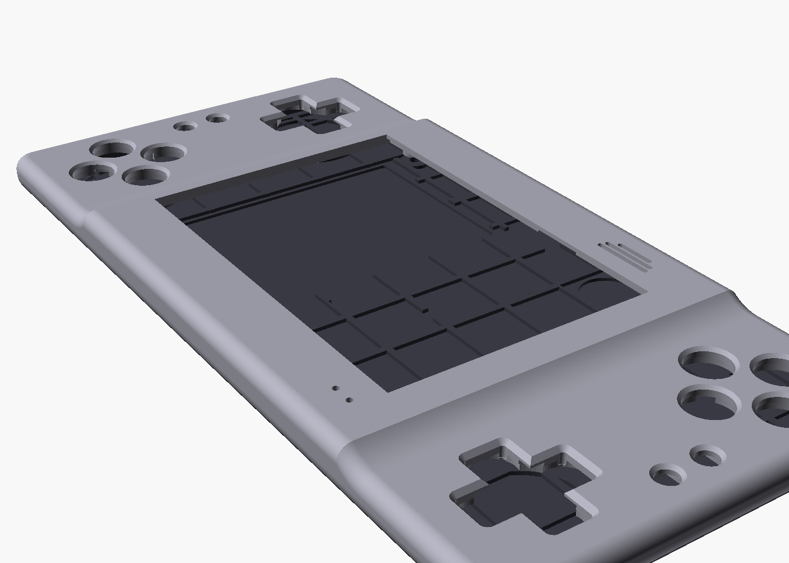
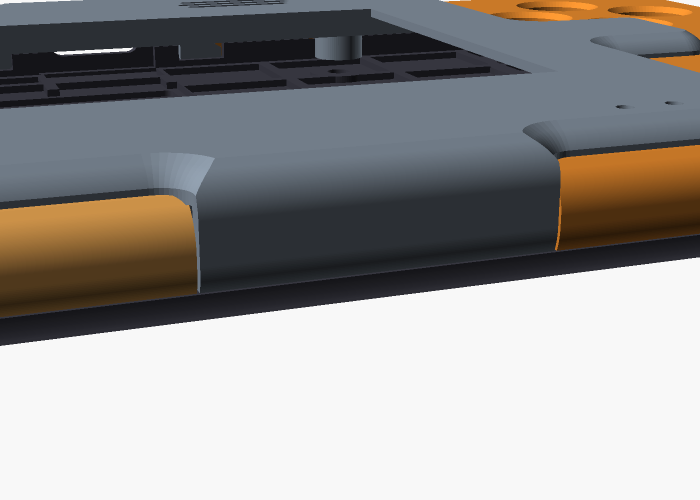
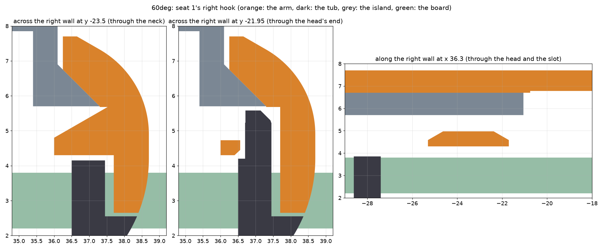
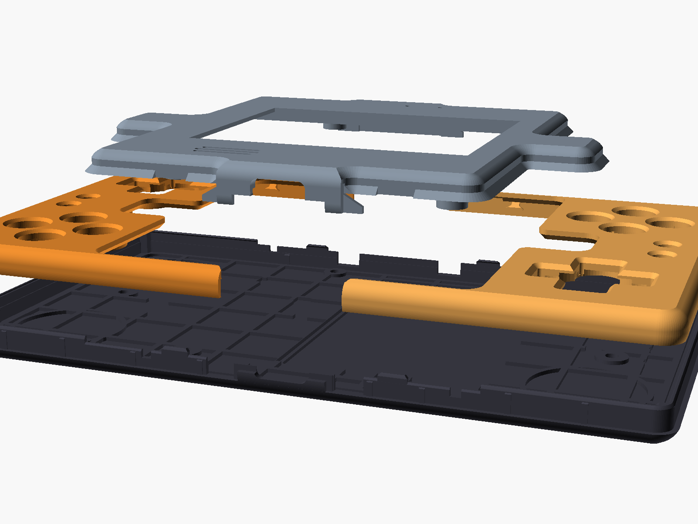
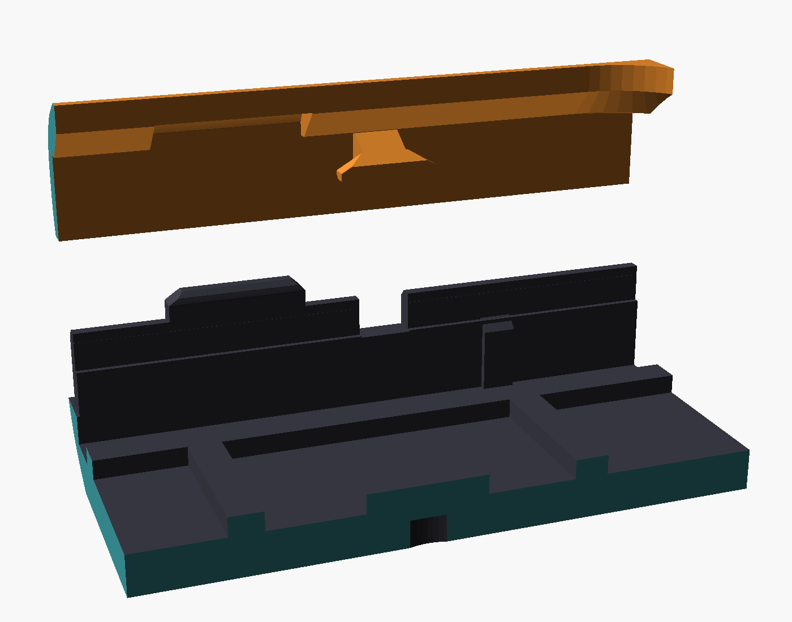

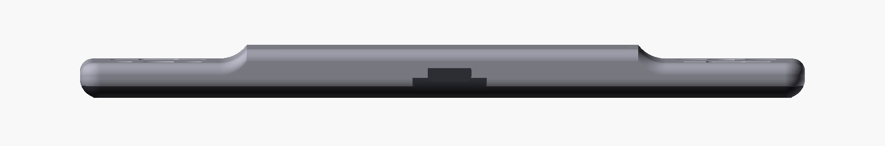
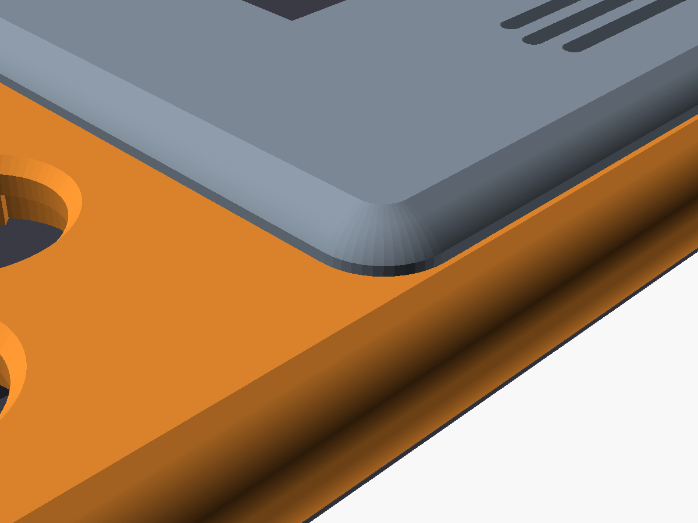
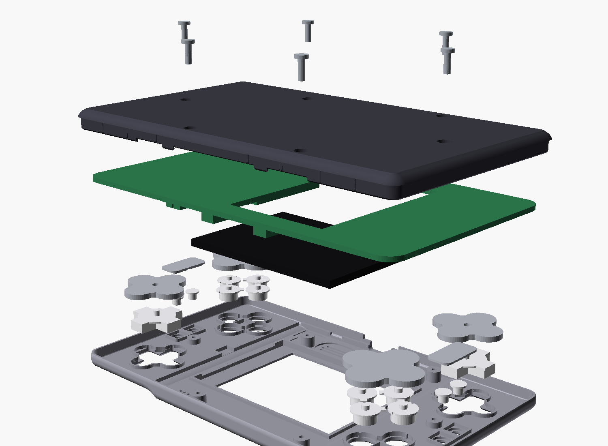

**The parts.** Four printed parts, as before, cut differently:
- **The island** (`top()`, `top.stl`): only the raised screen block, its two spines and an ear on each
  side wall: over the USB-C on the right, blank on the left (2026-10-24). Its foot is **2.6** (`isl_in`) in from the side outline; across the step
  and round the spines it is where the step's foot was (`joint_y`, `spine_end`: the buttons, Start/Select
  and every `positions.json` entry are where they were). Its plan's corners are rounded at the foot,
  r 3.0 convex and r 2.0 concave (`isl_r`, `isl_fillet`), and **one edge profile runs all round it**: the
  step's (0.35 straight up from the decks' face, then the r 3.0 arc to 60 degrees and its chamfer, a 1.79
  run), built as one loft of the plan's offsets (`isl_ring`: each corner's arc about its own centre), so
  the corners follow the same profile. Its flat face starts 4.39 in from the outline.
- **The deck, twice** (`deck(-1)`, `deck(1)`; one `deck.stl`, printed twice since 2026-10-24: seat 2's
  is seat 1's turned round, which `export.py` checks, 0.000 mm3 apart), C-shaped: each is its core (the end
  with the buttons, as before) and two **arms** along the side walls at its own height, carrying the side
  skirts, each ending at an ear. So the case's side, end to end, is the decks' profile: the tub's round, the seam at 2.55, the
  skirt, the face's round (`face_r`) up to the face at 7.7. No part of the side wall rises to the screen's
  height, except at the ear.
- **The tub**, as it was except where the skirts changed: the tongue along the side walls is lower, the
  keys moved into the arms, the laps' slots moved.

**What set the inset (2.6, not 4 to 6).** Under a deck's arm the board may have nothing taller than
1.6 (the decks' underside, 1.9 over the board, less 0.3); under the island's inside it may have 3.45.
Along the side walls the final board has, from the outline: J1 (USB-C, 3.25 tall) at 0.19, J5 and J6
(2.9) at 3.585, J2 (3.4) at 4.17, J4 (3.4) at 4.2, the speaker's pocket (3.8 of speaker) at 4.5, H4's
boss at 3.2. The island's inside must reach out past each of them with its wall (0.7, `isl_wall`, the skin
over the inside's corner) and the wedge outside that: J5 and J6 set it, 3.585 - 0.25 - 0.7 = 2.635, so
2.6 (their envelopes 0.29 off the island's inside). At 4.0 the wall would stand on J2, J4, J5 and J6; at
5.0 also on the speaker. Islands with bays round each part were the other way to keep 5: the island's
outline would have bulged out to the wall at J1, J2, J4, J5/J6 and the speaker, most of both sides.
`side_tall` and the asserts in `case.scad` hold the numbers; check_fit checks every part against the new
JOINT zones (41 parts under them, the tallest 1.19 of the 1.6 allowed). `positions.json` is unchanged:
the side strips are in the JOINT echo, not in the board's height limits.

**The ear (J1).** The receptacle stands in the right wall with its top at 7.05, 0.65 under the decks'
face, and the opening's top at 7.30, 0.40 under it: with the face's round starting 3.0 lower, a wall at
the decks' height would leave the opening breaking out through the round and the receptacle's top front
corner 0.6 outside the case. So over it the island comes out to the wall at the screen's height, as the
old top piece's side did, for 21.4 along the wall (`ear_y`, usb_y +-10.7): the notch over the tub's tab
(18 wide) and, at each end, a lap and its slot clear of the tab. The opening's upper half and the notch
are in the ear as they were in the top piece; the USB-C asserts and check_fit's plug check are as before
(J1's mouth 0.25 / 0.25 clear in y, 0.29 / 0.25 in z, a plug's overmold 0.16 off the wall). This is the
one place the side has to rise (the board is final). The right arms end at its ends (-8.7 and 12.7).

**The left ear** (Alex, 2026-10-24): the right ear turned round about the case's vertical axis
(`ear_yl`, y -12.7 to 8.7), blank (no USB-C opening, no notch, no tub tab): the island at the screen's
height out to the left wall, its laps into the left arms' skirts at both ends and their slots in the
tongue, as on the right. The left arms end at it (-12.7 and 8.7), so each deck's arms end at the same
places turned round, and the left keys and grip ribs moved to the right ones' places turned round (keys
-21 and 18, ribs 13.25 and -17.2; every assert held): seat 2's deck is seat 1's turned round, and the kits
carry one deck model, printed twice. Under it the island's inside reaches the wall's inside, as at the
right ear (the pinhole switches, J2 and J5 are under the island anyway); check_fit's JOINT zones leave
both ears out.

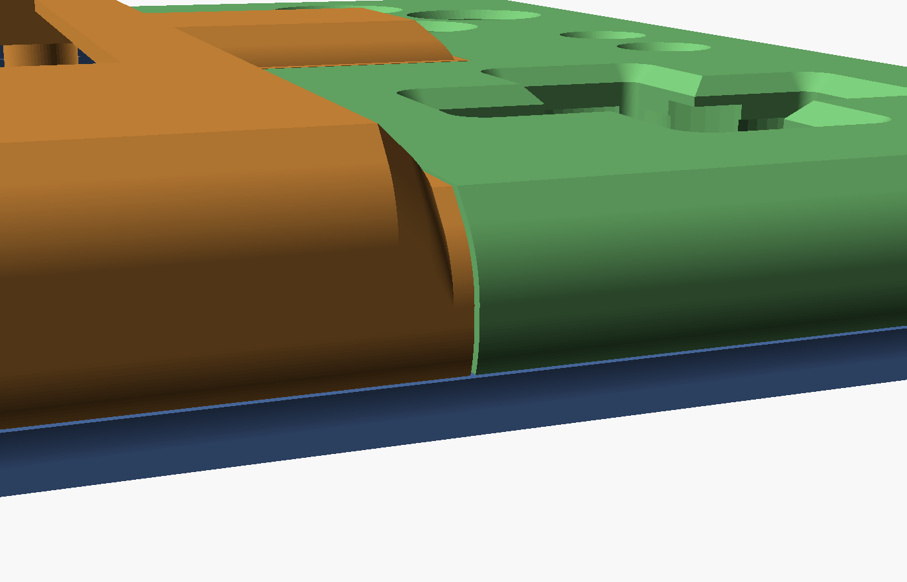
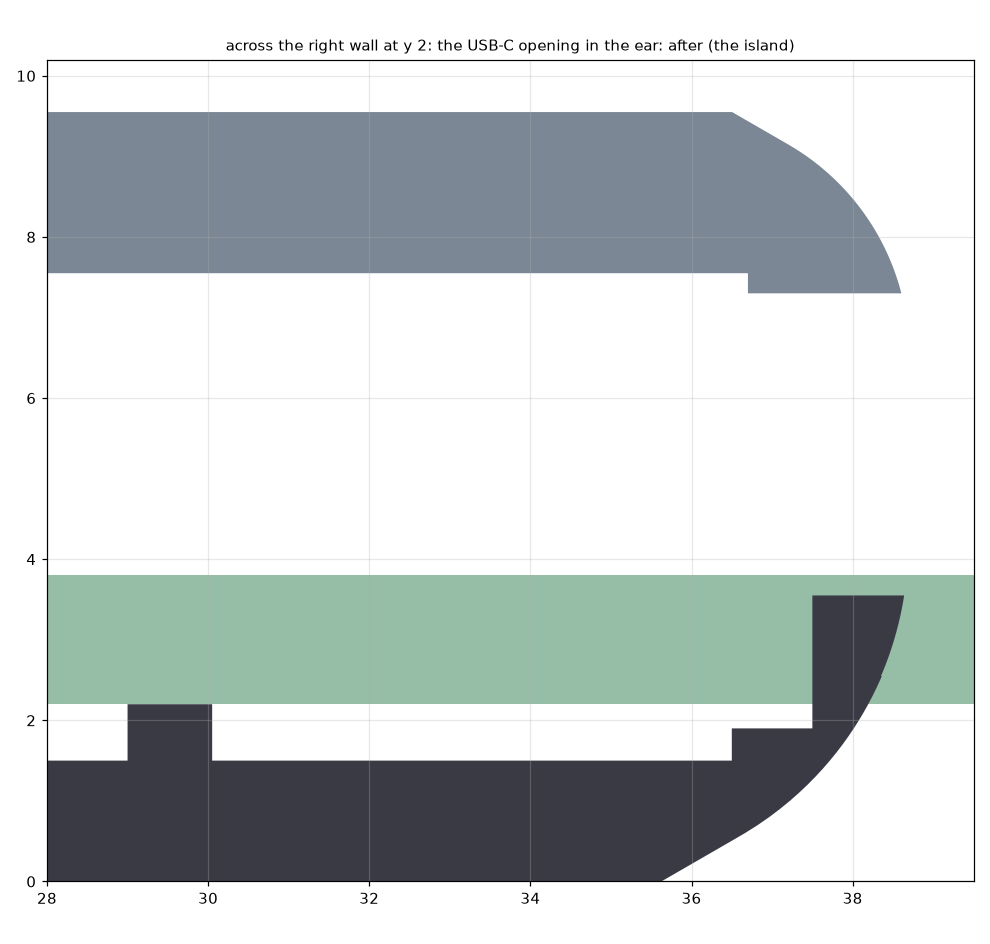

**The side round** is r **2.8** (`face_r`, Alex 2026-10-24; its top edge 2.05 in at 60): on the arms it
leaves **0.40** of flat face before the seam at the island's foot (0.25 at 3.0, which risked reading as a
crease). It was 3.0 for a day (the 60 degree pass had taken it to 2.4 because the blend brought it down
over the top piece's hollow and J4's pocket; the blend went and nothing hollow is under it).

**The joints.**
- **The island's wedge under the decks' lips** (the decks' wedge into the top piece of 2026-10-22, the
  roles swapped): under the decks' face the island's foot goes 0.8 straight down (`wedge_v`), then out at
  45 degrees under the decks to their underside, **1.2** (`wedge_out`) under each deck's lip, all round
  the island: across the step, round the spines, along both sides and the ear's ends. The decks' edges
  have the matching undercut: 0.95 straight down from the face (0.15, `deck_gap`, off the island's foot,
  the visible seam), then the 45 degree face, touching the island's (no clearance there: the posts push
  each deck onto it). Face down the island's wedge is a 45 degree overhang and the decks' undercut faces
  up: no supports, no bridges. It stops for 6.1 mm at each key (the arm's pocket for the key opens on the
  island's foot there) and at the ear's ends by the wall (1.35 in from the outline the ear's end is
  straight down the wall, or the wedge would come out through the arm's round).
- **The ears' laps.** At each end of each ear the island carries a lap into the arm's skirt (`ear_laps`,
  four since the left ear; until 2026-10-24 the left arms met each other with seat 1's lap behind seat
  2's skirt: see "Alternatives considered"). As the side joint's lap: the other skirt can't move in, this one can't move out past it, they lie flush and
  nothing shows through. Face down a lap's free end hangs off its part, so its top falls from its root at
  `overhang` (60; it was 45 with a deeper root): 1.09 tall at its tip. The tongue stops either side of
  each (`lap_slot`).
- **The tongue** is 4.15 over the seam round the cores (6.7, leaning in under their round, as before)
  and **3.03** along the side walls (`arm_tongue_top` 5.58, seam_gap and 0.02 under the decks' underside),
  so it passes under the island's wedge as the tub goes on. It steps at |y| 35.55, where the wedge has
  turned the island's corner away from the walls (the cores' groove 1.43 clear of it).
- **Keys** (`keys`): one tab in each arm (right 21 and -18, left -21 and 18: the right ones turned round), 1.1 over the tongue (to 6.68),
  5.0 along the wall, in a pocket in the arm (the arm's plate 0.92 over it): they locate the arm along the
  case and keep its skirt from moving in. The top piece's four keys went with its sides.
- **Grip ribs** (`grips`): two a side on each core (+-40, +-52), and two on each arm: +-26 and one near
  its free end (right -13.25 and 17.2, left 13.25 and -17.2).
- **The hooks** (`hooks`, Alex 2026-10-24): each arm carries one, so it can't spring outward. A neck 1.6
  wide comes down from the arm's skirt and plate through a vertical slot in the tub's tongue (1.9 wide:
  0.15 a side, from 4.15, 1.6 over the seam, up through the tongue's top), and a head 3.6 long and 0.55
  thick stands behind the tongue, 0.15 (`hook_play` = `deck_gap`) inside its inside face: if the arm
  moves out by 0.15 the head bears on the tongue's inside, over 0.67 of height (`hook_bear`). It goes
  straight in: the head passes inside the tongue, the neck down the slot (which also keys the arm along
  the wall, 0.15 a side), a 0.15 lead-in at 45 degrees on the head's outer foot. Face down the hook's top
  (the print's underside) rises from the arm's plate at `overhang`, 0.15 under the island's wedge's outer
  edge, and the head's ends past the neck taper in at `overhang` too, so it prints without supports
  (`overhangs.py`, the P1S slice). The head's foot stands **0.5 over the board** and reaches 0.2 in past
  its edge: check_fit checks every part within 0.3 of each head (HOOKS, it allows 0.2): nothing; the
  nearest parts are J6 0.89 from seat 2's left hook (2.9 tall, beside it, not under it), J4 1.50 from seat
  1's right one, C5 2.00, D3 2.05. Each hook takes 1.9 of tongue at its slot.
  **Where:** as near each arm's free end (at the ear) as the rest leaves 3.6 + margins: seat 1's right
  arm at **-23.5** (its key's pocket ends at -20.75 and its first grip rib at -13.25 sits 1.5 from the
  lap's slot: nothing nearer fits; the head 0.95 from the key's pocket, the slot 1.05 from the grip rib
  at -26), seat 2's right arm at **31.5** (from the lap's slot at 10.95 to the key's pocket at 23.75 the
  wall is full: lap slot, grip rib 17.2, key 21; then 1.45 to the grip rib at 26 and the crush rib at 28,
  so the first room is past it: the head 1.1 from the crush rib, 3.7 short of the tongue's step, 0.5
  from H1's tub boss in x). The left arms' are those turned round: seat 2's left at 23.5, seat 1's left
  at -31.5. So two hooks are 13 from their arm's free end and two 19: see "Open questions".
- **Corner posts**: as before; they now push each deck along the case onto the island's wedge (across
  the step and round the spine's end), its place over the buttons.

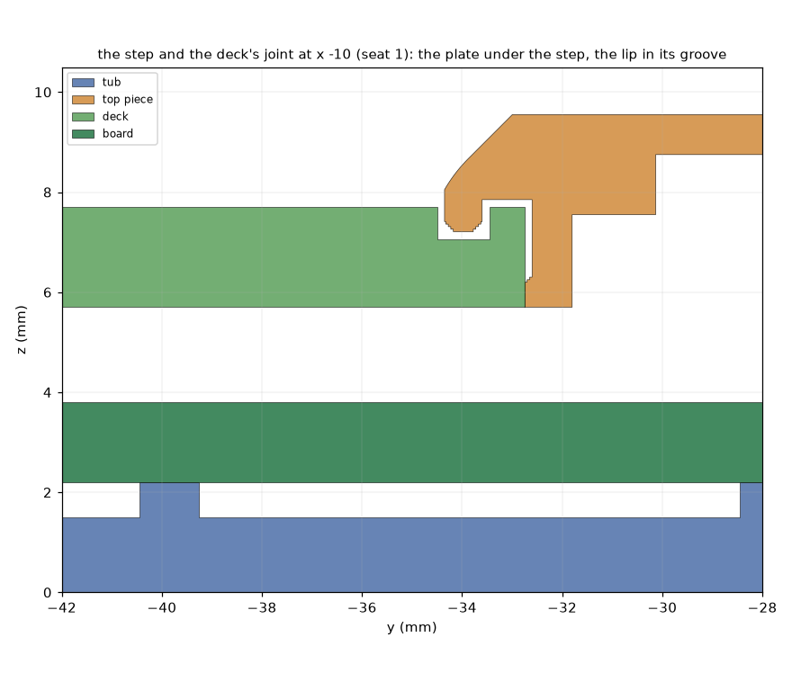
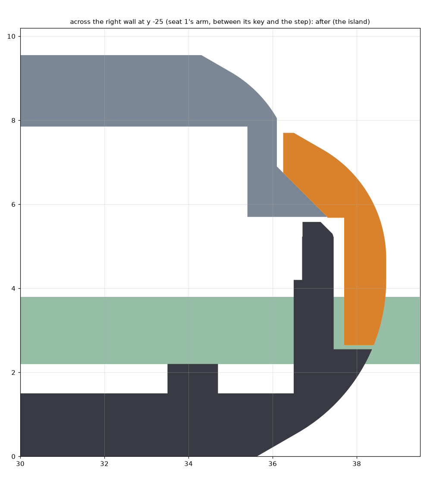
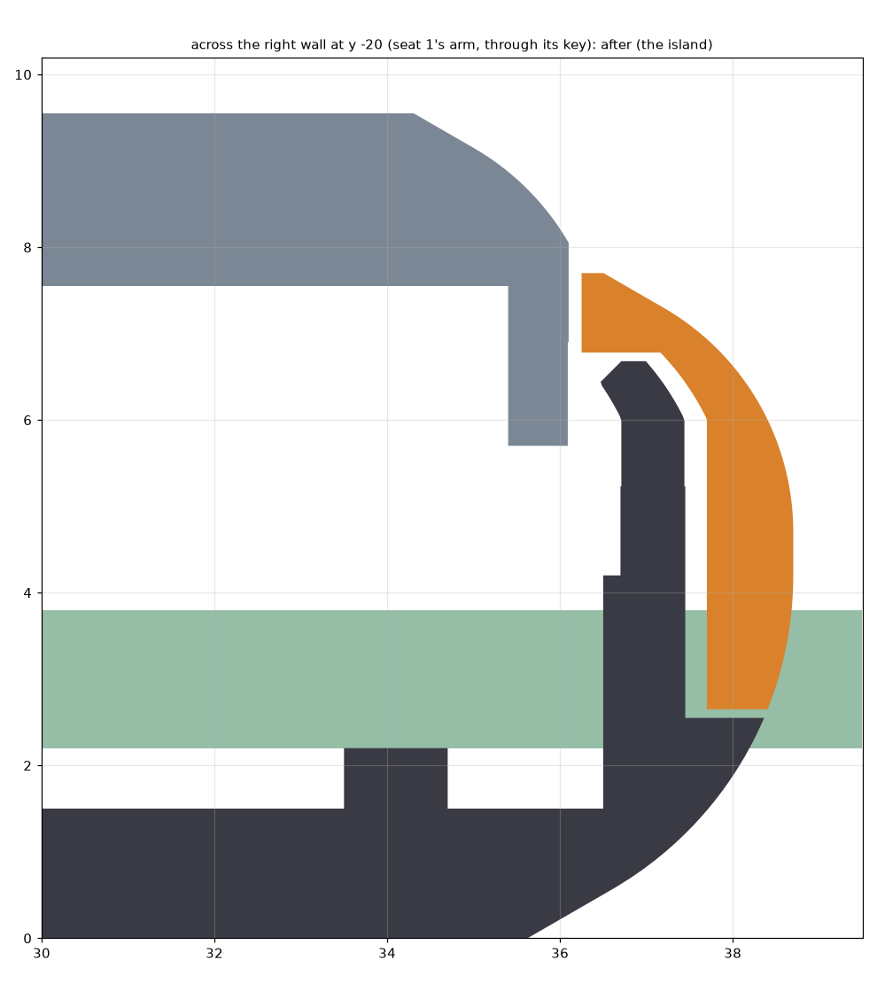

**How each part is held** (Alex asked for this explicitly):
- **The island:** across and along the case by the window the decks form round it (0.15 at its foot,
  nothing at the 45 degree faces) and its spines in the cores' notches; out of the front by its wedge
  under the decks' lips, all round; into the case by its bosses on the board and the panel; H1, H2, H3
  and H4 screw into it (their bosses inside its foot: H4's edge 0.6 in, its pilot 2.3 from the island's
  outside; 1.7 of boss round each pilot). Its ear's skirt sits over the USB-C notch with the tub's tab in
  it (along the wall), and the ear's laps hold the right arms' skirts flush. The speaker stays in its
  pocket in the island.
- **Each deck's core:** the tongue inside its skirt round the end and the corners (4.05 of overlap),
  the corner posts (across with 0.25; along the case, pushing it onto the island's wedge), two grip ribs a
  side; out of the front by those ribs and its end screw; it rests on the board by its boss.
- **Each arm:** it is one part with its core. Inward by the tub's tongue inside its skirt (2.93 of overlap)
  and the island's foot (0.15 off its lip); along the case by its core and its key; out of the front by its
  two grip ribs, its key's pocket and its ear's lap.
  No screw lands in an arm: H1 and H2 (and H4) are inside the island's foot with plenty of plastic, so they
  stay in the island, and every arm got its key and a second grip rib near its free end instead. Outward
  (away from the case) its **hook** holds it (since 2026-10-24): its head bears on the tongue's inside
  after 0.15 (until then only its core's stiffness and the grip ribs' friction did).
- **Without screws:** the tub's grip ribs hold the decks and the island's ears on it; the posts push the
  decks onto the island's wedge; the decks' lips hold the island in; the laps, the keys and the hooks hold
  the arms.
  The screws only lock it.

**Assembly** (built face down; every part goes in straight down, nothing at an angle):
1. **Two build bars** (`build_bar.stl`, print two: 71.0 x 2.0 x 1.85) on the bench about 126 apart.
   Face down the decks go in first and the island drops into them from behind, so the decks' faces
   must stand 1.85 (the step) off the bench: the bars carry each deck under its end's flat face (outside
   every opening, asserted), the island's face rests on the bench, the caps (1.41 proud) stand 0.44
   clear of it. (Until now the top piece was the base and held the decks up.)
2. **The two decks** (the same part) face down on the bars, end to end, the arms' ends 21.4 apart on
   each wall (the ears go there). **Caps** into the decks from behind, **silicone** on them.
3. **The speaker** face down into the island's pocket, its foam ring stuck to the pocket's ceiling.
4. **The island** face down into the decks' window from behind, straight down: the ears' laps go down
   behind the arms' skirts, its wedge settles onto the decks' lips, its face onto the bench.
5. **Panel** glass down into its pocket on its tape.
6. **The cell** into the tub's floor pocket; **board on edge**: FPC into J3, the cell's plug into J2.
7. **Board** face down; just before it lands, the **speaker's plug into J4** (unchanged: the speaker is
   in the island, its leads reach J4 only with the board nearly in place), the leads round H3's boss.
8. **Tub** over it all, straight down: the tongue into every skirt (and behind the arms' hooks, their
   necks down its slots), the keys into the arms' pockets, the USB-C tab into the ear's notch, the posts push each deck onto the island's wedge, the grip ribs take
   hold. Lift it off the bars.
9. **Six M2 x 6** from the back.

Opening it is the same backwards; unplug J4 before the board comes away (the speaker stays in the
island), and the island then lifts out of the decks from behind. The order can't be the other way round
(the island face down first and the decks onto it): the decks' lips are on the island's far side, face
down, so they can't pass its wedge.

**Thinnest plastic** (each asserted in `case.scad`): the island's skin over its inside 0.70 (0.72 to its
profile), over the speaker's pocket 1.35; the ear's side over its inside 1.59; the decks' lip's straight
part 0.95, an arm's plate over the island's wedge 0.95, over its groove 0.77, over a key's pocket 0.92;
the skirts' tips 0.70; a lap 0.85 (its tip 1.09 tall); a hook's head 0.55 (its end taper to the neck's 1.6).
The outside skin along every wall is 0.7 or more.

**Printing** (60 degree rule, `overhangs.py` and the P1S slices): every downward face of the four parts
in their print poses is 60.0 degrees from vertical or steeper (the island 350 mm2 of it between 45 and
60, a deck 210, the tub 634, as of 2026-10-23; the hooks' tops add faces at exactly 60); no part needs
supports (they stay under the board mock and the USB-C board coupon only). No two printed parts overlap
(0.000 mm3 for every pair, 2026-10-24; they touch only at the posts and the 45 degree faces). Each deck is
3.98 cm3. P1S (2026-10-24): `1_case` 55.3 g, 1 h 44 min; `1_case_decks` (the deck twice and the bars)
10.1 g, 26 min; `5_unit` 65.3 g, 2 h 09 min, still one plate (its decks and cell dummy turned a quarter
round to pack: `TURN` in `print_package.py`).

**Gone** (dead code removed): the side blend (`side_run`, `side_drop`, `blend_overhang`, `side_fill`,
the swept side), the lip, its groove, the decks' plate under the step, the top piece's hollow over it and
the end wall's foot (`deck_ext`, `lip_*`, `foot_h`, `joint_side`), the top piece's sides and their keys'
pockets, its 7.2 tongue; since 2026-10-24 the left arms' meeting (`arm_meet_y`, `arm_lap`, its slot, the
laps' lie-back field) and the second deck model. The fit kit's coupons that cut the skirts (`seam_top`
became `seam_deck`; new `usb_arms`; `meet_*` became `lear_*`, the left ear and the arms' ends either side,
2026-10-24; `seam_*` now carry seat 2's left hook and its slot). Found on the way: `fitkit.scad` has its own `groove()` (an engraving helper),
which silently replaced `case.scad`'s skirt groove in every fit-kit render, so the kit's skirt coupons
had no groove for the tongue; the case's is `skirt_groove()` now.

## This branch is the 60 degree variant (2026-10-23)

Alex: "Can you make a variant with improved curves on the tub sides, the ridges and so forth?
Assuming that the max angle that the printer can print is 60 degrees instead of 45." So on
`ref-design-cellcut-60` (from `ref-design-cellcut` at ce9bf8e, the lip under the step) `overhang` is
**60 degrees from vertical** (30 from the bed). It is a variant: it holds only if the overhang test
plates (`overhang_kit.zip`, the same kit as the main line's) show **both the P1S and the U1 print a
60 degree face clean, and a convex round down to 60**, at the layer height the case is printed at
(0.20 mm). Until then the main line stays at 45. The rest of this file describes the 45 degree case
except where this section says otherwise; its images are the 45 degree parts.

What changed (every number from `case.scad`; sections and outside views of both, side by side, are
in the session's scratch folder, not in `images/`):

| Shape | At 45 (ce9bf8e) | At 60 (this branch) |
|---|---|---|
| The tub's back round (`back_r`) | r 4.2 to 45 degrees, then a 45 chamfer 1.23 tall to the bed (2.46 in from the outline at the bed) | the same r 4.2 carried on to 60, then a 60 chamfer only **0.56** tall (0.97 run; 3.07 in at the bed) |
| The top piece's and the decks' face rounds (`face_r`) | r 3.0 to 45, then a 45 chamfer 0.88 x 0.88 to the face, its top edge 1.757 in | **r 2.4** to 60, then a 60 chamfer 0.32 tall (0.56 run), its top edge 1.757 in, where it was |
| The step to each deck (`step_r`) | r 3.0 to 45 and a 0.88 chamfer: a 1.36 run | the same r 3.0 to 60 and a **0.40** chamfer: a **1.79** run (its top edge 0.44 nearer the screen; the foot, the lip and the joint where they were) |
| The spines | 10.8 across the top | 9.9 (the same step on their sides and ends) |
| The side blend's band (`blend_overhang`) | 45, the round's own top chamfer carried up | **45** still, above the round's 60 facet (a 15 degree crease between them along the blend) |
| The joint's hollow and the decks' plate under the step at each side wall (`joint_side`) | out to the wall's inside, the top piece's skin over the hollow's corner **0.07** | stop 1.0 inside it; the skin is 0.75 |

**Since the island (2026-10-23):** the side's blend, its 45 degree band and the joint's hollow (the
table's last two rows) are gone, so `face_r` is **3.0** again, carried on to 60 (top edge 2.20 in); the
step's profile (`step_r` 3.0 to 60, a 1.79 run) is now the island's edge all round. The rest of this
section is as the variant left it.

**Why the face rounds got a smaller radius.** Carried on to 60, a 3.0 round ends 2.20 in from the
outline, past the wall's inside (2.0). Along the side's blend the round comes down to the deck's
height over the top piece's hollow, and there its top would leave the skin over the underside's
edge 0.40, over J4's pocket 0.51, and break through over the joint's hollow. A 2.4 round carried to
60 ends 1.757 in, exactly where the 3.0 at 45 ended, so nothing inside moves: it is rounder (its
chamfer is 0.32 tall where it was 0.88, and meets the face at 30 degrees instead of 45) but starts
0.6 lower down the wall. The tongue under the decks leans in less with it (its groove's top 1.23 in
from the outline, was 1.46), which only adds room.

**What couldn't use the extra 15 degrees, and why:**
- **The side blend's band** stays 45: it is the skin over the top piece's hollow, J4's pocket and
  the screws' bosses where the blend brings the round down, and a band at 60 is flatter, so
  thinner: 0.63 over the underside's edge with the 2.4 round, 0.41 with a 3.0 one (0.7 asserted).
  Only a round of 2.0 or less would let the band go to 60.
- **The step can't become an S.** Face down the step's foot is at the top of the print; a cove at
  the deck's edge would end in a feather edge of the top piece on the deck, and the lip's root needs
  0.7 of skin over the hollow (it has 0.74). The step's profile has to steepen all the way down to
  its vertical foot, so the most a higher limit buys is what it has: the arc further up and a short
  chamfer. Moving the joint out towards the decks only moves the same profile; a bigger `step_r`
  (4.0: 2.05 run) gives a straighter slope and a sharper crease at the foot, not a smoother step.
- **The tub's round can't get a bigger radius:** the skirts' tips at the seam (2.55) are 0.70 at
  r 4.2 (`skirt_t`), and a bigger round thins them.
- **The cap, D-pad and Start/Select chamfers** (0.6, 0.8, 0.6 at 45) are the DS Lite faceplate's,
  not the printer's limit, and stay.

**The 45s kept (hidden, functional):** the lead-ins on the tongue's tip, the tabs, the corner posts,
the grip ribs and the crush ribs (the tub prints back down: they are upward faces anyway); the lip's
tip and the end wall's foot (lead-ins); the lap's top (face down a 45 underside on a hidden 0.85
tongue: steeper prints cleaner, and its height isn't what limits it). And the overhang kit's
first-layer coupon is the 45 tub's edge (`fl_overhang`), so the kit is the same on both lines.

**Found on the way, fixed here (also wrong at 45):** at each side wall the top piece's band came
within 0.07 of the joint's hollow over the deck's plate (it ran out to the wall's inside where the
blend had brought the outside down to the deck's height). The hollow, the plate and its groove now
stop 1.0 inside the wall (the plate's end 0.15 off the top piece's solid band there, which also
locates the deck across), asserted along the hollow. `overhangs.py` also had cos where it meant sin
(the same number at 45 only).

**Checks:** every downward face of the three parts in their print poses is 60.000 degrees or steeper
(tub 634 mm2 of it between 45 and 60, top piece 307, a deck 108; none flatter); `overhangs.py`,
which now reads `overhang` from `case.scad`: no supports; the P1S slices: supports only under the
board mock and the USB-C board coupon (their threshold follows the rule: 30 from the bed).
`positions.json` the same, `check_fit` PASS, `check_buttons` its 11 known failures with the same
volumes, every part manifold. Asserted: the skin over the blend's underside 0.71, over J4's pocket
0.78, over the joint's hollow at the walls 0.75, the step's skin at the lip 0.74, the skirts' tips
0.70, the laps 0.85, and a new one: the tub's counterbores keep 0.5 to the bottom chamfer at the
first layer (H4's by the left wall has 0.60, was 1.14 at 45).

P1S (0.20 mm): `1_case` 55.6 g, 1 h 44 min (was 55.6 g, 1 h 41); `1_case_decks` 9.8 g, 24 min (9.7 g,
24); `5_unit` 65.2 g, 2 h 08 (65.1 g, 2 h 05).

**What it depends on:** the overhang kit. If either printer's 60 degree fin or the R3 round below
its 60 degree tick comes out rough, this variant doesn't print clean there (the rounds' last facets,
the step's chamfer and the tub's edge are at exactly 60); go back to the main line, or set
`overhang` to the angle that did print: every round here follows it (`face_r` can then grow as far as
its top edge stays 1.757 in: 2.58 at 55, 3.0 at 45; the asserts check it).

## In one paragraph

Four printed parts (since 2026-10-23: "The island", first): the **island** (the raised screen block,
its spines and an ear on each side wall, over the USB-C on the right), two **decks** (one part, printed
twice: each its core with the buttons and an arm along each side wall), and the **tub** (the back, with a pocket for the
cell). The decks make the case's face and its sides at their own height, end to end, and meet the tub
flush at one seam, 2.55 mm up the walls, low on the back's round: their skirts follow the round down to
it and slide over the tub's **tongue** (4.05 round the cores, 2.93 along the sides), which keys them: a
tab into each arm, a post in each corner that pushes a deck onto the island, and grip ribs, so the four
parts hold together before the screws go in. The island sits in the window the decks form, 2.6 in from
the sides, its edge a 45 degree wedge under a lip on the decks' edges; every arm ends at an ear, whose
lap goes behind its skirt, and carries a hook through a slot in the tongue. The board, with the cell in a hole in it, lies inside the
tub's walls. Everything is built **upside down**: the decks face down on two build bars, caps and
silicone into them, the speaker into the island's pocket, the island into the decks from behind, the
panel, the board face down (the speaker's plug into J4 first), the tub over it, six screws from the back
(four into the island, one into each deck). Every part prints without supports in its own pose: the
tub back down, the island and the decks face down.

| | cb51826 | 2026-10-21 | Now (2026-10-22) |
|---|---|---|---|
| Outside | 75.4 x 156.2 mm | 75.4 x 132.7 mm | **77.4 x 132.7 mm** (a DS Lite is 73.9 x 133.0) |
| Thickness | 13.4 at the screen, 11.5 at the decks | 13.35, 11.5 | **9.55 at the screen, 7.7 at the decks** |
| Board | 70.4 x 151.24 | 70.4 x 127.7 | 72.4 x 127.7 (r 5.5), a 54 x 37 hole for the cell |
| Cell | under the board | under the board | in the board's hole, its bottom in a 0.6 pocket in the tub's floor |
| Speaker | floor grille | floor chamber, side outlet | on the board's top in the right bezel, a grille in the face |
| Parts | tub, lid, two deck inserts | tub, top piece, two decks | the same (since 2026-10-23: tub, island, two C-shaped decks) |
| Held by | six screws, four snap hooks | six M2 x 8: four into the top piece, one into each deck | six M2 x 6, the same way (the side ones into the top piece beside the glass, since the side screws came back inward); before the screws, the tongue's keys and grip ribs |
| Crush ribs | on the lid | on the top piece's and the decks' walls | on the tub's walls (the board is inside them) |

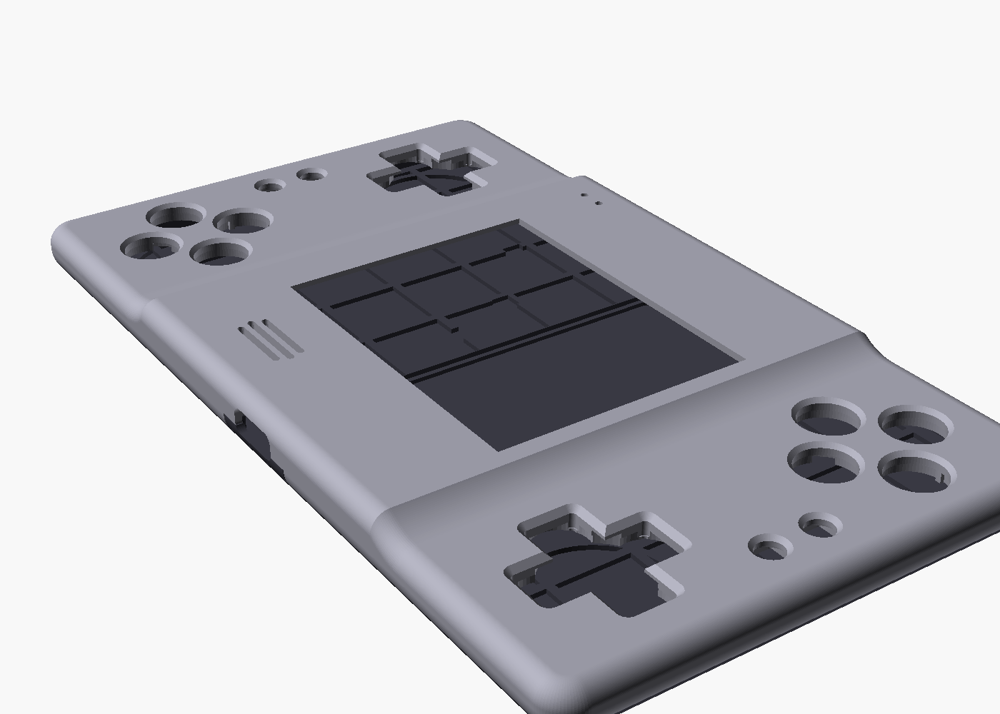

(The images are rendered from the parts of this commit; see "Images" at the end.)

The side view has no board in it, so the USB-C opening shows the far wall's inside and reads as
a recess; it is a through-opening (checked 2026-10-22): J1's mouth (8.94 x 3.20, its face 0.19 under
the surface) sits centred in it, 0.25 clear in y and 0.29 / 0.25 in z, and a mated plug's overmold
(the shortest the USB-IF allows) stands 0.16 off the wall. case.scad asserts the opening against
the port and the plug, and check_fit.py checks it against J1's 3D model.

## The board with the cell in it (2026-10-22)

`CELLCUT_FOR_CASE.md` (final) has the board's side. What the case does with it:

- **2 mm wider.** The board is 72.4 (x +-36.2), so `case_w` is 77.4, 1 mm more on each side. The
  clusters, Start/Select and the debug pinholes stay where they were (`edge_margin_x` 5 is the
  case's side to a silicone piece, `edge_margin` 4 still its end), so `positions.json`'s buttons
  don't move. The USB-C opening, the receptacle's face (x 38.55) and the board's tab and its slot
  go 1 mm out with the right wall, with the stepped tab seams and the `usb_gap` opening as before.
- **The stack.** The worst-case cell (4.5) stands at most `cell_top` 1.6 over the board, so its
  bottom is 2.9 under the top copper, 1.3 under the board's back. The tub's floor is pocketed
  `cell_pocket` 0.6 under it (0.9 of floor left there), so the board rests on 0.7 ribs
  (`board_lift`): floor 1.5 + 0.7 + board 1.6 + 5.75 = **9.55 at the screen**, 7.7 at the decks
  (the notes' figure for the pocketed floor; 10.15 with a flat one).
- **The cell's pocket** is the hole's outline 0.25 inside (r 0.75 corners). The cell lies against
  its right wall (x 25.05), so TH1, at the hole's right edge, reads it across about 1 mm.
- **Floor ribs under the strips.** The ring of ribs under the board's edge and the 12 mm grid stay,
  clear of the hole by 0.5; new ribs run along each strip (the left one at x -31.2 under SW18, SW19
  and J5/J6, the right one at x 29.6 under the power latch) and across the right one at y 14 (by
  TH1). They keep off the four Start/Select domes' vents, J1's legs and the test pads on the back
  (`rib_free`, which check_fit reads).
- **The board is inside the tub's walls.** Its top (3.8) was under the seam (4.2), so the top pieces'
  skirts no longer reached it (since the seam came down to 2.55 they run down beside its edge, outside
  the tongue: "The seam on the round"): the **crush ribs moved to the tub's walls** (sides at y +-28, ends at
  x +-22), their lead-in at the top, where the board meets them as the tub goes on. The tub's
  cavity follows the back's round only 0.2 in (`tub_round_in`), so the board's edge keeps 0.3 to
  it. The skirts' cut over the tongue is only the wall's inner half (and, where the tongue leans
  in under the decks, a groove in the plates): a cut across the whole inside took 0.1 off the decks'
  plates and left the pads' walls hanging.
- **The side screws** are the board's, inside the top piece (Alex, 2026-10-22: no shoulders): H1
  and H2 at (+-32.5, 29), at the seat-2 ends of the strips beside the cell's hole; H3 at (25.9,
  -21.95) in the right bezel, between the speaker and J4's plug; H4 at (-33.0, -15.2) in the left
  bezel, between J2 and the LDO. The top piece's 5.0 bosses run from the board to the ceiling (the
  pilot stops 0.8 under the screen face). Each keeps 0.3 or more from the panel's frame (H3: 0.54),
  1.2 from the side wall's inside, 0.72 from the step's top edge and 0.3 from the joint's band where
  the decks' wedges start (H1, H2: y 31.5 against 31.8), and H3 0.52 from the speaker's pocket, 0.36
  from J4 and 0.30 from its mated plug (asserts). The **tub's bosses** under the board are only
  `board_lift` (0.7) tall; 6.0 wide at H1, H3 and the ends, **5.0 at H2 and H4** (`tub_boss_d`): a
  6.0 boss would come within 0.8 of the cell's hole at H2 and 0.2 of the board's edge at H4. The 5.0
  ones leave 1.3 to the hole at H2 and 0.7 inside the board's edge at H4, and 1.3 of plastic round
  the screw's 2.4 clearance hole (the head's 4.4 counterbore is in the floor under them, 1.0 from the
  tub's bottom chamfer at H4). The shoulders, the decks' notches and their checks went.
- **Shorter screws:** M2 x 6. An 8 would run 0.9 past the decks' pilots now; a 6's tip stops 0.1
  short of the decks' (which end 0.6 under the face) and 1.75 short of the top piece's.
- **The speaker** lies on the board's top in the right bezel (centre 28.7, -11.4 since the side
  screws came back inward, its seat-2 end 0.1 short of the cell's hole; 10 x 15 x 3.5, 3.8 worst
  case). The top piece's underside has a 0.5 pocket over it, its outline plus 0.5 (the
  board's keep-out), so 0.45 over a worst-case speaker; the face over it is 1.5. The **grille** is
  three 1.0 slots along the racetrack, 1.8 apart, inside the outline less 1.5 (over the cone):
  12, 10.8 and 10.8 long, about 33 mm2 open. The rim round them is solid, for the front foam ring
  to seal on. Face down they are plain holes in the plate on the bed: nothing to bridge
  (`overhangs.py`: no supports). The bezel next to the screen bay keeps its full 2.0 from the panel
  frame (x 22.86) to the pocket (x 23.2), 1.5 from there to the grille (x 26.4); the grille's slots run
  y -5.4 to -17.4. A 0.3 pocket over J4 (31.9, -27.0) and its mated plug, each grown 0.25, gives
  the plug room; it goes round H3's boss and stops at the joint's band. The floor chamber, the
  side outlet and the pad went.
- **The speaker's leads** (35 mm, to a 1.25 mm plug) run on the board from the speaker to the back
  of J4's mated plug (x 24.75, its mouth faces the glass), round H3's boss, which stands between
  them. With the leads leaving the speaker's seat-1 end (turn it so they do), the shortest path that
  keeps a 0.8 lead off the boss, the speaker and J4 is 14.0 mm (1.5 straight out of the plug, then
  up the 0.65 gap between H3's boss and U7's end, partly over U7's end under the panel frame, 1.0 of
  room there, and over the boss's top, 1.4 below the speaker). If they can't ride over U7, round U7
  under the panel it is 27.4. Plugging in takes about 10 more (the plug's 4.0 travel out of the
  mouth, and a few mm to hold it): 24 or 37 mm against 35. Leads leaving a long side need 17.1
  (left) to 25.0 (right), the far end 28.1, each over U7's end. So J4 is plugged with the board just
  off its place: with the leads in, J4 can be at most about 20 mm from where it lands.
- **J2** (the cell's plug, 3.4) at the hole's seat-1 corner and its mated plug (3.2, over the left
  strip) sit under the left bezel's 3.75; **J5/J6** (2.9) face the left edge. Their plugs go in
  with the tub off; no slot in the wall (debug is case-open, and a slot weakens the wall and lets
  light in).
- **Start/Select (row 4)** close on 4.0 mm metal snap domes (0.31 high at worst with the Kapton
  dot): `ss_metal_dome`, `ss_plunger_gap` and two asserts: the dome fits the pad's well (4.6 >=
  4.3), and the pad's plunger rests 0.05 over the dome's apex. The plunger's rest height in a real
  strip is unmeasured; 0.36 (the least that clears) is assumed, so `ss_lift` stays 0.35. If a strip
  measures g < 0.36, raise `ss_lift` by 0.36 - g: at most 0.15 with today's lip, up to 0.45 with a
  0.3 Start/Select chamfer. The model's pads now show each metal dome and the plunger over it.
- **The spines** keep their length; seat 1's covers U6 (1.75, over the decks' 1.6) and seat 2's only
  U9 (1.2), so they could be shorter (not done: the decks and positions.json stay as they are).

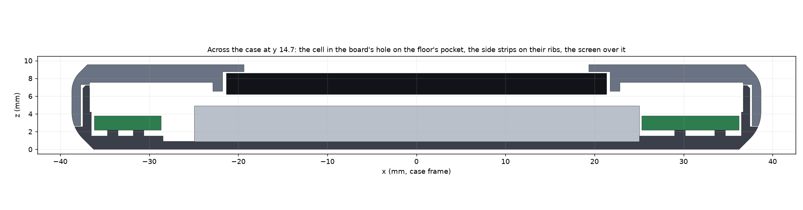
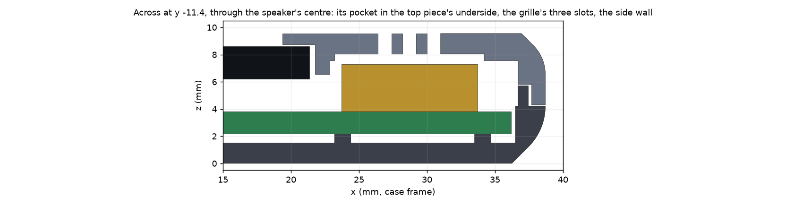
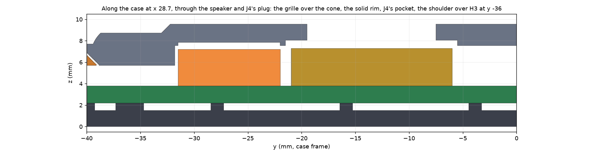
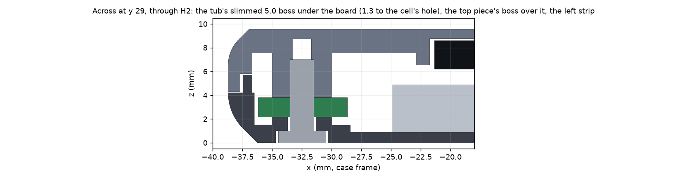
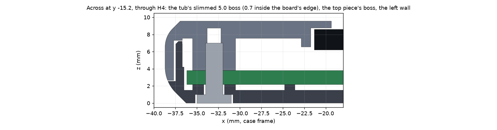
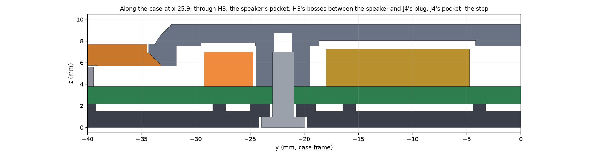

## The joints (2026-10-22, after Alex printed the shell)

Alex, on the print of 110d46b: "the top pieces need to flow better and interlock. Right now it
feels like the pieces are designed to fit on the tub but not mesh with each other. Also it would
be good if the pieces went farther over the side. Like the tub has a tall inner wall that the top
piece slides farther down for some more stability. Maybe add some tabs on the tub wall to fit into
the top pieces?" And: "The last version was pretty sturdy and only needed the screws to lock
together, this version needs the screws to fit together at all which is bad". So the test is: with
no screws, the four parts go together and hold as one, nothing rocking or falling apart when
handled gently; the screws only lock it.

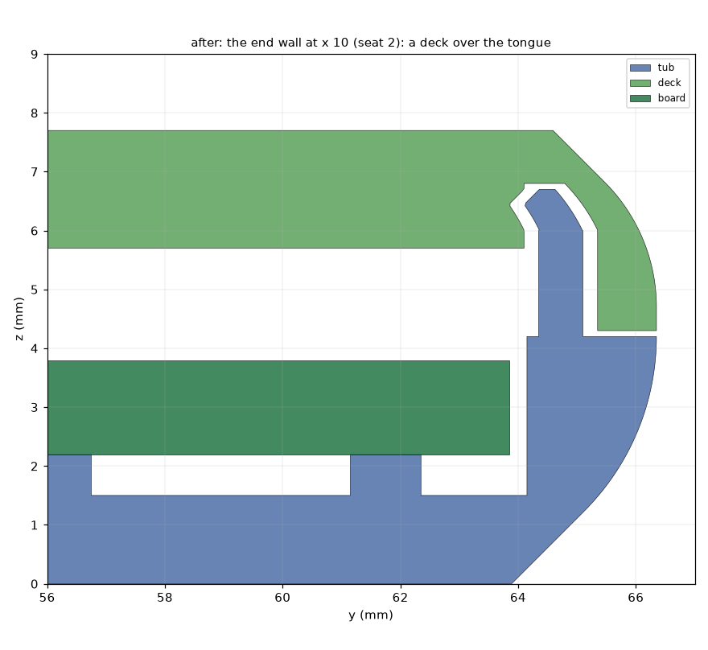
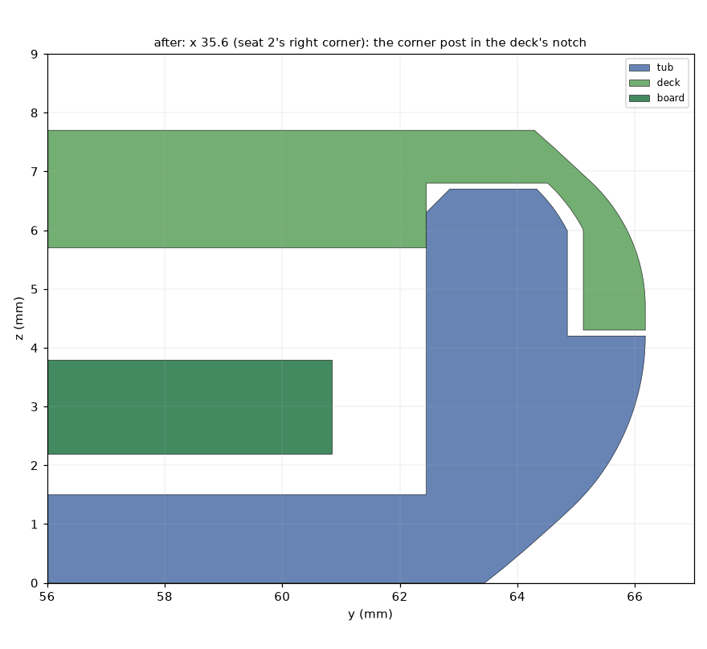
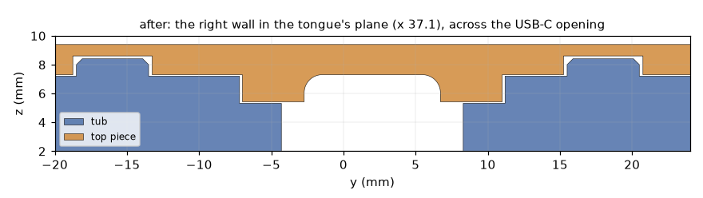

**What got looser.** The kit Alex printed before was 4df3f96's (f3763df, which raised `slide_fit`
from 0.15 to 0.25, went in the same minute, so any kit of that shell had 0.25). Between it and
110d46b:

| | 4df3f96 (held) | 110d46b (needed the screws) |
|---|---|---|
| `slide_fit` (`deck_gap`, `seam_fit`) | 0.25 | 0.25 |
| the decks' wedges under the top piece | 0.95 | 0.95 |
| the tongue | 1.5 tall, 0.75 thick | the same |
| `seam_gap` | 0.1 | 0.1 |
| the board | z 6.0 to 7.6, inside the skirts, over the tongue | z 2.2 to 3.8, inside the tub's walls, under the seam (4.2) |
| crush ribs (0.05 short of the board) | on the top piece's sides (y +-28) and each deck's end (x +-22), z 5.8 to 8.6 | on the tub's walls |
| the skirts' height | top piece 9.05, decks 7.2 | 5.25 and 3.4 |
| shoulders, the decks' notches | none (99e3f04 added them, c955631 took them out) | none |

Only the board and its crush ribs changed. In 4df3f96 the board, laid face down, pressed into ribs
on the top piece's sides and on both decks' ends: it tied the three top parts into one, and each
deck's end hugged the board's end inside its 7.2 mm skirt. The tub sat on loosely in both (a 1.5
tongue at 0.25 a side, nothing gripping). With the cell in the board, the board went under the
seam and its ribs onto the tub, and nothing tied a deck to the top piece or either to the tub. The
fits and the wedges were never what held it, so they aren't what's restored: the tongue now does
the board's old job (below).

**What made the parts read as separate (110d46b, rendered and cut):**
1. Butt joints with a slot: at each side wall the deck's skirt ended 0.25 from the top piece's, a
   straight slot through the skirt from the seam over the round to the face, and the same 0.25 slot
   ran along the step's crease. By design nothing touched.
2. Nothing held a deck along the case. The 45 degree wedges at the step and round the spine's end
   both face the same way: they stop a deck coming out of the face, and push it back along the case
   when it's pushed towards the face. Face down, a deck settled back down its wedges; face up,
   screws out, it floated 0.25 each way and 0.35 up and down, so the surfaces stepped and the gaps
   ran 0 to 0.5 at the joints.
3. The skirts sat on the tub, not over it: 1.4 of overlap on a 1.5 tongue, 0.25 a side, so the top
   piece could tilt on it, and nothing gripped, so it lifted straight off.
4. A straight path past the joints: through the side slot into the groove's clearance, and over
   the tongue's top (0.1 under the decks' plates) into the case.
5. Not a problem: the rounds and skirt heights match across the joints (both skirts end at 4.3;
   at the side joints both round over from the decks' 7.7 face through `face_r`). The top piece's
   side follows the step down over the last 2.1 before the joint, which reads as a soft crease
   beside the seam; it is continuous, and stays.

**What changed, for each:**
- **The tongue is 3.0 tall** along the top piece's sides (`tongue_h`, its top 7.2, 0.35 under the
  top piece's underside): the top piece's skirt runs 2.9 down over it (was 1.4). Under the decks and
  across the step's band (|y| over 31.8, where the band starts) it is **2.5** (`deck_tongue_h`, top
  6.7): the decks' skirts run 2.4 down over it. It runs on unbroken under the side joints, so one
  wall locates both neighbours (the step from 3.0 to 2.5 is under the top piece's band, 2.6 from the
  joint, and the grooves overlap it 0.35 each way). (Since "The side joint" the decks' height starts
  at |y| 24.0, under the top piece's side blend, and the tongue stops either side of each deck's lap.) What limits it under the decks is their face's
  round: 0.9 under the 7.7 face (the groove's top) it has come 0.86 in, so the groove leans in after it
  (the skirt never under `skirt_t` 0.7) and the tongue leans in with it, to 2.25 from the outline:
  0.25 outside the board's edge, which it passes as the tub goes on (its tip is chamfered from the
  wall's inside, so it leads the board in), and the deck's plate keeps 0.9 over the groove. A 3.0
  tongue there would leave 0.4 of plate and come within 0.05 of the board's edge. **The seam stayed at 4.2** in this pass (it came down
  the same day: "The seam on the round"),
  where the back's round ends: a lower seam would put the skirts' edges on the round (a feather edge
  in the face-down print, a seam on a curve), and it's the tongue's top, not the seam, that limits
  the overlap. The skirts still stop `seam_gap` 0.1 over the tub and the grooves 0.1 over the
  tongue's top, so the screws clamp the board, not the seam; a deck's plate bears on nothing.
- **Tabs into the top piece** (`keys`): four, at y 18 and -16 on the right wall and 22 and -24 on
  the left (20 and -20 since "The side joint": they sit under the full screen face) (two a side; clear of the USB-C notch, the side screws' bosses, the speaker's and J4's
  pockets and the pinholes, asserted). Each carries the tongue 1.3 higher (to 8.5), 5.0 along the
  wall, its tip leaning in under the face's round and chamfered (0.33 at the very top), its corners
  0.5 x 45 degrees as lead-ins. They sit in pockets in the top piece's sides, `seam_fit` 0.25 along
  the wall, with 0.95 of face over each. They locate the top piece along the case and stop it
  twisting; the two tongues locate it across.
- **The USB-C notch keys too:** over the tub's tab the top piece's skirt keeps its inner half from
  the opening's centre up (18.0 wide), and the tongue stops `usb_fit` 0.2 short of it on each side,
  so the opening's upper half is still all in the top piece.
- **A post in each corner for the decks:** the board's corners (r 5.5) leave 2 mm inside the tub's
  corners (r 2.3 inside), the only place on the tongue with room inwards. Each post stands from the
  floor to the tongue's top, its inner corner at (+-34.80, +-62.45), 0.3 outside the board's corner,
  about 2.6 x 2.6, its inner faces chamfered 0.4 at the top. It sits in a notch in the deck's plate:
  across the case with `seam_fit`, along it with none, so as the tub goes on it pushes the deck
  towards the screen onto its wedges and holds it there (since 2026-10-23 onto the end wall's foot
  under the step: "The lip under the step"). One part still fits both ends.
- **The decks sit on their wedges** (until 2026-10-23; now on the end wall's foot): no clearance on the wedges along the step and round the
  spine's end (the posts hold the deck on them, at its place over the board's buttons), `deck_gap`
  0.15 on the straight faces (the land, the skirts' ends at the side walls, the spine's sides; was
  0.25). The seams across the face and down the sides are an even 0.15. (Pushing the deck past its
  place to close them moved the openings 0.15 off the buttons: "Alternatives considered".)
- **Grip ribs** on the tongue's outside (`grips`): 1.0 wide, standing 0.2 off it, 0.05 short of
  the skirt, as the board's crush ribs are of the board (a skirt's inside prints small, so it grips
  them), from the seam to 0.1 short of where the tongue's outside starts to lean or chamfer (6.8
  along the top piece, 5.9 at the decks), each with a 45 degree lead-in. Two a side for the top piece (y +-25), one a side for each
  deck (y +-52), and one 2.0 wide across each side joint (y +-34.35): it presses both skirts' ends
  out to the same line, so the two lie flush. They hold the tub on and centre each part across it.
  (Since "The side joint": the rib across each joint went, its job the lap's; the top piece's are at
  y +-26 on the decks' height of tongue, and each deck has two a side, at y +-40 and +-52.)

**How each joint holds, no screws:** the top piece is on the tub by its skirts over 2.9 of tongue
(across), four tabs and the USB-C notch (along, and against twisting) and four grip ribs (on). Each
deck is on the tub by its skirts over 2.4 of tongue and two grip ribs (across, on) and two corner
posts (across with 0.25, along by pushing it onto the top piece). Each deck is on the top piece by
its plate under the step and the top piece's lip in the groove in its face (since 2026-10-23, "The lip
under the step"; until then its wedges): it can't come out of the front, slide along the case or
across it, and the posts hold it on the end wall's foot; and by the lap at each side wall (the skirts flush; until "The side joint", a grip rib across the joint). The board is centred by the tub's crush ribs
and sits between the tub's ribs and bosses and the top pieces' bosses.

All of it prints without supports: the tub back down (the tabs, posts and ribs stand up; every lean
and chamfer 45 degrees or steeper), the top piece and the decks face down (the grooves, pockets and
notches open upwards). `overhangs.py`: none needed. No new test plate: `slide_fit` (on `6_tests`)
covers the tongue and the keys, and the seam coupons in `4_fit_coupons` now carry a tab (y 22) and
a grip rib (y 25).

## The seam on the round (2026-10-22)

Alex, after the joints: the top pieces' outer walls should come farther down the side, over most of
the back's round, to a much lower ledge on the tub, the tub keeping its tongue that the top pieces
slide over. Agreed: the seam from the round's end (4.2) down to about 2.5.

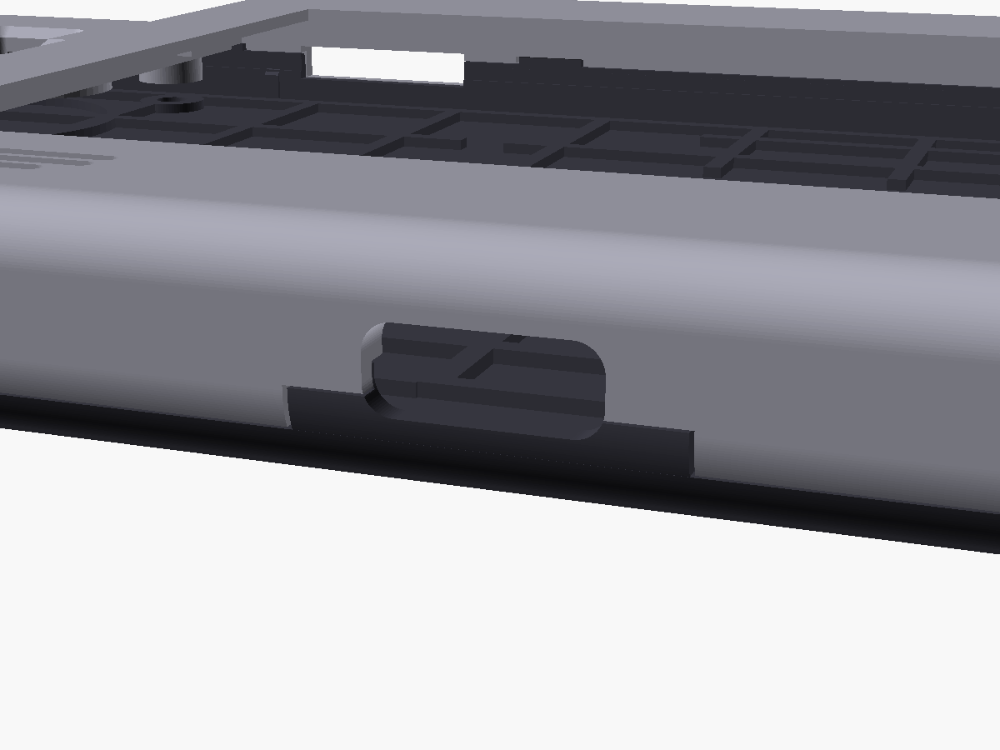

- **The height: `z_seam` 2.55**, one height all round. The skirts' outsides follow the back's round
  down to their tips at 2.65 (`seam_gap` 0.1 over the tub); their insides stay straight down the
  tongue (the groove where it was, `wall`/2 in), so they still slide straight on. What sets it is
  the skirts' tips: the round has come 0.30 in at 2.65, which leaves a tip 0.70 thick
  (`skirt_t`); at a 2.5 seam it would be 0.32 and the tips 0.68. Going lower means moving the
  tongue and its groove inwards (and the keys, the posts, the grip ribs and the decks' leaning groove
  with them) into the board's margin; 2.55 is within 0.05 of what was agreed, with nothing else
  moved. Asserted: the tips at the top piece and the decks, and the room beside the board's edge.
- **The margins, all round** (horizontal sections of the parts at 2.67 to 4.13, the side walls, the
  end walls, the corners, past the side screws' bosses, the crush ribs and the USB-C tab): at the
  skirts' tips the outside is 2.20 from the board's edge (38.40 against 36.2 at 2.65), of which the
  skirt takes 0.70, `seam_fit` 0.25 and the tongue 0.75, leaving 0.50; under the round's end the
  tongue reaches in to the tub's cavity wall below it (`tub_round_in`), so it is 0.95 thick there
  and 0.30 from the board, as the tub's wall was. The tightest places are the skirts' tips (0.70,
  everywhere round the case, the same at the ends and the corners since the plan's offsets keep their
  distance round a corner), the tongue to the board (0.30) and the grip ribs (0.05 to the skirts, by
  design). The board's corners (r 5.5) are farther from the case's (r 4.3) than its edges are.
- **The overlap:** the tongue keeps its tops (7.2 along the top piece's sides, 6.7 under the decks)
  and rises from the new seam: `tongue_h` 4.65, `deck_tongue_h` 4.15. The top piece's skirt runs
  **4.55** down over it (was 2.9), the decks' **4.05** (was 2.4).
- **The ledge** on the tub at the seam is a flat step 0.9 wide, from the outside (38.36) to the
  tongue's outer face (37.45), all round.
- **Keys, posts and grip ribs** stay where they were: the tabs into the top piece still reach 8.5
  and now rise from the lower seam with the tongue; the corner posts stand from the floor to 6.7 as
  before; the grip ribs now run from the seam (2.55) to the same tops (6.8 along the top piece, 5.9 at
  the decks), 4.25 long instead of 2.6, so they grip over more of the skirt (`grip_reach` is still
  a guess: see "Best guesses").
- **USB-C:** the brief for this pass expected the opening to sit wholly in the top piece's wall
  with the tub's tab gone. It can't: the receptacle's face is 0.15 under the surface, so its front
  stands 0.85 into the skirt, and the board goes onto the face-down top piece straight down. Any skirt
  under the receptacle's mouth would be in its way, unless the board went in 0.9 off to the left and
  slid across under the bosses, the speaker and the panel's frame. So the opening is split as before:
  its upper half in the top piece, its lower half in the tub's tab, which now rises from the new seam
  (2.55) to the port's centre (5.43; its outer half to 4.33), 18 wide, in a notch in the skirt, with
  the stepped seams that keep light out. Under the opening the tab is 1.0 tall. The band (the tongue)
  is cut behind it, as before, for the board's tab to pass as the tub goes on. The USB-C asserts are
  tied to the tab (it rises from the seam, at least 0.8 under the opening; and an assert that fails
  if the notch ever stops being needed). check_fit: J1's mouth 0.25 / 0.25 clear in y, 0.29 / 0.25 in
  z, a mated plug's overmold 0.16 off the wall, as before.
- **Printing:** the top piece and the decks print face down, so the skirts' inward-curving edge is
  at the top of the print and slopes inwards going up: an upward face, no supports (`overhangs.py`,
  and the P1S slices: supports only under the board mock, as before). The tub prints back down as
  before; the ledge is an upward face. The top piece is 6.9 tall now (was 5.75), each deck 5.05
  (was 3.9); both still fit their plates.

## The side joint (2026-10-22)

*Superseded by "The island" (2026-10-23): the top piece's sides, the blend and the deck's lap behind the
top piece's skirt went. The lap itself lives on, where the arms meet and at the ear's ends.*

Alex, on the outside where a deck meets the top piece on a side wall: "These parts should flow into
each other better." It was a butt joint, the two skirts 0.15 apart with nothing hooking them
together, and the top piece's step from the screen face (9.55) down to the deck (7.7) reached the
side wall in a 2.1 mm S right at the seam: a notch that read as two parts.

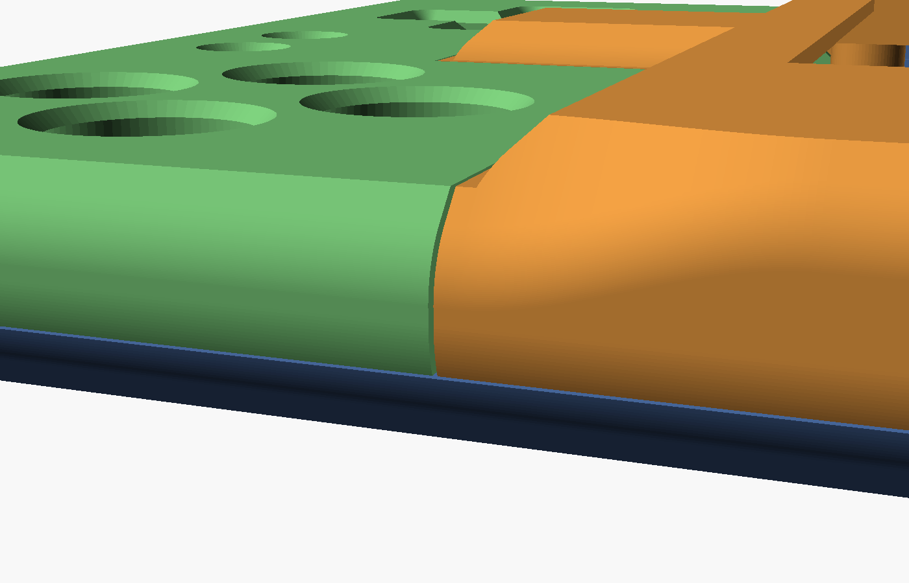

**The lap** (`lap`, on each deck at each side wall):
- **Shape and sizes.** The deck's skirt carries a tongue of its own, `lap_l` 3.0 along the wall
  behind the top piece's skirt end, in the skirts' groove (where the tub's tongue was), and
  `lap_root` 1.5 back along its own skirt, where it fills the groove so the lap is one with the skirt.
  Across the wall it runs from `deck_gap` 0.15 behind the top piece's skirt (1.15 in from the outline)
  to the tub tongue's inside (2.0, leaning in under the deck's round above 6.0 as the tongue does):
  **0.85 thick**. Both skirts keep their full thickness (1.0, 0.7 at their tips on the round): halving
  the skirt into a lap, 0.5 and less a side, was the reason a lap was rejected in "The joints"; behind
  the skirt there is room for a whole one. It stands from the skirts' bottom (2.65) to 6.675 at its
  root, under the groove's top (6.8). Face down its free end hangs off the deck, so its top (the
  print's underside) falls at 45 degrees from the root to 3.53 at the tip: full height (4.0) at the
  joint's line, 0.88 at the tip.
- **How it engages.** In the face-down build the deck drops into the top piece from behind, and the lap goes straight up the top piece's groove with it (the groove is open at the
  bottom). Clearances: 0.15 to the top piece's skirt (`deck_gap`), 0.25 to the groove's inner side
  (`seam_fit`, where the step's band is solid inside), 0.125 under the groove's top, free along the
  wall. A deck that lies back (0.15) only draws the lap's tip out a little.
- **What it holds.** The top piece's skirt can't move in (the lap is behind it) and the deck's can't
  move out past it (its lap is behind the top piece's), and the tub's tongue on either side keeps both
  from moving in: the two skirts lie flush, and there is no straight path through the joint (the
  0.15 line outside, the lap behind it).
- **The tub.** The tongue would fill the groove there, so it stops either side of each lap: a slot
  5.55 long (`lap_slot`: `seam_fit` off the lap's free end, and off its root `seam_fit` plus
  `post_lead`, the most a deck lies back before the corner posts push it home), from the seam up,
  through the tongue's thicker foot under the round's end; the ledge runs on under it. So the tongue
  no longer runs unbroken under the side joints: the lap locates the two skirts to each other, and
  each part is still on the tongue either side. **The grip rib** that stood across each joint (2.0
  wide, pressing both skirts out to one line) went: it stood in the slot, and its job is the lap's.
  Each deck has one more a side instead, at y +-40 (with +-52, two a side). Asserted: the lap's
  thickness and tip, the slot clear of the crush ribs (y +-28), the keys and the corner posts, the
  ribs clear of the slots.

**The blend at the side** (`side_run`, `side_drop`):
- The step across the face stays as it was (the arc and its chamfer, a 2.1 run with the land). On
  the side walls the top piece's side round now comes down from the screen face's height to the
  deck's over **9.4 mm** before the step's land, in a smooth S (no slope at either end; the round's
  top drops 1.85, at most 16 degrees from level along the wall, at mid-run). Over the land (the last
  0.6) and at the joint it is exactly the deck's round, with no slope along the wall either: **the
  outside is continuous across the joint**, no step and no kink, and the seam is the 0.15 line.
- Between the lowered round and the screen face, the round's own top chamfer (45 degrees) carries
  on up to the face: a band that widens towards the step, up to 1.85 tall where it meets the step's
  corner. Face down, every face of it slopes 45 degrees or steeper: the chamfer is 45 across the
  wall and the S adds its slope along it (the flattest face on the mesh is 45.0; `overhangs.py` and
  the P1S slices: no supports).
- What it took inside: the top piece's keys and the tongue's tall part (7.2) must stay under the full
  screen face (the keys' pockets keep 0.7 under the round), so the blend is as long as they allow. The
  tongue steps to the decks' height (6.7, leaning in under the deck's round) at y +-24.0 (was +-31.8,
  where the step's band starts), the left keys moved from 22 and -24 to +-20 (the right ones, 18 and
  -16, stay; all still clear of the bosses, the speaker, J4 and the pinholes), and the top piece's grip
  ribs from +-25 to +-26. Between y 24 and 31.8 the top piece's skirt runs 4.05 down over the tongue
  (4.55 before). Where the chamfer comes down furthest over the top piece's hollow (y 31.8, the band's
  edge), its underside comes down to the groove's top (6.8) from the wall's inside out to 0.4 in
  (`side_fill`, 0.1 outside the board's edge), which leaves the chamfer 0.71 over that corner (asserted
  0.7). Near the joint the top piece's skin over the groove is the deck's, 0.7 (`skirt_t`). A longer
  blend would mean the keys further towards the middle.
- Nothing the board sees moved: `positions.json` is the same, `check_fit` passes, `check_buttons`
  has its 11 known failures with the same volumes (the decks' edges at the step didn't move; the laps
  are at the side walls, outside the board).

## The lip under the step (2026-10-23)

*Superseded the same day by "The island": the decks' plate under the step, the lip, its groove, the
hollow and the end wall's foot went; the island's wedge under the decks' lips holds it in now.*

Alex, after "the tongue under the step" (dbf61a6: the deck's wedge carried on down to 4.6 as a
flange, the top piece's tongue down through slots in it between ties, 0.53 fins on 2 to 4 mm
bridges): "I think this tooth method isn't viable. I don't want them breaking." Its root cause: with
the deck printed face down, anything of it past its face's outline had to stay under the 45 degree
line, so a flat flange under the top piece floats, and a groove in the overhanging wedge has a far
wall that starts in mid air. So the deck now goes under the top piece at its own level, its face on
the bed, and the groove is in that face. The plan Alex approved (2026-10-23) had the sizes rough;
these are the case's.

**The shape** (`deck_ext`, `lip_*`, `end_wall`, `foot_h`, `step_foot` in `case.scad`):
- **The deck's plate runs on under the step** at its own level, 5.7 to 7.7 (nothing of the deck is
  lower than 5.7, the decks' height limit for the board): **1.6** (`deck_ext`) past the joint's line,
  across the step from the spine to the side walls (0.15 inside them), down both sides of the spine
  and round its end. That is as far as it goes with the top piece's **end wall** at 0.8 between it
  and the screen's bay (the spines' hollows behind theirs): the wall's inside stays where the old
  band's was (31.8 from the centre, `joint_w` 2.55 in from the joint), where the board's decks zone
  starts, so `positions.json` is the same. The panel's frame and FPC, Start/Select, the pads, the
  screw bosses and the spine's walls are all outside it (check_fit: 38 of the board's parts under the
  joint, the tallest 1.19 of the 1.60 it allows).
- **The top piece's step comes straight down to the deck's face:** no land at the deck's height any
  more. The step's arc is the same round as before (`step_r`, its chamfer at `overhang`), ending
  **0.35** (`step_foot`) over the deck, and from there it drops vertically to the joint. Over the
  plate the top piece is hollow, its ceiling 0.15 over the deck (7.85), out to the end wall. Without
  the vertical foot, the arc right down to the deck would leave the skin over the hollow 0.55 at the
  lip's root; with it, 0.74. On the side walls the step's foot turns over the side's top in the same
  45 degree chamfer as the blend (0.35 tall at the joint, nothing at the round's start), and the
  side's round itself is the deck's across the joint, as before.
- **One continuous lip** at the step's foot, its outer face the joint's line (the seam): **0.75**
  wide (`lip_w`), **0.5** (`lip_d`) down into a groove in the deck's face, its tip's edges chamfered
  0.2 (`lip_lead`) as lead-ins. The groove is 1.05 wide, 0.65 deep: 0.15 (`deck_gap`) each side of the
  lip and under it. It runs the whole joint: across the step on both sides of the spine, down the
  spine's sides and round its end. At the side walls it runs on into the top piece's skirt (over the
  skirts' groove and the deck's lap, which stop at 6.8); the groove and the plate stop 0.15 short of
  the wall's inside, 0.4 before the face starts to round over, so the groove never opens on the
  outside. Looking into the seam there you meet the deck's plate, then the lap: no straight path.
- **Face down**, the deck's whole plate is on the bed and the groove opens onto it: its roof is a
  **1.05 bridge** (flat, chosen over 45 degree sides, which would have left the strip beyond it a
  knife edge on the bed or the lip 0.3 deep). The top piece's lip stands straight up off the hollow's
  floor. Nothing else hangs: `overhangs.py` and the P1S slices need no supports on either part.

**The thinnest plastic:** the deck's strip beyond the groove **0.70** (from the groove to the
plate's end), under the groove **1.35**, the top piece's skin over the hollow **0.74** (at the lip's
root, to the step's face), the end wall **0.8**, the lip 0.75 (0.35 at its chamfered tip). All
asserted in `case.scad`.

**What it holds.** Across the step and round the spine's end the lip stops a deck sliding along the
case both ways (0.15 of play each way); down the spine's sides the two lips stop it across. The
plate under the step holds it in from the front (the wedge's job until now). The lip is straight, along
the way the deck goes in, so it doesn't hold the parts together that way: the tub, the posts and the
screws do, as before.

**The corner posts stay, as they are.** With the lip the deck would lie anywhere in its 0.15 of play,
and the posts, pushing it towards the screen, would take it 0.15 past its place (the visible seam
closed, the openings 0.15 off the buttons: that was rejected in "The joints"). So the top piece's end
wall has a **foot**: over its lowest 0.5 (`foot_h`) along the step and round the spine's end it comes
0.15 nearer, onto the end of the deck's plate, with a 45 degree lead-in above it. That is the deck's
place: the posts push it onto the foot as the tub goes on (their lead-in catches a deck lying back up
to 0.4), as they pushed it onto its wedges before. Without the tub the deck can lie 0.15 back; the foot
only touches in the last 0.5 of the deck's travel, so it doesn't bind while the deck goes in.

**Assembly** is as before: the deck goes face down into the face-down top piece from behind; its
plate slides in under the step's hollow and the groove down over the lip in the same straight motion.

**Gone:** the tongues, slots, ties, fins, the flange and its keepouts (`flange_keep`; the 0402s under
it no longer matter), the wedge and the undercut, `joint_land`; check_fit's flange check became a
check of the board under the joint (case.scad's `JOINT` line, the decks' underside less 0.3).
`positions.json` is the same, `check_buttons` has its 11 known failures with the same volumes, the tub
is unchanged, every part is manifold and support-free. Each deck is 0.12 cm3 heavier, the top piece
0.32 lighter (P1S: `1_case_decks` 9.7 g, 24 min; `1_case` 55.6 g; `5_unit` 65.1 g, 2 h 05 min).

## The smooth rounds (2026-10-22)

The top piece's and the decks' rounds and the step were stacks of flat 0.1 mm slabs, as the tub's
was until 4df3f96. They are now solids lofted through the profile every 0.05: the decks' outline as
the tub's; the top piece as boxes lofted up the step (the screen block, the spines) and the side
walls swept along y under the step's height, so the side round still follows the step down to the
deck. The chamfers are exactly `overhang`: every downward face is
45.0000 degrees from vertical or steeper (166 mm2 of the top piece's and 73 mm2 of a deck's at
45). Sliced on the P1S (0.2 mm, Bambu Studio's command line), the outer wall now lies on the true
surface at every layer (0.000 mm off) and steps out 0.2, 0.2, 0.199, 0.18, 0.15, 0.126 ... up each
round; the slabs had sat up to 0.05 off it on the decks' round and 0.025 on the step. (Here the
slabs' faces happened to fall 0.01 off the P1S's planes, so they printed without the tub's 0.4
risers; the lofts no longer depend on that.) The loft also runs its sides' edges the other way
round from its caps': 4df3f96's ran them the same way, which OpenSCAD's Manifold backend rejected
("PolySet -> Manifold conversion failed") and quietly repaired.

## The length and the width

The end bands are as they were (the clusters, Start/Select and the end screw sit where they sat
relative to the case's end): `band` = `edge_margin` 4 + `piece_d` 26 + `piece_to_glass` 5 = 35 mm a
side, so `case_l` is 132.7. The width is the board's 72.4 plus the walls and their clearance, 77.4,
2 mm more than the clusters set (`edge_margin_x` 5 at the sides); `glass_side` follows, 16.6 mm
from the bay to each long edge: room for USB-C and the speaker on the right, the core and the debug
parts on the left.

## Item 10: the top pieces curve over the sides and meet the tub flush

- **The seam** (`z_seam` 2.55 since 2026-10-22; 4.2, `back_r`, until then) is low on the tub's back
  round. Below it is the tub: the floor, the round's lower part (ending in a 45 degree chamfer at the
  bed) and nothing else. Above it the top piece's and the decks' skirts carry on round it, up into the
  walls, and the top piece (in the middle) and the decks (at the ends) form all
  of the walls and roll into their faces through `face_r` = 3.0: an arc out of the wall that turns
  into a chamfer at `overhang` where the arc would go flatter in the print pose (the same profile
  as the back's round, `edge_in()`).
- **The joint at the seam:** the tub's wall carries a **tongue**, its inner half up past the
  seam to 7.2 (4.65 over it, `tongue_h`; to 6.7 at the decks, `deck_tongue_h` 4.15; 1.5 tall until "The
  joints", 3.0 and 2.5 until "The seam on the round"); the top pieces'
  skirts come down outside it, their outer half to the seam. The
  outsides are flush; a skirt can't move inwards; there is no straight path through the seam for
  light or dust; and it is the top pieces that wrap over the tub ("or go over it"), not the tub that
  forms a lip. The skirts stop `seam_gap` 0.1 short of the tub so the screws clamp the board, not
  the seam.
- **Width:** 77.4 since 2026-10-22 (the board's 72.4); the walls stay 2.0.
- **USB-C:** with the seam below the port, the opening's lower half is now a **tab of the tub** that
  rises from the seam (2.55 since "The seam on the round") into a notch in the top piece's skirt (the old lid tongue, upside down), with
  the stepped seams that stopped light showing through. The board's tab sits in a slot in that tab.
- **Snap hooks: dropped.** They held the lid on the tub while the case was turned over for the
  screws. Built upside down, nothing has to hold anything while the screws go in (gravity does), and
  the PLA hooks snapped on the first print. The six screws hold the case closed, as before.

## Item 13: the step down to the decks is a curve

The step is 1.85 mm tall (the screen face 5.75 over the board, the decks 3.90). It belongs to the
top piece, which prints face down, so every point of it faces down in the print pose, and nowhere
may it slope flatter than `overhang` (45 degrees, a guess until the `6_tests` ladder). Under that rule a
straight 45 degree slope is already the gentlest possible line; a curve can only be steeper
somewhere. So the step is the same round as every other outside edge, which reads as one shape
(the screen block's edges all roll over alike): `step_r` = 3.0, an arc that reaches the deck steep
(22 degrees off vertical) and turns, near the screen face, into a 45 degree chamfer where it would
otherwise go flatter. Since 2026-10-23 it comes straight down to the deck at the joint: the arc ends
`step_foot` 0.35 over the deck and drops vertically from there, its run 1.36 mm (until then the arc
ran right down to the deck, 1.53, and the top piece ran on flat 0.6 at the deck's level, `joint_land`;
"The lip under the step" took the land away and put the lip under the foot). The seam with the deck
lies in the crease at its foot.

When Alex's ladder says a printer can do, say, 60 degrees, `overhang = 60` lets the arc run much
further up before the chamfer starts (and makes every other round rounder too); nothing else
changes. A concave cove at the deck's edge, the softest shape for a thumb, is impossible in any
face-down print: it would be a downward face at the deck's height with nothing under it.

That rule is why the step can't simply be stretched out across the face: on the flat face any slope
gentler than 45 degrees is a downward face face down. On the side walls it can (2026-10-22, "The side
joint"): the side round already slopes 45 degrees or more across the wall, so its height can come
down along the wall as gently as it likes, and it now does, over 9.4 mm, into the deck's round.

## Item 14: no more cards slotted in from the front

The inserts dropped in from the front between the tub's walls and tucked under a lip on the tub's
end wall; they wobbled at the sides and the lip felt fragile. Now each deck (since 2026-10-23 it also
runs along both side walls as arms, and the screen block sits in it: "The island"):

- **reaches the case's outline** and curves over the end and the sides itself, down to the seam,
  where its skirt sits on the tub's tongue like the top piece's: supported all round its outer edge
  by the tub, no lip;
- **seats into the top piece from behind:** along the step and round the spine its plate runs on
  1.6 under the top piece, and the top piece's lip goes down into a groove in its face ("The lip
  under the step", 2026-10-23). It drops in from behind and can't come out of the front, slide along
  the case or across it; the tub's corner posts push it onto the end wall's foot, its place over the
  buttons. (Until 2026-10-23 its edge went 0.8 straight down from the face and then out 1.2 at 45
  degrees under an undercut in the top piece, a wedge, which only held it towards the screen and out
  of the front; for a few hours that day the wedge ran on down as a flange with the top piece's tongue
  through slots in it: "Alternatives considered".)
- **has its own screw:** the end screw now goes through the board into a boss on the deck (the end
  bosses moved off the spine into the deck, just past the spine's end), pulling it down onto the
  board. No anchor ring round a column any more, so the
  0.15 ring that was too tight is gone with it.

One part fits both ends (the end bosses are each other turned round, as before).

## Item 15: built upside down

The order is in "The island" (2026-10-23): the build bars, seat 2's deck then seat 1's face down on
them, caps and silicone, the speaker into the island's pocket, the island into the decks from behind,
the panel, the cell, the board (J3 and J2 on edge, J4 just before it lands), the tub, six screws. Until
then the top piece lay face down as the base and the decks dropped into it from behind.

Opening it is the same backwards: screws out, ease the tub off (it grips: pull it straight up,
an end at a time; the cell comes with it, on its leads), lift the board only a little and
**unplug J4 first**: the speaker stays stuck in the island (Alex's choice), on 35 mm leads. Then the
board comes away, and the island lifts out of the decks from behind. The same goes for anyone opening
it face up: unplug J4 before the board and the island part.

## The other parts of the design

- **How the screen is located and held:** as before, its top in a pocket in the top piece's
  underside under a 0.8 skin, centred by a 1.1 frame (0.4 a side), held by double-sided tape. The
  window is the panel's visual area (38.72 x 50.96, the active area plus 1.0). The panel's back is
  2.4 over the board (J3 under it), 0.8 over a worst-case cell.
- **J3's whole range:** the folded FPC's tip lands 22.5 to 25 mm in from the seat-1 glass edge
  (`tip_range`, an estimate), so J3's origin is 20.3 to 22.8 in. The case keeps the FPC's whole
  footprint, out to 25.5 in, and J3's courtyard over the whole range clear (`fpc_zones`, `j3_zone`).
- **How the board is located:** crush ribs on the tub's side and end walls, 0.05 short of the
  board, with a lead-in at their upper end; the screws line it up. It is clamped between the tub's
  bosses and the top pieces' bosses, and rests on the tub's floor ribs.
- **Screws:** side bosses at (+-32.5, 29), (25.9, -21.95) and (-33.0, -15.2) in the top piece;
  end bosses at (+-3.0, +-50.75), on the decks.
- **Debug pinholes:** BOOTSEL and RESET at (-31.2, 8.6 and 1.6); J5 and J6 at y 15.2 and 22.7.

## Print orientation and supports

| Part | Pose | Supports (`overhangs.py`) |
|---|---|---|
| tub | back down, as exported | none |
| island (`top.stl`) | face down | none |
| deck (print two) | face down | none |
| build bars (print two) | flat | none |
| board mock, USB-C board coupon | as before | yes, as before (the USB-C stand-in) |
| speaker dummy | flat | none since 2026-10-22 (a plain racetrack, face up) |

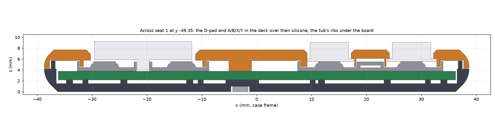
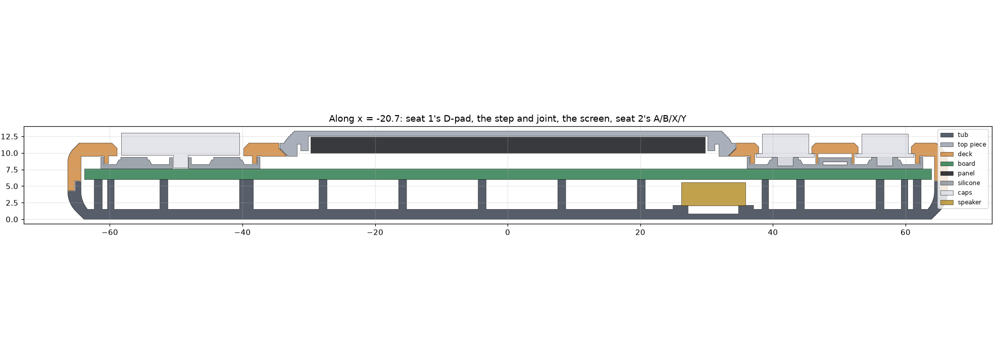
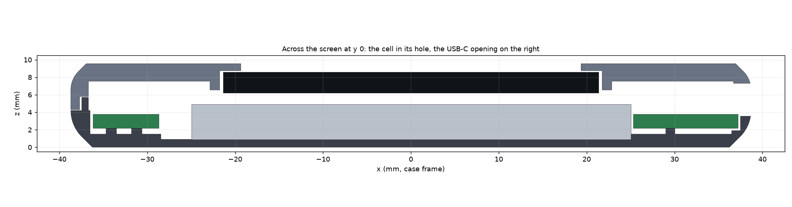

## Row 9: the tub's bottom edge (2026-10-21)

Alex saw a vertical lip on the outside of the tub, all round its bottom edge, on the print of the
10-20 kit. That tub's mesh has none (its only one was the speaker pad, row 6) and neither kit added
a brim or support round it. But its round was built in flat 0.1 steps whose faces lay exactly on
the P1S's slicing planes, and Bambu Studio took the step above or below as it liked: the chamfer
printed 0.35, 0.1, 0.3, 0.1 out per layer, pairs of layers standing straight at the bed. The
round is now one smooth solid lofted through the outline every 0.1 (`tub_outside()`), so each
layer steps out 0.2 on the P1S and the U1, from the wall into the back within `overhang`. If the
next print still shows a lip, it is the first layer's squish: the kits keep Bambu's and Alex's
0.15 elephant-foot compensation.

## Best guesses until `6_tests`

Alex won't print `6_tests` soon, so these are committed as best guesses (2026-10-21). Each is marked
"GUESS" in `case.scad`; when the plate is printed, check each against its coupon and move it.

| Parameter | Guess | Checked on `6_tests` by | Which way to move it |
|---|---|---|---|
| `cap_hole_d` | 8.0 | `tune_openings`: holes 7.6 / 7.8 / 8.2 beside the keyed 8.0 cluster | the smallest hole a real A/B/X/Y cap drops through and presses without catching; smaller if 8.0 rattles |
| `dpad_gap` | 0.65 | `tune_openings`: D-pad openings 0.55 / 0.65 / 0.75 | the tightest opening the real D-pad rocks freely in every direction |
| `overhang` | 45 (60 on this branch, the variant) | `test_overhangs`: fins 45 to 75 degrees from vertical, a convex R6 round (on the P1S and the U1) | up to the steepest fin that prints clean on both printers; every round and the step to the decks get rounder with it |
| `slide_fit` (`seam_fit`) | 0.25 a side | `test_rings`: rings 0.2 / 0.3 / 0.4 / 0.5 a side over the 5.0 `test_column` | the smallest ring that slides on the column by hand without force or rocking (0.15 was too tight on the old insert's ring) |
| `grip_reach` (2026-10-22) | 0.2: the grip ribs 0.05 short of the skirts | the case itself (and the seam coupons): the tub should press on by hand and stay on when the case is lifted by the top piece | towards 0.25 (touching) if the tub falls off; towards 0.1 if it won't go on |

`slide_fit` is the one parameter for a printed part sliding on a printed part: the tub's tongue
inside the skirts and the keys in their pockets take it (`seam_fit`). The decks' wedges took it too
until 2026-10-22 (`deck_gap`); then the posts held each deck on its wedges, with no clearance there,
and `deck_gap` became 0.15 on the joint's straight faces; since 2026-10-23 it is the lip's clearance in
its groove and over the decks' plates under the step. Raising it from 0.15 to 0.25 (2026-10-21)
changed no position the board reads (`positions.json` is the same): the top piece's wall behind the
undercut kept its thickness (`step_wall_t` 1.35, which used to be written 1.2 + `deck_gap`), and the
tub's tongue became 0.75 thick (was 0.85).

## Alternatives considered

- **The full-width top piece** (until 2026-10-23): the screen face, the steps and the case's sides in
  one part, its side round brought down to the decks' near each end. Alex: "This doesn't look good. It
  needs to blend and flow better. It's because the top part of the case diverges from the rounded part
  that combines with the tub but it needs to look like one piece one flow, not two." Replaced by the
  island and the C-shaped decks ("The island").
- **The side blend** (2026-10-22 to 2026-10-23): the top piece's side round coming down from the screen's
  height to the decks' over 9.4 mm, a 45 degree band over it widening to 1.85 at the step. It is what
  Alex was looking at above; at 60 degrees it also forced the side round down to r 2.4 and left a 15
  degree crease between the band and the round.
- **The lip into the groove and the plate under the step** (2026-10-23, a day): replaced by the island's
  wedge under the decks' lips, the concept Alex approved. Round an island the joint runs along the side
  walls too, where the arms are 2.45 wide: a groove in their face there would leave a knife edge between
  it and the round; the wedge needs no groove, prints with no bridge (the groove's roof was a 1.05
  bridge), and the decks' plate stays whole at their own level.
- **The island 4 to 6 mm in** (the brief's aim): the board's parts along the side walls (J5, J6 at 3.6
  from the outline, J2 and J4 at 4.2, the speaker's pocket at 4.5) would stand under the arms (1.6
  allowed, 2.9 to 3.8 tall) or under the island's wall. Bays in the island round each would bulge it out
  over most of both sides. 2.6 is as far in as it goes (J5 and J6).
- **The USB-C in an arm** (no ear): the receptacle's top is 0.65 under the decks' face and the opening's
  top 0.4: the opening would break out through the side's round.
- **The arms meeting each other on the left wall** (2026-10-23 to 2026-10-24): seat 1's left arm carried
  a lap 3.15 past its end behind seat 2's skirt at y -2.0. It made the decks two parts (the ear is off the
  case's middle, at J1, so the arms ended at different places on each), and a lap on a deck's arm hangs
  off the part face down. Alex chose the left ear instead: the same joint as the right's, one deck part.
  (The day before it was rejected for putting a bump in the left side that nothing needs.)
- **A tab on the tongue's outside into a slot in the skirt** (to hold an arm outward): it only stops the
  arm moving up or down; moving out, the slot slides off the tab. To stop outward motion some of the arm
  must be inboard of the tub, so the hook is on the arm, its head behind the tongue.
- **The hooks nearer the arms' free ends:** see "The hooks": the laps' slots, the keys and the grip ribs
  fill the wall there. Moving a key or a grip rib would make room, but Alex set those (the right ones'
  places turned round), so the hooks went where it is free.
- **The island face down first and the decks onto it** (as the top piece was the base): face down the
  decks' lips are on the island's far side and can't pass its wedge, so the decks go first, on the build
  bars.
- **Screws into the arms** (H1, H2, H4): they are inside the island's foot with 2.3 or more of plastic
  round their pilots, so they stay in the island; the arms got keys and a second grip rib each instead.

- **Decks as wells in the top piece** (the top piece's rim at screen height all round each end,
  the deck dropped into it from behind): the stiffest, every screw in the top piece, no seam round
  the decks' outer edges. Rejected: a 1.9 mm bumper round the thumbs' area, higher than the caps'
  tops, and Alex asked for "the top pieces" to curve over the sides.
- **A one-piece top with the decks in it:** no deck seams, but face down the decks print 1.85 mm
  off the bed (supports, the peel-away face the inserts were made to avoid); face up its insides are
  all ceilings. Rejected.
- **Printing the top piece face up** (the outside all top surfaces, a smooth curve for free):
  the bezels' undersides become 13 mm ceilings. Rejected.
- **The deck carrying the curve's foot:** face down, anything of the deck above its face is below
  the bed. Not possible.
- **No spine** (a straight step across, a simpler rectangular deck): since 2026-10-22 J2 and J4 are
  in the bezels and the spines only cover U6 and U9, so it is the board's call now: U6 (1.75) under
  seat 1's spine would have to go under the screen or drop to 1.6.
- **The side screws' bosses on the decks** (2026-10-22): the simplest, but the top piece would have
  no screw, and the decks' wedges only hold it from moving in. **A tab of the top piece at the
  deck's height** round each screw: a 5.6 mm ledge 1.85 off the bed, face down. So: shoulders,
  until the board brought the side screws back inside the top piece (2026-10-22) and they went.
- **A D-shaped or wall-merged tub boss at H2 and H4** (2026-10-22): a round 5.0 boss already keeps
  1.3 from the cell's hole and 0.7 inside the board's edge, and it is only 0.7 tall; a D or a boss
  run into the wall would gain nothing there.
- **A slot in the left wall for the debug cables** (J5, J6): not done, debug is case-open.
- **Keeping the hooks:** nothing needs them when the case is built upside down, and they snapped in
  PLA.
- **The seam higher** (at the port's centre, no USB-C tab): then the tub forms most of the walls and
  the board isn't inside the top piece's skirt when it goes in. **Seam at the board:** the same
  tab and a thin tub wall above the round. The round's end is the natural line.
- **The tub's skin over the top's tongue** (the old way round): the tub would form the outer lip,
  which item 10 rules out.
- **The butt joint at the side walls** (until 2026-10-22, "The side joint"): the deck's skirt ended
  0.15 from the top piece's, the tub's tongue running on behind both and a grip rib across the joint
  pressing both skirts out to one line. Replaced: nothing hooked the two walls together, so they
  could still step in or out of each other by the fits, and from outside the joint read as two parts
  (Alex: "These parts should flow into each other better"). (In "The joints" a lap was turned down
  because halving the 1.0 skirt leaves 0.5 or less a side, which prints as one line; the lap now sits
  behind the whole skirt, in the tongue's place.)
- **The step ending at the seam on the side walls** (until 2026-10-22, "The side joint"): the side
  round followed the step's 2.1 S down to the deck right at the joint, a notch beside the seam.
  Replaced by the 9.4 blend. **A longer blend:** the keys and the tongue's tall part must stay under
  the full screen face; past 9.4 the left keys would have to move further towards the middle.
  **Stretching the step across the face too:** on the flat face a slope gentler than 45 degrees is a
  downward face face down (Item 13).
- **Keys for the decks on the side walls, as bumps on the tongue's inside into the plates**: anything
  on the tub inboard of its wall passes the board's edge as the tub goes on, with the board not yet
  centred (it lies on the bosses). Only the corners, where the board's r 5.5 corner leaves 2 mm, have
  room: the posts.
- **Pushing each deck past its place onto the step, to close the seams**: the openings moved 0.15
  off the buttons, and `check_buttons.py` went from its 11 known failures to 21 (the silicone and
  the caps against the deck). The decks stay where they were, on their wedges, the seams 0.15.
- **A 3.0 tongue under the decks too**: the decks' round leaves room for 2.5 (the plate 0.4 over the
  groove at 3.0, and the tongue's lean within 0.05 of the board's edge). (**The seam lower, for more
  overlap**, was rejected here too: the skirts' edges would lie on the back's round. Alex asked for
  exactly that next: "The seam on the round".)
- **The seam at the round's end (4.2)** (2026-10-22, "The seam on the round"): a clean line where
  the back's round meets the walls, the skirts' tips square. Replaced at Alex's ask: the top pieces'
  walls over most of the round, to a much lower ledge, for a shell that reads as the top pieces
  wrapping the case rather than sitting on the tub. **A 2.5 seam:** the skirts' tips would be 0.68,
  under `skirt_t`, unless the tongue moved inwards. **The USB-C opening wholly in the top piece, the
  tub's tab gone:** the receptacle stands 0.85 into the skirt and the board goes in straight down
  (see that section).
- **The wedge** (until 2026-10-23): the deck's edge under the top piece's 45 degree undercut,
  along the step and round the spine. Replaced: it only stops a deck towards the screen and out of the
  front (the wedges across the step and round the spine's end all face the same way), so along the case
  only the tub's corner posts held the two together, and with the tub off, or with the parts
  handled before the screws, the top piece "kind of just sits on top of the deck" (Alex). The plate
  under the step now holds the deck in from the front ("The lip under the step").
- **The teeth: a flange and a tongue through it** (dbf61a6, 2026-10-23): the wedge carried on down
  its 45 degree line to 4.6 as a flange 2.3 under the top piece, and a 0.8 tongue of the top piece
  down through slots in it (2.1 to 4.0 long) between 1.5 ties, the flange beyond each slot a fin
  bridged from tie to tie, 0.53 of engagement. Rejected by Alex: "I think this tooth method isn't
  viable. I don't want them breaking." Face down, all of the deck past its face's outline had to stay
  under the wedge's line, so the far side of any groove started in mid air and had to be bridged, and
  the board's 0402s under the flange cut the tongue into pieces. **A flat flange under the step's
  block, as Alex first sketched it:** face down a 1.4 to 2.7 mm ledge off the wedge, in mid air.
  The lip turns it round: the groove is in the deck's face, on the bed.
- **45 degree sides on the lip's groove** (no bridge at all): with the groove 0.65 deep they meet
  before its floor, so either the strip beyond the groove ends in a knife edge on the bed, or the lip
  is a 0.3 ridge. The flat 1.05 roof is a short bridge over solid plate.
- **The plate further under the step** (the plan's 1.8): the end wall would be 0.6; it stays 0.8,
  and the plate 1.6. Moving the wall's inside nearer the screen would move the board's decks zone.
- **Shoulders and the decks' notches back** (for the hold): neither kit Alex printed had them (they
  lived from 99e3f04 to c955631), so they weren't what held 4df3f96; the screws stay inward.

## Open questions

0. **The island (2026-10-23), on the next print, most important first:**
   a. **The hooks** (2026-10-24): whether a hook goes in without force (0.15 round the head and the
      neck), holds the arm (the island_coupons hook pair tests it), and prints clean face down (its top at
      exactly `overhang`). Two hooks are 13 and two 19 from their arm's free end (the ear): if the free
      ends still spring out, a key or a grip rib near the ear can move to make room for the hook there
      (an asserts-only change). J6 stands 0.89 beside seat 2's left hook's head: a cable plugged into J6
      leaves past the board's edge under the head (debug is case-open anyway).
   b. **The island's wedge** (45 degrees, 1.2 under each lip, no clearance on the slope, 0.15 at the
      foot): whether the island drops into the decks without binding and doesn't move out of the
      front, and whether the posts seat each deck onto it without forcing the tub's corners.
   c. **The build bars**: whether the decks sit steady on them while the caps, the island and the board
      go in. A deck that rocks on its bar wants a wider bar.
   d. **The ears** (the left one blank since 2026-10-24): whether the two raised parts of the side read
      as intended.
   e. **The arm face** (0.40 of flat since the 2.8 round, 2026-10-24): whether it still reads as a crease.

1. **The overhang limit** (`overhang`, 45 on the main line, 60 on this variant: a guess either way): the `6_tests` ladder on both printers. A higher limit
   makes the step and every edge rounder in one line.
2. **The lip and its clearance** (`deck_gap` 0.15 round the lip, over the plate and down the spine's
   sides, none on the end wall's foot): the `0_buttons_end` coupons (top piece end + deck) show
   whether a deck drops in over the lip and round the spine, and whether the seam in the step's
   crease looks right. If it binds, `deck_gap` towards 0.2 (the groove's roof, 1.05 now, may go to
   1.15, still a short bridge; the strip beyond it is 0.70, so a wider groove wants `lip_w` 0.7).
3. **The seam and the joints** (`seam_fit` = `slide_fit` 0.25, `grip_reach` 0.2, guesses; `seam_gap`
   0.1, `tongue_h` 4.65 and `deck_tongue_h` 4.15 over a seam at 2.55): the seam coupons (a tab and a grip rib on them) and the
   case. Whether the tub presses on by hand, stays on when the case is lifted by the top piece and
   eases off again; whether the corner posts push the decks onto the end wall's foot (each deck's seams
   even, no rocking) without forcing the tub's corners out. Too tight at the posts: take 0.1 off
   their inner faces (`post_c`).
4. **J3's range** (`tip_range` 22.5 to 25) is an estimate; a real panel's folded FPC settles it.
5. **The speaker in its pocket:** stuck by its front ring to the pocket's ceiling, its back stands
   0.45 (worst case) to 0.75 off the board. If Alex would rather tape it to the board (as the board
   session drew it), its front then needs a foam ring 0.5 to 0.8 thick to seal on the grille's rim.
6. **J4 and the speaker's leads:** the speaker stays in the top piece, so J4 must be plugged with
   the board just off its place (the leads reach about 20 mm past the closed path) and unplugged
   before the parts come apart. Worth trying on the fit kit with a real speaker: whether the leads
   lie flat round H3's boss and over U7's end, and whether the plug can be reached with the FPC in.
   The speaker's lead exit is unknown here (assumed at its seat-1 end).
7. The screw columns: no column passes through another printed part any more, so the `6_tests`
   rings only matter if one ever does again.
8. **The board as the tub goes on:** the tongue's leaning top passes 0.25 outside the board's edge
   (under the decks; 0.5 elsewhere) before the crush ribs centre the board, so the board must lie
   within about 0.5 of centred on its bosses (the tongue's chamfered tip and the posts' lead-ins
   guide it in that far).
9. **The side joints' laps** (2026-10-22): 0.85 thick, 3.0 along the wall behind the top piece's skirt,
   0.15 off it. Whether each deck still drops in from behind without the lap catching the top piece's
   skirt's end (a lead-in can go on the lap's tip if it does), whether the two skirts now sit flush and
   the lap's free end prints clean (its top is a 45 degree face down), and whether the blend's widening
   chamfer near each step reads as one surface with the round on a real print.
10. **The tongue is a thin wall now** (0.75, 4.65 tall over the seam, 0.95 thick below 4.2): inside
   the skirts it is held all along, but off the case it will flex. Handle the tub by its floor. The
   skirts' tips are 0.70 at the seam; if the face-down print leaves them ragged, the seam can go up
   (each 0.1 up the round thickens them about 0.04).
11. **The lip under the step** (2026-10-23, guesses until a print): whether each deck drops in from
   behind with the groove over the lip (0.15 a side, 0.2 lead-ins on the lip's tip), whether the
   groove's roof (a 1.05 bridge face down) prints clean (a droop under 0.15 doesn't touch the lip's
   tip), whether the deck stays put along and across the case with the tub off, and whether the
   posts seat it on the end wall's foot without forcing. If the foot binds as the deck goes in, shave
   it (or lower `foot_h`); without it the posts would push the deck onto the lip's outer face, 0.15
   off its buttons, so `post_c` would have to come back 0.15 with it.

## Images

Since the left ear and the hooks (2026-10-24, this commit's parts): `outside_front` (3/4 from the front),
`left_ear`, `section_hook` (seat 1's right hook: across the wall through its neck and its head's end, and
along it), `exploded_hooks` and `exploded_hook_close` (the parts lifted off the tub: the hooks under the
arms, the slots in the tongue), `print_overhangs` (every part in its print pose, downward faces coloured by
angle). `joint_outside_left` still shows the arms meeting (the parts before); the others below are of the parts before too.

Since "The island" (2026-10-23, the parts of 8c39dca): `outside_front`, `outside_back`, `outside_side`,
`outside_usb` and `joint_outside` (the ear), `joint_outside_left` (the arms meeting), `section_joint_zoom`
(x -10: the wedge), `section_usb` (y 2, the ear), and the new `island_corner`, `section_arm` (y -25),
`section_arm_key` (y -20), `exploded_build` (face down, in build order) and `print_overhangs` (every part
in its print pose, downward faces coloured by angle). The lip's, the blend's, the side joint's and the
top piece's keys' images went. The others (`section_cell`, `section_speaker*`, `section_h*`, `section_seat`,
`section_screen`, `section_length_dpad`, `section_spine`, `section_seam_zoom`, `section_tongue_end`,
`section_key_post`, `section_usb_wall`) are still of the earlier parts: where they cut the side walls they
show the top piece's sides at the screen's height. Before/after pairs with the same cameras are in the
session's scratch folder.

Rendered from the parts of this commit (`case/images/`; the session scratchpad has the sources):
the outside views with OpenSCAD from the assembled STLs, the sections with matplotlib from
`trimesh` cuts of the same parts (the cell nominal, the speaker 3.5 tall). The joints' images
(2026-10-22: `joint_outside`, `section_seam_zoom`, `section_joint_zoom`, `section_tongue_end`,
`section_key_top`, `section_key_post`, `section_side_joint`, `section_usb_wall`, `exploded_keys`)
were of 7e9d7e1's parts. Since "The seam on the round" every image here is of 8dbf2c3's parts (the
board drawn as its outline's slab in the close-ups), except `exploded_keys`, which still shows the
skirts ending at 4.3; `section_usb` and `outside_usb` are new. Since "The side joint" (80953e7's
parts): `joint_outside`, `section_side_joint`, `outside_front`, `outside_back`, `outside_side`,
`section_h2`, and the new `joint_outside_left`, `section_lap`, `lap_inside`, `exploded_lap` and
`section_blend_along`; the others don't cut or see the side joints. `exploded_keys` still shows the
grip rib across the side joint and the left keys at 22 and -24. Since "The lip under the step"
(3730e7e's parts): `section_joint_zoom` (the same cut and framing), `joint_outside`,
`joint_outside_left`, `outside_front`, `outside_back`, `outside_side`, `section_length_dpad`,
`section_spine`, `section_h3`, `section_speaker_along`, `section_side_joint` and `section_blend_along`
(the step's land went), and the new `section_lip_spine`, `section_lip_end`, `section_lip_wall`,
`exploded_lip`, `print_lip` and `print_lip_spine`; dbf61a6's `section_flange_*` and `exploded_tongue`
went with the tongue.
