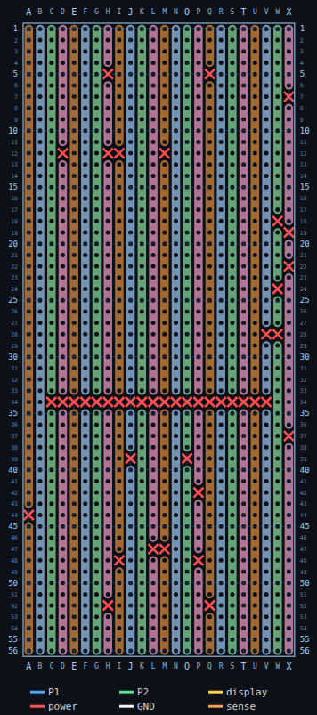

# Assembly, stage by stage

Generated by `layout.py`. `BUILD.md` is the reference - what goes where
and why. This is the procedure: the order to do it in, and a test at the
end of each stage so a mistake is found while it is still reachable.

**Do not skip the checks.** Almost everything on this board ends up
under the Pico or the display, and the cost of finding a bad joint
later is measured in desoldering, not minutes.

## Before you start

Orientation, used by every coordinate here: **component side up, Player
2's edge at the top**. Columns are lettered A..X left to
right, rows numbered 1..56 top to bottom. So H54 is column H, row
54. Mark A1 in the corner with a pen before you start; every mistake in
this build begins with counting from the wrong edge.

Tools: fine-tip iron, 0.7 mm solder, a multimeter with a continuity
beeper, a spot cutter or 3 mm drill bit held in the fingers, flush
cutters, tweezers. A helping hand is worth having for the module leads.

| Stage | What | Rough time |
|---|---|---|
| 1 | Cut the tracks | 45 min |
| 2 | Jumper wires | 60 min |
| 3 | The Pico | 20 min |
| 4 | Switches | 40 min |
| 5 | Power train parts | 30 min |
| 6 | Charger, cell, switch | 30 min |
| 7 | Display | 20 min |
| 8 | First power | 20 min |

## Stage 1 - Cut the tracks (44 cuts)

Everything else sits on top of these, and several end up under the Pico
or the display, so they all happen now. Cut from the **copper side**;
`cut_template.svg` prints 1:1 and is already mirrored for it.

### Mark them with the stencil, not by counting

Counting to row 34 by eye is how a cut goes missing, and the one that
goes missing is usually one of the twenty in the fence, because they
look like a single thing rather than twenty things. Two ways to avoid
counting at all:

1. **Printed mask** - `cuts_stencil.scad` builds a 1 mm plate the size
   of the board with an opening over each of the 44 holes to destroy.
   Measure your board first and set `board_w` and `board_l`, then print
   it flat, no supports, 0.15-0.2 mm layers. Drop it on the copper side,
   push a scrap of 0.8-1 mm wire through each of the four corner dowel
   holes to stop it turning, and put a scribe or an ultra-fine pen
   through every opening. Lift it off and you have 44 marks and nothing to count.

2. **Paper** - print `cut_template.svg` at 100% and check the printed
   ruler bar really measures 100 mm before you trust it. Tape it to the
   copper, prick each X through with a needle, peel it off.

Either way the mask is mirrored, so the A1 corner ends up on your right
when the copper faces you. Put a pen dot on the board's A1 corner before
you flip it: the hole grid is symmetric under a half turn, and nothing
physical stops the mask going on backwards. The chamfered corner and the
engraved `A1` are there to be checked, not to save you.

*Component side, with only the cuts shown. The wire-colour key at the
bottom belongs to later stages and can be ignored here.*

Start with the long line: **row 34, columns C to V** (20 cuts). This is the one that
splits the board into its two player halves.

Then the per-column fences:

| Column | Holes to destroy |
|---|---|
| A | A44 |
| D | D12 |
| H | H5 H12 H52 |
| I | I12 I48 |
| J | J39 |
| L | L47 |
| M | M12 M47 |
| O | O39 |
| P | P42 P48 |
| Q | Q5 Q52 |
| V | V28 |
| W | W18 W24 W28 |
| X | X7 X19 X22 X37 |

**Check:** meter across every cut, one probe each side of the destroyed
hole. All must read open. A cut that looks clean under a lamp and still
beeps is the single most common fault on stripboard: the copper tears
rather than lifts and leaves a whisker. Re-cut and re-test.

## Stage 2 - Jumper wires (16)

These go down before anything else because most of them run under the
Pico, the display or the charger. Insulated wire on the component side,
soldered only at the holes listed. Colours are the ones in `BOM.csv` and
match the preview.

Do the two ground buses last: they are the longest, and having them in
place makes the shorter wires harder to reach.

| # | Wire | Colour | Solder at |
|---|---|---|---|
| 1 | P1_INFO to GP13 | blue | M48 S48 |
| 2 | P1_RIGHT to GP2 | blue | L48 F48 |
| 3 | P1_DOWN to GP3 | blue | H54 G54 |
| 4 | P1_B to GP12 | blue | Q54 R54 |
| 5 | P2_A to GP27 | green | A3 K3 |
| 6 | P2_B to GP22 | green | H3 N3 |
| 7 | P2_MENU to GP19 | green | H7 R7 |
| 8 | P2_DOWN to GP18 | green | Q3 S3 |
| 9 | display VCC from 3V3 | red | O41 G33 |
| 10 | display CS to GP10 | yellow | J41 P41 |
| 11 | display GND | white | P47 P49 |
| 12 | D1 cathode to VSYS | red | W25 D25 |
| 13 | charger OUT- to GND | white | X20 T20 |
| 14 | battery sense to GP28 | orange | V12 I13 |
| 15 | P1 ground bus | white | A56 E56 I56 P56 T56 X56 |
| 16 | P2 ground bus | white | D1 E1 I1 M1 T1 X1 |

**Check:** with the meter, confirm each of these reads closed, probing
the two holes named. They are the connections the wires just made, and
every one of them is buried by a later stage:

| Probe | And | Expect |
|---|---|---|
| M48 | S48 | closed |
| L48 | F48 | closed |
| H54 | G54 | closed |
| Q54 | R54 | closed |
| A3 | K3 | closed |
| H3 | N3 | closed |
| D1 | X1 | closed (P2 bus, end to end) |

Then confirm the buses did **not** catch a neighbour: probe a bus joint
against the column beside it, and expect open.

## Stage 3 - The Pico

Solder its headers on first, then drop it in. **USB to the left.** Pin 1
lands in C37 and pin 40 in
C30; the preview marks pin 1 with a
red box. Before soldering, check it straddles the row
34 cuts - if it does not, it is a row out and every net on
the board is wrong.

**Check:** pick three pins at random and confirm each reads closed to a
free hole further along its own column, and open to its neighbour. Then
look along the pin rows with a lamp for solder bridges, which are easy
to make at 2.54 mm and invisible from directly above.

## Stage 4 - Switches (16)

Solder **all four legs** of each. The two legs on one column form one
terminal, the two on the other form the second; using only two legs
works electrically and then fails mechanically the first time a thumb
lands on it.

| Ref | Button | Signal column | Ground column | Top row |
|---|---|---|---|---|
| SW1 | P1_UP | H | E | 49 |
| SW2 | P1_DOWN | H | E | 53 |
| SW3 | P1_LEFT | D | A | 51 |
| SW4 | P1_RIGHT | L | I | 51 |
| SW5 | P1_A | U | X | 51 |
| SW6 | P1_B | Q | T | 53 |
| SW7 | P1_INFO | M | P | 51 |
| SW8 | P1_MENU | Q | T | 49 |
| SW9 | P2_UP | Q | T | 6 |
| SW10 | P2_DOWN | Q | T | 2 |
| SW11 | P2_LEFT | U | X | 4 |
| SW12 | P2_RIGHT | P | M | 4 |
| SW13 | P2_A | A | D | 4 |
| SW14 | P2_B | H | E | 2 |
| SW15 | P2_INFO | L | I | 4 |
| SW16 | P2_MENU | H | E | 6 |

**Check:** this is the best test on the whole board, and it takes two
minutes. Put the meter across the switch's signal column and its ground
column, then press. Closed on press, open on release, every time:

| Ref | Probe | And | Press |
|---|---|---|---|
| SW1 | H49 | E49 | closes |
| SW2 | H53 | E53 | closes |
| SW3 | D51 | A51 | closes |
| SW4 | L51 | I51 | closes |
| ... | and so on for all sixteen | | |

If one is closed all the time, its signal and ground columns are
bridged - most likely a fence cut that did not take. If one never
closes, the switch is rotated 90 degrees.

## Stage 5 - Power train parts

| Ref | Part | Holes | Watch for |
|---|---|---|---|
| D1 | 1N5817 Schottky, standing up | W27 X27 | **cathode stripe toward W27** - the only polarised part here |
| R1 | 100k, standing up | X26 V26 | either way round |
| R2 | 100k, standing up | V24 T24 | either way round |
| C1 | 100 nF ceramic | V22 T22 | either way round |
| J1 | 1x8 female socket | I46 J46 K46 L46 M46 N46 O46 P46 | a socket, not pins: the display plugs into it |
| BT1 | 1x2 header | W8 X8 | the cell's leads land here |
| J2 | 1x2 header | W10 X10 | charger B+ / B- |
| J3 | 1x2 header | W21 X21 | charger OUT+ / OUT- |
| SW17 | 1x2 header | W23 X23 | flying leads out to the panel switch |

**Check, before any power exists:** meter between the holes below and
expect **open** on all of them. A short here is the one fault that can
damage something later.

| Probe | And | Expect |
|---|---|---|
| W21 (VBATT) | X21 (OUT-) | open |
| W8 (BATT+) | X8 (BATT-) | open |
| W27 (VSYS) | any ground hole | open |

And expect **closed** for the divider chain, which proves the tap is
really one node:

| Probe | And | Expect |
|---|---|---|
| V26 | V24 | closed (the tap) |
| T24 | any ground hole | closed |

## Stage 6 - Charger, cell and switch

The charger goes on the **front**, under where the display will sit,
with its USB-C hanging over the right board edge. Solder its four leads
**before** peeling the tape: you cannot reach underneath afterwards.

All four pads are on the short edge opposite the USB-C, reading
OUT- B- B+ OUT+ across it. Read the silkscreen, not this table, and if
the module is rotated the other way the two OUT leads swap:

| Module pad | Goes to |
|---|---|
| B+ | J2.1, W10 |
| B- | J2.2, X10 |
| OUT+ | J3.1, W21 |
| OUT- | J3.2, X21 |

Then the slide switch to SW17 on flying leads, and the cell to BT1 with
its leads brought round the board edge from the back. Foam-pad the cell
to the copper side last.

**Check, in this order:**

1. Switch **off**, cell connected: VSYS reads 0 V. If it does not, the
   switch is bypassed somewhere.
2. Switch **on**: W27 reads the cell
   voltage less about 0.3 V, the drop across D1. Around 3.4 to 3.9 V on
   a part-charged cell.
3. USB-C plugged in: the module's red LED lights. Green means already
   full.

## Stage 7 - Display

The socket is already in from stage 5, at I46 to P46.

**Check the module's pin order against its own silkscreen first.** This
layout assumes 1=GND 2=VCC 3=SCL/SCK 4=SDA/MOSI 5=RES 6=DC 7=CS 8=BLK.
If yours differs, stop and re-target the display jumpers from stage 2;
do not rotate the socket.

Plug the module in, then shim the four adhesive standoffs to the gap
under its corners and stick them down with the module in place, so they
find their own height rather than fighting the socket.

## Stage 8 - First power

Flash firmware over the Pico's own micro-USB before trusting the
battery path. BOOTSEL is under the display, so unplug the module from
its socket if you need it, or use SWD.

In order:

1. USB only, cell disconnected. The Pico should enumerate.
2. Read GP28 in firmware with the cell disconnected: it should sit near
   zero, since the divider has nothing to divide.
3. Cell connected, switch on, USB out. Firmware should read about half
   the cell voltage on GP28: 2.10 V at a full 4.2 V cell.
4. Every button, one at a time, against the map in section 10 of
   `BUILD.md`. A button that reports as its neighbour means two signal
   columns are bridged; a button that never reports means its jumper.
5. Display last. If it stays dark but the backlight is on, suspect CS
   or DC before suspecting the panel.

Known and expected: the battery reading over-reads while USB-C is
plugged in, because the charger holds the cell up. Only trust the gauge
on battery.
